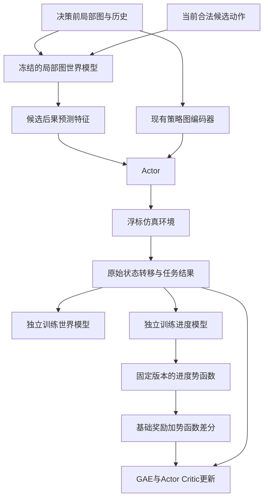

# 图世界模型与过程进度奖励实现方案

本文件面向 `buoy_network` 后续代码开发，规定两个研究点的实现范围、数据接口、训练顺序和验收要求。

- 创新点一：拓扑与业务解耦的图世界模型，以及由预测可靠性约束的路由决策。
- 创新点二：拓扑条件过程进度建模，以及面向长时程稀疏奖励的时间信用分配。
- 目标硬件：NVIDIA GeForce RTX 4060 Laptop GPU，8GB 显存。
- 当前状态：设计文档；本文提出的新模块、参数和脚本尚未实现。
- 代码核查日期：2026-10-20。下文代码位置以仓库根目录为基准，用函数名定位，避免依赖易变化的行号。

首个可运行目标是：**25 个节点、一步局部图世界模型、独立预训练后冻结、预测特征辅助 Actor、独立的小型进度模型、基于原始仿真交互的 PPO 更新。**

实现可行性与实验收益分开验收：模型能训练、数据流正确、资源可承受是工程目标；是否超过原 TG-MAPPO 和 EARP，要由对照实验确定。

## 1 研究范围与模型关系

### 1.1 四个模块的职责

| 模块 | 作用 | 第一版训练方式 |
| --- | --- | --- |
| Actor | 根据当前可用信息选择下一跳 | 原始仿真环境中的 PPO |
| Critic | 估计当前训练奖励对应的长期价值 | 原始仿真轨迹上的价值回归 |
| World Model，简称 WM | 预测某个候选转发动作的后果 | 独立状态转移数据上的监督学习 |
| Progress Model，简称 PM | 从历史路径估计任务可完成性，构造进度势函数 | 成功与失败轨迹上的结果监督 |

WM 是额外的环境动力学分支，PM 是额外的训练奖励分支。它们不替代 Actor–Critic，也不需要大型语言模型、视觉模型或视频生成网络。

PM 借鉴过程奖励模型的进度评估思想，但第一版没有人工逐步正确性标签，准确名称是“结果监督的过程进度模型”。它的评分不能直接解释为已经识别出的因果贡献。

### 1.2 两个研究问题

1. **预测与决策：**区分外部拓扑变化和动作引起的业务变化，能否改善动态网络中的下一跳决策？预测不可靠时收缩其影响，能否降低模型误差的负面作用？
2. **进度与学习：**利用成功、失败轨迹学习拓扑条件进度，能否在延迟反馈和稀疏奖励下减少达到目标投递率所需的环境交互？

GNN、GRU、势函数塑形本身都是已有方法。论文贡献应具体落到解耦结构、可靠性机制、浮标任务的进度表示，以及对应消融实验上。

### 1.3 第一版数据流



WM 预测特征也可以送入 Critic，但必须单独记录其信息范围。第一版 Actor 最终自己采样动作，规划器不在采样后替换动作。

## 2 硬件与运行环境

### 2.1 已核查事实与测量边界

当前 `run_training.cmd` 指向 `D:\python3.6.8\python.exe`。该解释器实际为 Python 3.6.8，PyTorch 1.8.1+cpu，`torch.cuda.is_available()` 返回 False。

本机显卡报告为 RTX 4060 Laptop GPU，总显存 8188 MiB。显卡存在不等于当前项目已启用 CUDA。

前期对一个“64 维输入投影、64 维 GRU、小评分头”的基础 PM 做过合成数据运行检查：参数量 31,233，批量 16，序列长度 128，CPU 上 5 次前向、反向及 Adam 更新约 0.12 秒。该结果仅证明小模块能够运行，不是完整路由性能、显存或长期训练速度的实测结果。

### 2.2 环境处理顺序

1. 保留现有解释器和依赖，先记录旧基线的运行方式与配置。
2. 为研究版本建立独立 Python 环境，选择相互兼容的 Python、PyTorch CUDA 构建和 PyTorch Geometric 版本。
3. 安装时核查官方兼容说明，不把旧 Python 3.6 依赖原样混装到新环境。
4. 统一设备入口，建议新增 `--device auto|cpu|cuda`。显式请求 CUDA 但不可用时应报错；`auto` 可退回 CPU并记录实际设备。
5. 策略、WM、PM 各做一次前向与反向冒烟检查，再开始完整训练。

当前 `src/buoy_network/agent.py` 存在模块级 CPU 设备设置，`graph_actor_critic.py` 还存在模块级 CUDA 声明。应由构造参数统一传入设备，避免各文件各自决定设备。

### 2.3 8GB 显存起步预算

| 项目 | WM 起步值 | PM 起步值 |
| --- | --- | --- |
| 节点数 | 25 | 复用同一环境 |
| 图编码 | 2 层，隐藏维度 64 | 首版使用独立数值特征或冻结编码 |
| GRU | 1 层，隐藏维度 128 | 1 层，隐藏维度 64 |
| 历史长度 | 4，验证后增加到 8 | 从 32～128 步开始 |
| 批量 | 16 | 16 |
| 预测长度 | 1 步 | 每个前缀一个得分 |
| 参数目标 | 先控制在约 100 万以内 | 约 3 万～10 万 |
| 学习率起点 | 3e-4 | 1e-3 |

这些是待验证的起步配置，不是已测最优参数或显存保证。WM 与 PM 独立预训练，策略训练时冻结辅助模型并使用 `no_grad`，避免同时保留多套计算图。原始轨迹保存在 CPU 或磁盘，GPU 只接收当前批次。

首次完整训练必须记录峰值 allocated/reserved 显存、批次耗时、环境采样耗时和实际参数量。显存目标为峰值 allocated 不超过约 6GiB，并结合整卡使用量预留桌面显示空间；资源紧张时依次减批量、缩历史、减隐藏维度。普通 FP32 先正确运行，再评估 AMP；不为节省显存而改变算法定义。

## 3 实现前必须处理的代码基础问题

以下是代码核查发现的事实或需要验证的风险，不代表本文件已经完成修复。

| 位置 | 当前情况 | 研究版本要求 |
| --- | --- | --- |
| `src/buoy_network/environment.py::_get_entity_feat_global` | 主要返回节点编号 | 改为真实位置、可观测链路与队列等物理特征；编号仅作索引 |
| 同文件 `graph_observation` | 计算了坐标差，但距离张量填入 `[ia, ib]` | 使用真实坐标差；图边与物理通信范围一致 |
| `src/buoy_network/runner.py::run` | 节点主要在回合结束后移动，拓扑更新调用被注释 | 研究模式中按统一时隙更新位置、邻居和动作掩码 |
| `src/buoy_network/buoy.py::reset_lost_rate` 等 | 丢包率赋值后又被置零 | 提供明确的随机信道开关，避免波动场景实际无随机丢包 |
| `runner.py::run` | Actor 输出经邻居数量取模，邻接 Sink 时还会强制直发 | 统一动作语义，保证策略动作、执行动作和概率记录一致 |
| `agent.py::collect/insert` | 采样未传合法动作掩码，写入时混入形如 `[0]/[1]` 的执行标记 | 分开定义合法动作掩码、活跃标记与终止标记 |
| `runner.py::run` 与 `agent.py::warmup` | 回合内 warmup 调用被注释 | 每次 reset 后验证第 0 个观测确实写入 rollout buffer |
| `runner.py::run` | 以 `self.step > episode_length` 判断结束，缓冲区按取模写入 | 用精确 T 次转移管理 rollout，验证无第 T+1 次覆盖 |
| `buoy.py::data_packet` | `life` 初始值固定，成功包随后会被删除 | 独立保存完整包事件，明确递减 TTL、失败和截断语义 |
| `buoy.py::send/receive` | 能量扣减被注释 | 第一版可不研究能量；不能把常量能量当成已实现的能效实验 |
| `readme.md` 与两组环境 | 主算法与基线仍使用不同环境 | 创新消融先统一到研究环境；跨框架正式比较前统一语义 |

旧基线结果保留。环境修正后重新训练并命名为“修正环境下的 TG-MAPPO 基线”，不能把环境修正的收益计入 WM 或 PM 创新收益。旧权重的观测维度、动作维度可能不再兼容，需要明确拒绝不匹配的 checkpoint。

## 4 统一时间 动作与任务定义

### 4.1 主时隙与原子转发事件

研究模式采用一个明确的主时隙 t：

1. 获取时隙开始时的状态、队列和局部观测，固定本时隙待服务数据包。
2. 计算所有节点的合法候选集合与 WM 预测特征。
3. Actor 基于同一时隙开始的信息采样动作，并保存 log probability。
4. 执行本时隙转发，按固定规则处理到达、失败和冲突。
5. 推进一次时间，更新位置、信道、TTL、邻居与下一时隙观测。
6. 写入完整转移；到达或丢弃事件单独写入包级记录。

第一版规定每个发送节点每个时隙最多服务一个 FIFO 包，新到达的包下一时隙才可继续转发。避免原节点遍历顺序造成同一个包在一轮中被多次转发。冲突规则可以先采用明确简化模型，但所有比较方法必须一致。

WM 的“一步”定义为一个主时隙，`current_step`、节点遍历次数、包跳数不能混作同一个时间。仿真时延以时隙或明确配置的秒数报告；模型推理耗时单独用毫秒记录。

### 4.2 动作与掩码

固定 N 节点的第一版使用 N+1 个动作：`0..N-1` 是全局下一跳节点索引，`N` 是 `WAIT`。节点编号不作为位置或距离特征。

- 当前不可达邻居、自己及任务禁止节点对应动作被 mask。
- 空队列、Sink 和无邻居节点有合法的 WAIT 动作，不生成全零分布。
- Sink 可以作为合法下一跳，由策略采样；需要强制直发的消融可在采样前把掩码收缩到唯一合法动作，记录该分布下的 log probability。
- 取消研究版本中的取模映射和采样后覆盖动作。
- `available_actions` 形状是 `[envs, N, N+1]`；`active_masks` 是 `[envs, N, 1]`，两者含义不同。
- 保存时区分“当前观测对应的掩码”和“下一观测对应的掩码”，与 buffer 的 t、t+1 索引一致。

### 4.3 终止与截断

至少保存 `packet_delivered`、`packet_dropped`、`env_terminated`、`rollout_truncated` 四种事件。

- 一个包成功不等于整个环境结束。
- TTL 到期是该包任务的真实失败。
- 全部任务完成或声明的有限任务期限结束，才是环境任务终止。
- 仅因训练批次长度用完的截断需要 bootstrap；不能把所有未完成包标为失败，也不能强制清零其进度。
- 有限任务期限本身是实验目标时，截止仍未完成可定义为失败，并把剩余期限纳入状态。必须与单纯采样截断区分。

## 5 观测与数据协议

### 5.1 状态快照与局部可见性

仿真器可以导出完整状态作为监督数据和诊断真值；Actor 的输入严格限定在预先声明的局部信息范围，首版采用自身和一跳邻居。

局部图使用 N 个固定索引槽位与 `visible_mask`：不可见节点的物理特征清零并 mask，不能仅把边断开却继续泄露全局位置、队列和信道真值。全局 Critic 或全局 WM 的结果只能用于相同信息条件的独立实验，不能悄悄送入局部 Actor。

建议节点特征包含相对坐标、可观测相对运动、归一化队列、Sink 标识等；边特征包含距离、历史 ACK 成功率和链路观测年龄。实际随机信道参数与可估计链路质量分开存储。新邻居的成功率统计采用统一先验，旧邻居按节点键保留统计。

环境没有真正实现能量、有限队列容量、速度估计等量时，先补实现或从特征表中去掉，不用占位常量冒充有效状态。

### 5.2 转移记录

建议新增版本化的 `TransitionRecord`，至少包含：

| 字段 | 含义 |
| --- | --- |
| `schema_version / env_version` | 数据结构和环境定义版本 |
| `episode_id / env_step / seed` | 场景与时序定位 |
| `policy_version / wm_version / pm_version` | 采集及辅助模型版本 |
| `state_t / state_tp1` | 仿真完整快照，仅供监督或诊断 |
| `obs_t / obs_tp1 / visible_mask` | 决策前后局部观测 |
| `actions / action_log_probs / available_actions` | 实际策略动作及对应采样分布信息 |
| `executed_events` | 发送者、接收者、包键、尝试及成功结果 |
| `task_reward / legacy_dense_reward / earp_reward` | 分离记录的基础目标、旧密集项和 EARP 项 |
| `packet_events / env_terminated / rollout_truncated` | 不同粒度的结束原因 |

包键使用 `(episode_id, packet_id)`；不能只用每回合会重置的 `packet_id`。每条转移的 t 与 t+1 快照必须深拷贝或不可变，避免数组引用在采集后被环境修改。

另保存包级 `PacketTrace`：生成时刻、源/目的节点、带时间戳的逐步历史、等待/重传、结束时刻、结束原因、关联决策键。成功包从在线环境删除之前，必须完成轨迹归档。

### 5.3 缓冲区划分

- **PPO rollout buffer：**仅存当前行为策略采集的仿真轨迹，不加入任意旧策略数据或模型合成轨迹。
- **WM replay：**可存多种行为策略的历史状态转移，按完整回合采样连续窗口。
- **PM episode/packet replay：**存已知真实结果的包轨迹，成功失败分层采样；未结束轨迹作为删失样本处理。

WM 和 PM 缓冲区保存在 CPU；全局快照按 `(episode_id, env_step)` 去重，避免每个节点重复保存一份大矩阵。首版建议约 20,000 个主时隙的容量上限，并限制总包轨迹数及磁盘大小，实际按内存测量调整。

训练、验证、测试按完整回合和场景种子划分，不随机拆相邻窗口。归一化器只由训练数据拟合，测试场景不参与辅助模型、阈值或超参数更新。

## 6 创新点一 图世界模型

### 6.1 第一版选择局部动作条件模型

第一版建模：

```text
p_theta(next_local_obs, packet_events, local_task_reward | local_history, own_action)
```

其他节点的未知行为作为行为策略下的随机背景被边缘化。记录行为策略版本，后续通过近期数据更新减轻分布漂移。

不能在训练时输入“其他节点真实执行的动作”，推理时却当作已知量使用。若后续改做联合动作 WM，必须显式实现其他智能体行为模型或一致的候选联合动作生成，并单独验收。

### 6.2 拓扑与业务解耦

```text
局部观测历史 -> 图编码 -> 时序隐状态
                         |-> 外部拓扑分支 -> 位置变化 / 后续可见链路概率
                         |-> 动作条件业务分支 -> 队列变化 / 包转移 / 投递丢弃事件
候选下一跳特征 -----------> 动作条件业务分支
```

- 拓扑分支不因“选择哪个下一跳”直接改变漂移预测，体现外部动态与控制动作的区别。
- 业务分支接收发送者及候选接收者的图嵌入、WAIT 标记和当前待服务包特征。
- 局部队列受其他节点行为影响，预测分布或期望，不承诺每个随机结果都可准确预测。
- 包的“下一步投递/丢弃事件”由 WM 预测；“最终完成概率”由 PM 估计。两者目标不能混淆。

原型采用独立 GNN 与 GRU，避免 Actor 编码器更新导致冻结 WM 的输入语义不断变化。之后若共享编码器，需要独立版本管理或固定编码快照。

### 6.3 输出与损失

| 输出 | 监督目标 | 损失/检查 |
| --- | --- | --- |
| 相对运动/连续观测变化 | 下一时隙局部可观测数值 | Huber 或归一化 MSE |
| 后续链路可用性 | 下一时隙邻域可见连通结果 | BCE，处理正负样本不平衡 |
| 本次发送成功概率 | 实际尝试的 ACK/传输结果 | BCE；WAIT 不计入发送分类损失 |
| 发送/接收节点队列变化 | 下一时隙实际队列变化 | Huber，检查取值范围 |
| 包投递/丢弃事件 | 本次动作对应包的事件 | 分类损失，处理稀有事件 |
| 局部基础任务奖励 | 物理任务奖励分解 | Huber；不拟合历史 EARP 和 PM 塑形项 |

总损失为各项加权和，先标准化量纲，再选择固定权重起点。随机事件主要用概率校准、Brier score、NLL 评价，不能要求模型逐个猜中随机丢包。

历史编码与待预测动作分开：`H_t` 只含当前及过去状态、过去动作，候选 `a_t` 作为条件输入；`s_(t+1)`、ACK 与终局标签不能出现在当前输入中。

### 6.4 独立训练步骤

1. 在修正环境中，用合法随机路由、简单地理/链路规则和基线策略采集数据，记录各自占比。
2. 从小数据集开始，确认随机批次可以过拟合，排除输入目标错位。
3. 训练一步模型；用独立场景验证，与“下一步等于当前状态”“历史链路均值”等简单预测基线比较。
4. 连续指标、概率指标和稀有事件分别报告；某个头不优于简单基线时，不把其输出作为可靠规划依据。
5. 保存最优验证 checkpoint，冻结后进入策略集成。

早期不以固定的大数据量作为前置门槛。先采约 1,000～5,000 个主时隙做数据流检查，再按学习曲线扩充。采样成本需要计入方法总预算。

### 6.5 冻结后辅助 Actor

为每个合法候选动作输出固定长度特征，建议第一版使用：发送成功概率、发送队列变化期望、接收队列变化期望、本步投递概率、本步丢弃概率、预测分歧代理值，共 6 维。没有集成模型时，第六维置零并记录配置。

固定 N=25 时，预测张量约为 `[envs, N, N+1, 6]`。先压缩候选预测后与原图特征拼接，再进入 Actor；Critic 的融合单独配置。无效动作预测不参与归一化或聚合，WAIT 有明确编码。

关键约束：

- 在采样动作之前计算候选预测，Actor 根据预测特征产生最终分布。
- `collect`、`forward`、`evaluate_actions` 使用完全相同的当前观测、预测特征与合法动作掩码。
- 将采样时的 `wm_features` 缓存进 rollout buffer，并让所有实际使用的 minibatch generator 正确切片。
- 冻结 WM 的整个输入编码器和归一化器，使用 eval 模式；不能只冻结预测头。
- 一个 rollout 的采集和全部 PPO epochs 完成之前，不更换 WM 版本。
- 不反向传播穿过冻结 WM；WM replay 与 PPO replay 的用途严格分开。

### 6.6 后续可信多步想象

一步版本有效后，再扩展 H=3 的短推演、预测分歧门控和自适应停止。此阶段必须真正生成未来潜在状态及其动作条件变化，不把单步成功率重复相乘冒充完整世界模型规划。

多步版本还要定义局部图变化、其他节点行为、队列随机性及终止事件如何传播；验证一步误差与多步误差。需要末端价值时，Critic 的输入必须能由想象状态合法构造，不能把未对齐的 WM 隐变量直接送入原 Critic。

初期可将规划结果用于单独的候选评估或明确的辅助蒸馏目标，不直接往原 PPO buffer 填入想象轨迹。规划后替换动作会改变行为分布，须先重设相应概率记录与训练目标。

## 7 创新点二 过程进度与时间信用分配

### 7.1 先做独立于 WM 的小模型

PM 的第一版输入为包的历史路径和当时可观测拓扑特征，采用小型投影层、GRU 和 sigmoid 评分头。可先用固定数值特征，避免依赖尚未收敛的 WM。

建议表示：到 Sink 的相对距离、候选出口统计、历史链路质量、队列等待、剩余 TTL、重复访问比例、近期邻居变化率。节点索引只用于组织路径，不作为可直接记忆的任务编号。

成功包标签为 1，TTL 到期或真实任务截止失败为 0。仅被 rollout 截断的包不伪造失败标签。对不同长度包轨迹按包归一化样本权重或均匀抽前缀，避免长失败轨迹主导训练。

将终局标签广播到路径前缀，是在学习给定行为策略下的条件完成概率，不是声称成功路径的每一步都正确。初期所有包均失败时，应先用简单场景或可行规则采集少量成功轨迹，再训练评分器；此类采样同样计入预算。

### 7.2 团队势函数与奖励通道

第一版沿用当前共享团队奖励，先解决时间维度信用分配，不立即拆成节点私有奖励。

对本回合初始 P 个包，定义：

```text
score_p(t) = completion_score(prefix_p_to_t, visible_topology_to_t)
phi_p(t) = reliability_gate_p(t) * score_p(t)
Phi_t = sum(phi_p(t) for unresolved packets) / max(P, 1)
```

已投递或已确认丢弃的包，其后势函数为 0。首版每回合开始时生成任务集合，P 在回合内固定；若以后支持持续到包，必须重新定义生成事件、归一化和任务期限，不能直接沿用固定 P 假设。

节点在队列中等待的时隙也有历史状态，不能仅对成功跳转计算进度，否则会忽略拥塞和重传的长期影响。

训练奖励采用：

```text
shaping_t = alpha * (gamma * Phi_(t+1) - Phi_t)
train_reward_t = task_reward_t + shaping_t
```

团队奖励计算一次，再广播给各节点，避免汇总节点奖励时又把同一个塑形项乘以 N。原始任务回报、EARP 回报和塑形项始终分别记录。

PM 对照实验默认关闭 EARP，EARP 单独作为对照组；二者叠加只能作为额外实验，不能混淆归因。

### 7.3 势函数一致性要求

固定 PM、门控和 alpha，在同一任务轨迹内使用相同折扣因子。若长度为 T 的真实终止任务满足 `Phi_T=0`，则：

```text
sum(gamma**t * shaping_t, t=0..T-1) = -alpha * Phi_0
```

在初始历史固定且不受后续动作影响、没有额外未来信息泄露等条件下，这一边界项不改变原任务的策略排序。该结论不等于“任意神经奖励都无偏”，也不保证函数逼近与 PPO 优化必然更快。

必须满足：

1. PM 及其特征编码器、归一化器、可靠性门控在整条任务轨迹内固定版本；评分使用 eval 模式，避免 Dropout 等随机性改变同一历史的势函数。
2. `alpha` 在任务轨迹内固定；调度仅发生在任务边界。
3. 可靠性门控乘在 `phi_p` 内部，再做差分，不能临时乘在最终塑形奖励上。
4. 真正终止时 `Phi_T=0`；采样截断时保留实际势函数并 bootstrap。
5. 不把负塑形项裁为 0，不随意裁剪或重新缩放塑形后的奖励。
6. GAE 使用塑形后的即时奖励，Critic 学习同一奖励定义下的价值；评估使用原任务指标。

塑形器的 gamma 以 `GraphReplayBuffer.gamma / all_args.gamma` 为准。当前历史封装 `DeepQNetwork` 另有由 `reward_decay` 设置的 `self.gamma`，不能未经核对直接复用，否则可能与实际 GAE 折扣因子不一致。

有跨 rollout 的任务时，需要持有该任务开始时的 PM checkpoint 到任务结束。第一版更简单的策略是按完整有限任务回合更新 PM，不在同一回合内更换参数。

### 7.4 训练与冷启动

1. 收集并归档成功、失败包轨迹；按完整回合划分数据集。
2. 训练前缀评分器，检查验证集 Brier score、分层校准以及成功失败区分能力。
3. 基础模型有效后冻结，先用小 alpha 接入奖励；保留 `alpha=0` 的完全关闭模式。
4. 每轮先保存原任务奖励，再计算势函数序列和塑形项，最后执行 GAE 与 PPO。
5. 若需要更新 PM，先完成使用旧版本的任务和 PPO 更新，再训练新版本。
6. 训练数据逐步纳入近期策略轨迹，避免只记住初始规则策略的成功模式。

PM 与 Critic 的区别需要实证：PM 独立利用包级历史、成功失败轨迹和拓扑变化学习进度，Critic 负责当前 PPO 的价值估计。应增加“增强/历史 Critic 但不塑形”的对照，检查收益是否只是额外历史容量带来的。

### 7.5 拓扑变化下的可靠性调节

完整版本可在共享 GRU 上增加 3 个 bootstrap 评分头。每个头按包重采样训练，头间分歧与近期拓扑变化率共同决定固定函数形式的 gate。

头间分歧只是可靠性代理，不自动等于经过校准的概率置信区间。门控阈值只在验证集上选择，并与单头、无门控版本比较。门控和编码器一并纳入 PM 版本。

## 8 建议目录与接口

以下均为计划新增内容，第一轮按需要创建，避免一次性搭建全部扩展。

```text
src/buoy_network/
    learning_data.py           # 快照 转移 包轨迹及schema
    world_model.py             # 局部图世界模型及预测头
    world_model_buffer.py      # 连续窗口采样 CPU存储
    world_model_trainer.py     # 独立监督训练和验证
    progress_reward.py         # 包进度模型 势函数 门控
    progress_buffer.py         # 包级轨迹 前缀和结果标签
    progress_trainer.py        # 独立训练 校准和版本管理
scripts/
    collect_model_data.py      # 在统一环境中采集原始数据
    train_world_model.py       # 监督预训练
    train_progress_model.py    # 结果监督预训练
    evaluate_models.py        # 辅助模型与简单预测基线比较
tests/
    test_research_env.py
    test_model_data.py
    test_world_model.py
    test_progress_reward.py
    test_ppo_feature_consistency.py
```

建议公开接口：

```python
# 接口示意，类型细节在实现时固化；此处不是可直接运行的代码。
env.export_state() -> StateSnapshot
env.build_local_observation(agent_id) -> LocalObservation
env.available_actions() -> array[envs, N, N + 1]
env.step_joint(actions) -> StepResult

wm.forward(local_history, candidate_action_features, masks) -> Predictions
wm.predict_candidates(local_history, available_actions) -> CandidateFeatures
wm_trainer.fit(train_replay, validation_replay) -> TrainingReport

pm.score_prefix(packet_prefix, topology_context) -> Score
pm.compute_team_potential(packet_prefixes, task_context) -> Scalar
reward_shaper.apply(task_rewards, potentials, end_flags, gamma, alpha) -> Rewards
```

### 8.1 现有文件改动清单

| 文件 | 主要改动 |
| --- | --- |
| `src/buoy_network/environment.py` | 正确图特征 快照 局部可见性 合法动作 主时隙 |
| `src/buoy_network/buoy.py` | 位置与信道演化 FIFO/TTL 包事件和归档 |
| `src/buoy_network/runner.py` | 采集前后状态 动作一致性 终止语义 辅助模型调度 |
| `src/buoy_network/agent.py` | 统一设备和模型管理 预测特征传递 GAE前塑形 |
| `src/onpolicy/algorithms/graph_actor_critic.py` | 预测特征融合 同步修改forward和evaluate_actions |
| `src/onpolicy/algorithms/graph_MAPPOPolicy.py` | 贯通采样/评估/价值接口的预测特征 |
| `src/onpolicy/algorithms/graph_mappo.py` | 解包新的训练批次 确保PPO目标不受隐式动作替换影响 |
| `src/onpolicy/utils/graph_buffer.py` | 缓存预测特征/原任务奖励/塑形项/版本/结束标记 同步generator |
| `src/onpolicy/config.py` 与 `src/buoy_network/main.py` | 新参数 单一参数定义处 配置校验 |
| `run_algorithm.py` | 传递研究配置 新实验标签 不改变旧实验入口含义 |
| `src/experiment_io.py` 与绘图脚本 | 兼容原CSV 研究指标写入独立日志 |

先沿用 `DeepQNetwork` 这个历史封装名，明确内部实际管理 Graph-MAPPO；不在首版同时进行大规模类重命名。

## 9 训练顺序与伪代码

### 9.1 分阶段里程碑

| 阶段 | 可交付结果 | 验收后才能继续 |
| --- | --- | --- |
| P0 | 修正环境与统一动作的基线 | 数据/包守恒 掩码 终止 buffer边界冒烟通过 |
| P1 | 独立WM数据集与一步模型 | 按回合拆分 无未来泄露 简单预测基线比较完成 |
| P2 | 冻结WM辅助Actor Critic | PPO采样/评估概率一致 资源测量完成 |
| P3 | 独立PM与势函数塑形 | 终止/截断及折扣相消检查通过 |
| P4 | WM与PM组合 | 单项与组合消融可复现 原任务指标一致 |
| P5 | 可选可信多步想象 | 多步误差与行为分布处理已有单独验证 |

P3 可在 P0 之后独立推进，不要求先完成多步 WM。P5 是研究扩展，不是首个可运行版本的前置条件。

### 9.2 冻结辅助模型后的策略训练

下面演示 E 组的完整有限任务回合：首版设置 `rollout_length = task_horizon`，到任务截止时由环境显式产生真实终止。以后若一个任务跨多个 rollout，应在批次之间保留环境、包历史和辅助模型版本，仅重置 rollout buffer；不能把采样截断当成下一个新任务。

```python
# 生命周期示意，不是现有项目可直接调用的代码。
for episode in episodes:
    env.reset()
    rollout.reset_and_warmup(env.current_observations())
    obs_history = initialize_local_histories(env.current_observations())
    wm_snapshot = load_frozen_wm()
    pm_snapshot = load_frozen_pm()
    alpha_episode = configured_alpha
    phi_t = pm_snapshot.team_potential(env.visible_history())

    for t in range(task_horizon):
        obs_t, masks_t = env.current_observations_and_actions()
        wm_features_t = wm_snapshot.predict_candidates(obs_history, masks_t)
        actions, old_logp, values = policy.sample(obs_t, wm_features_t, masks_t)

        result = env.step_joint(actions)
        archive_raw_transition_and_packet_events(result)
        obs_history = append_local_observations(obs_history, result.obs_tp1)
        phi_tp1 = pm_snapshot.team_potential(result.history_tp1)
        if result.env_terminated:
            phi_tp1 = 0.0

        train_reward = result.task_reward + alpha_episode * (gamma * phi_tp1 - phi_t)
        rollout.insert(obs_t, actions, old_logp, values, wm_features_t,
                       masks_t, result, train_reward)
        phi_t = phi_tp1
        if result.env_terminated:
            break

    compute_returns_and_gae_with_correct_bootstrap(rollout)
    ppo_update_using_cached_features_and_masks(rollout)
    # 只在符合版本边界的时机更新WM/PM；先实现完全冻结版本。
```

所有新增功能关闭时，进入修正环境下的普通 TG-MAPPO 流程。关闭功能后的性能应与同配置基线吻合，而不是与旧环境不兼容的权重强行比较。

## 10 配置与未来命令约定

新参数要统一定义并保存到每次运行的配置文件。建议包含：

| 参数 | 建议初值/取值 | 用途 |
| --- | --- | --- |
| `--device` | `auto` | 单一设备入口 |
| `--env_version` | `legacy/research_v1` | 环境版本隔离 |
| `--reward_mode` | `sparse/task_dense/legacy` | 明确基础任务奖励 |
| `--use_earp` | false | 与PM分离的奖励开关 |
| `--use_world_model` | false | WM特征开关 |
| `--wm_checkpoint` | path | 冻结模型路径 |
| `--wm_history_len` | 4 | 历史长度 |
| `--wm_hidden_size` | 128 | 时序隐状态 |
| `--wm_batch_size` | 16 | 监督训练批量 |
| `--wm_horizon` | 1 | 首版只允许1 |
| `--use_progress_reward` | false | 进度塑形开关 |
| `--pm_checkpoint` | path | 固定进度模型路径 |
| `--pm_hidden_size` | 64 | PM隐状态 |
| `--pm_heads` | 1 | 后续可靠性版本改为3 |
| `--pm_alpha` | 0.1 | 归一化任务奖励下的调参起点 |
| `--pm_update_mode` | `frozen/episode_boundary` | 模型版本边界 |
| `--task_horizon` | 80 | 有限任务期限 |
| `--rollout_length` | 80 | 采样长度 与任务期限分开 |
| `--task_ttl` | 80 | 包生命周期 与缓冲长度分开 |

布尔参数采用清晰的真假解析，避免 `store_false` 或 `parse_known_args` 默默吞掉拼错参数。新入口应对未知参数报错；现有公共参数保持兼容。

下面仅是实现后的预期调用形式，**目前脚本和参数不存在，不应直接执行**：

```powershell
python scripts/collect_model_data.py --env_version research_v1 --grid_size 5 --seed 12
python scripts/train_world_model.py --dataset <dataset_dir> --device cuda --wm_batch_size 16
python scripts/train_progress_model.py --dataset <dataset_dir> --device cuda --pm_heads 1

python run_algorithm.py --algorithm tg-mappo --env_version research_v1 --reward_mode sparse --use_earp false --use_world_model true --wm_checkpoint <wm_checkpoint> --use_progress_reward true --pm_checkpoint <pm_checkpoint> --device cuda
```

## 11 实验设计

### 11.1 共同条件

所有创新组使用相同的研究环境、观测范围、动作定义、初始任务分布、数据包到达与服务规则、训练预算和评估种子。WM/PM 的预采样与预训练时间单独报告，并计入总数据或算力成本。

现有环境带有逐步复合奖励，不能直接称为严格稀疏奖励任务。必须显式提供终点稀疏组：中间步任务奖励为 0，成功投递及真实失败按统一结果奖励；另提供原有/密集任务奖励组检查适用范围。各组任务奖励的具体数值应在配置中固定。

### 11.2 核心分组

| 组别 | WM | PM | EARP | 目的 |
| --- | --- | --- | --- | --- |
| A | 关闭 | 关闭 | 关闭 | 修正环境下的图MAPPO基础组 |
| B | 关闭 | 关闭 | 开启 | 原有EARP机制对照 |
| C | 一步冻结 | 关闭 | 关闭 | 独立衡量WM作用 |
| D | 关闭 | 单头势函数 | 关闭 | 独立衡量过程进度塑形 |
| E | 一步冻结 | 单头势函数 | 关闭 | 两个研究点组合 |
| F | 解耦/可靠性版 | 多头门控版 | 关闭 | 完整方法及分项消融 |

在 F 内逐项比较统一WM与解耦WM、门控关闭与开启、固定与自适应推演长度，避免只比较多个新模块同时变化的版本。

PM 增加固定距离势函数、仅当前状态的进度头、历史Critic等对照；WM 增加恒等状态/历史均值预测及普通时序编码对照。有限预算优先完成 A～E，再扩展 F。

### 11.3 场景与指标

- 节点规模先25，稳定后扩展16/36；固定维度Actor若不支持跨规模，分别训练，不宣称零样本规模泛化。
- 测试不同漂移强度、持续与突发信道波动，以及训练未见的场景参数。
- 长任务通过更长的有效路径、排队和延迟反馈形成；只把 episode 从80改为320不自动等于有效决策链变长。
- 起步评估80/160/320时隙，并报告实际跳数、等待长度和奖励延迟分布，确认任务可完成。
- 至少3个种子做开发比较，正式实验争取5个，串行运行并报告均值和离散程度。
- 评估冻结辅助模型及其统计量，关闭探索训练更新，用独立场景和统一解码规则。

主要指标：投递率、超时/丢弃率、成功包端到端时延及P95、真实成功包跳数、重传/环路次数、达到预设投递率所需环境步数、不同种子方差、总训练时间和峰值显存。

已有 `average_hops` 包含未投递惩罚，已有 `average_delay` 主要来自成功包记录；新增标准指标需明确定义并写入独立字段，不能静默改变旧CSV字段含义。低投递率时仅成功包平均时延可能误导，应同时报告投递率和超时率。

## 12 日志 保存与恢复

兼容现有 `results/runs/<run>/moves_<k>/logs/` 输出，新增研究数据写入该次运行的独立子目录：

```text
config.json
environment_manifest.json
data_manifest.json
research_metrics.csv
model_metrics.csv
checkpoints/
    policy_latest.pt
    wm_best.pt
    pm_best.pt
```

保存内容至少包括：网络/优化器、观测和动作schema、归一化器、图参数、模型版本、alpha/gate、随机数状态、训练阶段、数据划分、实际设备和依赖版本。

断点恢复时检查环境、观测、动作和辅助模型版本；不兼容时明确拒绝。纯评估不应恢复训练数据采集或更新归一化器。记录 task return、EARP return、shaping return、train return 四类回报，科研结论以原任务和物理指标为准。

## 13 必须验证的正确性

这些检查针对算法含义与训练一致性，优先于大规模调参。

1. **物理图：**已知坐标产生正确距离，半径内外边界一致；移动后邻居和掩码更新。
2. **包守恒：**生成数等于在线数、投递数和丢弃数之和；同包每时隙最多一跳，队列非负。
3. **动作与概率：**采样动作等于执行动作；空队列可WAIT；未更新策略时重算 log probability 与采样记录接近。
4. **掩码索引：**采样和 PPO 使用相同的 t 时刻合法集合，无掩码错位或全零分布。
5. **buffer边界：**准确T条转移及T+1状态，初始观测正确，不存在额外写入覆盖。
6. **数据泄露：**训练测试按回合分离，历史窗口不跨回合，当前输入无未来事件和标签。
7. **WM条件：**改变合法候选动作能影响业务预测，不应直接改变外部漂移；WAIT和缺失节点处理正确。
8. **WM特征一致：**训练批次重放采样时预测特征，模型版本、掩码与归一化不变。
9. **奖励恒等式：**终止势为0时，折扣塑形和满足边界公式；用可手算轨迹验证。
10. **截断：**非终止截断保留进度和bootstrap，不把未完成包伪标为失败。
11. **关闭退化：**WM/PM关闭恢复对应基线；alpha为0时奖励不变；零势函数不改变GAE输入。
12. **端到端冒烟：**短回合完成采样、辅助模型训练、PPO更新、保存恢复和评估，无NaN或形状错误。

算法数据流正确后，再测资源和多种子曲线。不能用网络能够前向传播替代上述语义验收。

## 14 难度 工作量与首轮范围

| 工作 | 难度估计 | 主要风险 |
| --- | --- | --- |
| 小型WM监督网络 | 4/10 | 动作条件与局部观测含义不清 |
| 冻结WM接入PPO | 5/10 | 采样/评估输入或概率不一致 |
| 小型PM训练 | 3/10 | 冷启动 成功失败偏置 标签删失 |
| 势函数与GAE接入 | 5/10 | 终止与截断混淆 版本切换 |
| 多步想象与交替更新 | 7/10 | 累积误差 其他节点行为与分布变化 |
| 公平完整实验 | 6/10 | 环境差异 数据预算和指标定义 |

难度是开发判断，不是结果保证。首版按P0～P4实施，P5另行安排。熟悉PyTorch和仓库后，单个基础模块通常可按1～2周量级规划；环境修正与完整消融需要额外时间，训练耗时以本机测量为准。

首轮开发任务建议限定为：修正研究环境与动作记录，导出版本化数据，跑通一步WM和单头PM，分别冻结接入，完成一次可恢复的短训练。首轮不同时引入语言模型、扩散策略、大规模联合动作搜索或全网络端到端联合训练。

## 15 完成清单

- [ ] 当前基线配置、旧日志和依赖信息已保留。
- [ ] 研究环境版本、时间单位、奖励与任务结束定义已固定。
- [ ] 图特征、信道动态、动作映射、掩码和rollout边界已修正并验证。
- [ ] 新环境的基础TG-MAPPO可独立训练和评估。
- [ ] 原始转移与完整包轨迹可导出、按回合拆分和恢复。
- [ ] 一步WM可训练，完成简单预测基线比较和校准报告。
- [ ] 冻结WM特征贯通collect、buffer、policy和evaluate_actions。
- [ ] PM使用成功失败样本训练，截断包不误标。
- [ ] 进度塑形通过边界恒等式、终止/截断和GAE检查。
- [ ] A～E核心组可运行，辅助数据预算可追踪。
- [ ] 4060完整冒烟实测显存与速度，给出可重复配置。
- [ ] 完成保存恢复、冻结评估和至少3个种子的开发结果。
- [ ] 在资源与单步效果确认后，再决定P5多步可信想象的范围。

## 16 方法参考

以下用于理解方法及建立相关工作对照，不表示本项目已经复现其全部算法或达到其结果。

- [DreamerV3 Mastering diverse control tasks through world models](https://www.nature.com/articles/s41586-025-08744-2)：潜在世界模型与想象学习范式。
- [When to Trust Your Model Model Based Policy Optimization](https://arxiv.org/abs/1906.08253)：模型误差与短推演设计。
- [Transformer World Model for Sample Efficient Multi Agent Reinforcement Learning](https://arxiv.org/abs/2506.18537)：多智能体中的世界模型与其他智能体行为问题。
- [Dual Mind World Models A General Framework for Learning in Dynamic Wireless Networks](https://arxiv.org/abs/2510.24546)：动态无线网络中的世界模型相关工作。
- [Rewarding Progress Scaling Automated Process Verifiers for LLM Reasoning](https://arxiv.org/abs/2410.08146)：过程进展评估思想；本项目借鉴思想，不训练语言模型。
- [Learning Process Rewards via Success Visitation Matching for Efficient RL](https://arxiv.org/abs/2606.23640)：由结果轨迹学习过程奖励的相关方向。
- [Redistributing Rewards Across Time and Agents for Multi Agent Reinforcement Learning](https://arxiv.org/abs/2502.04864)：多智能体时间信用分配相关工作。
- [Policy invariance under reward transformations Theory and application to reward shaping](https://people.eecs.berkeley.edu/~russell/papers/icml99-shaping.pdf)：势函数塑形及其适用条件。
