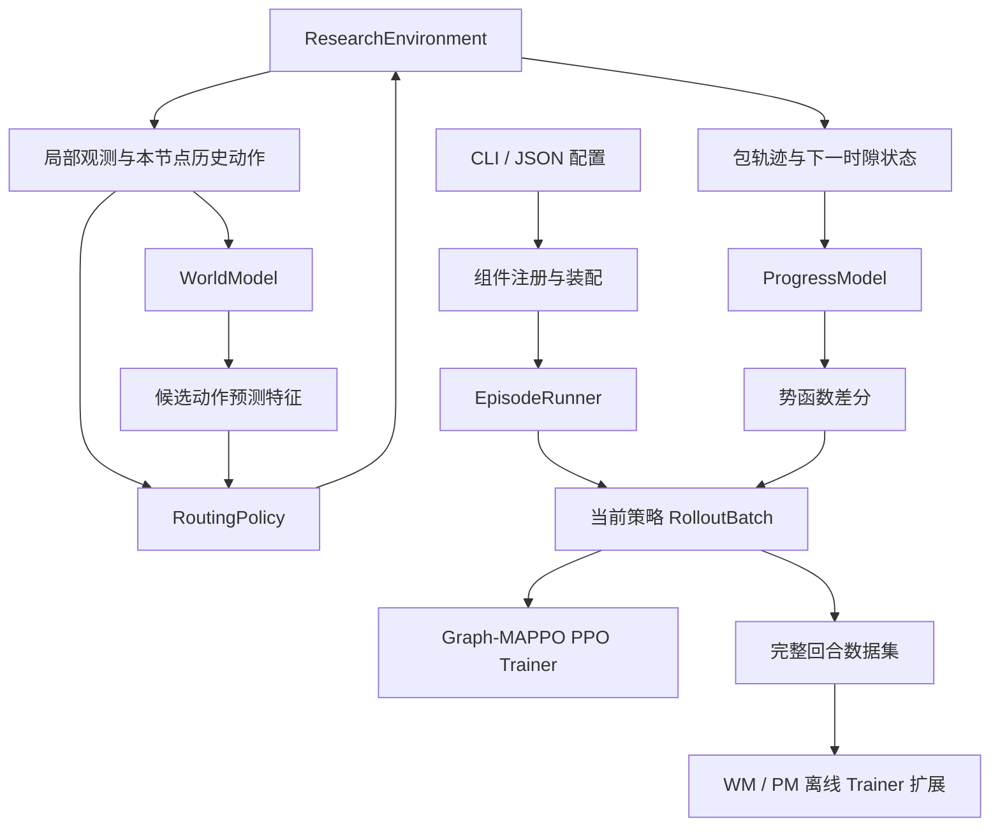

# 浮标网络研究版本：架构与开发接口

本文对应 `WORLD_MODEL_PROGRESS_REWARD_PLAN.md`，记录本轮已经落地的代码框架。

## 1. 范围与当前状态

新版本使用 Python 3.10 及以上版本，入口为 `run_research.py`。现有
`run_algorithm.py`、`main.py`、`src/buoy_network/main.py` 与历史训练代码继续独立运行。
根目录旧 README 的当前备份是 `readme_before.md`。

本轮交付可执行的架构基础：类型化配置、组件注册、不可变数据契约、参考仿真、
规则路由、rollout、GAE、势函数差分、回合数据归档、实验日志和 checkpoint 元信息校验。
2026-10-21 已增加纯 Torch 局部图 Actor、联合观测 Critic、真实 clipped PPO、策略权重保存及冻结评估，
可用配置为 `configs/research_graph_mappo.json`，实际证据见 [C2 优化记录](RESEARCH_POLICY_OPTIMIZATION.md)。

**学习型图 WM、GRU PM、完整训练恢复、EARP 和正式海洋
信道模型仍需要后续实现。**它们没有被空实现或规则算法伪装成已完成的训练组件。
`describe` 会列出可用组件；调用尚未注册的训练器会明确报错。

参考环境采用半径通信、独立同分布丢包、可选高斯漂移、无限队列和无冲突转发。
每个非 Sink 节点在任务开始时生成一个包，Sink 为最后一个节点，目的地坐标视为已知信标。
这些假设写入输出 manifest；参考环境结果只用于框架验证，正式实验应接入经过验收的环境。

## 2. 文件结构

```text
run_research.py                    # 仓库根目录 Python 主入口
scripts/test_research.py           # 按函数、模块、联调顺序执行并输出报告
configs/research_v1.json           # 可覆盖的研究配置示例
configs/research_graph_mappo.json  # 可运行的基础图策略训练配置
docs/RESEARCH_ARCHITECTURE.md       # 本文
tests/test_research_architecture.py
tests/test_research_functions.py
tests/test_research_modules.py
tests/test_research_integration.py
tests/test_research_graph_policy.py
tests/test_research_ppo.py
tests/test_research_policy_checkpoint.py
tests/research_plugin_fixture.py   # 仅供联调的模型/trainer 替身，无梯度训练
src/buoy_network/research/
├── __init__.py                    # 包版本，无模型初始化副作用
├── __main__.py                    # python -m src.buoy_network.research
├── cli.py                         # 严格参数解析、命令分发
├── config.py                      # 配置类型、默认值、JSON 加载和校验
├── contracts.py                   # 观测、动作、转移、包历史等公共数据类型
├── registry.py                    # 具名组件注册与工厂查找
├── bootstrap.py                   # 默认实现装配、扩展加载、依赖注入
├── envs/
│   ├── base.py                    # ResearchEnvironment 抽象接口
│   └── reference.py               # 可执行的小时隙参考环境
├── policies/
│   ├── base.py                    # RoutingPolicy：采样、重算概率、价值估计
│   ├── rules.py                   # 合法随机路由与地理规则路由
│   └── graph.py                   # 局部图 Actor、联合观测 Critic、严格掩码及权重加载
├── models/
│   ├── base.py                    # WorldModel 与 ProgressModel 接口
│   ├── disabled.py                # 明确关闭辅助模型时的实现
│   └── rewards.py                 # 与评分网络独立的势函数差分
├── data/
│   ├── buffers.py                 # 当前策略 rollout 与独立完整回合 replay
│   └── storage.py                 # JSONL 数据归档、manifest、回合级拆分
├── training/
│   ├── base.py                    # Trainer、TrainingContext 扩展契约
│   ├── runner.py                  # 时序采集、特征缓存、bootstrap、任务续采
│   └── ppo.py                     # clipped PPO、活动决策统计、优化器和权重保存
└── runtime/
    ├── device.py                  # 单一设备选择入口，延迟导入 torch
    ├── artifacts.py               # 运行目录、配置、物理指标和版本信息
    └── checkpoints.py             # 模型元信息及环境/维度/schema 兼容检查
```

相对于原计划的平铺文件，这里按职责拆成子包。将来 WM 的网络和损失函数可放入
`models/world_model.py`、`training/world_model_trainer.py`；PM 同理。
无需把预训练、环境推进、奖励逻辑继续堆进现有 `agent.py` 或 `runner.py`。

## 3. 模块依赖与数据流



`contracts.py` 和 `config.py` 不依赖任何具体环境或神经网络。
环境只负责物理任务与原始事件；策略只通过局部观测和预测特征采样；
runner 负责时间顺序、版本边界和奖励拼装；trainer 负责优化器与模型训练。
只有 `bootstrap.py` 选择具体组件，替换实现不需要修改采集流程。

内置 `graph_mappo` 使用共享前馈图 Actor，每个节点独立读取自己的局部观测；独立 Critic
聚合所有节点当前局部观测，集中上下文不会传入 Actor。它不读取隐藏全局状态，也不包含策略 GRU。
PPO minibatch 按时间步保留完整 N 节点；动作掩码使用负无穷，分布先减每行最大值再计算概率。
全 WAIT 批次跳过 Actor 梯度，避免 Adam 动量移动策略参数；Critic 继续学习团队回报。

## 4. 公共数据与形状

以下形状针对单个环境，未来并行执行增加外层 `E` 维。

| 数据 | 约定 |
|---|---|
| `StateSnapshot` | 全局不可变快照，供监督、诊断；不传给 Actor |
| `ObservationBatch` | N 份局部观测，以及统一的 episode/step |
| `LocalObservation.node_features` | `[N,4]`：相对 x/y、队列占初始包数比例、Sink 标识 |
| `visible_mask` | `[N]`；不可见节点特征和关联边清零 |
| `adjacency` | `[N,N]`；局部可见物理边 |
| `available_actions` | `[N+1]`；全局节点索引和末位 WAIT |
| `active` | 活跃节点标志，独立于合法动作掩码 |
| `goal_offset` | 当前节点到已知目的地信标的相对坐标 |
| `head_packet_features` | 当前 FIFO 队首包的 TTL 比例和跳数比例 |
| `LocalHistoryBatch` | 每个节点的局部观测窗口和自己的过去动作，不含未来事件 |
| `CandidateFeatures` | `[N,N+1,6]`；必须缓存模型版本和采样时的原值 |
| `ActionBatch` | `[N]` 动作、log probability、价值，以及采样前循环状态 |
| `TransitionRecord` | t/t+1 状态与观测、动作、预测特征、版本、分项奖励及结束标记 |
| `PacketTrace` | `(episode_id,packet_id)`、逐时隙历史、结果和结束原因 |

运行时使用冻结 dataclass 和嵌套 tuple，避免环境继续推进后改写旧数据。
神经模块自行把 CPU 数据编码为当前设备上的 tensor，不把 GPU tensor 存进 replay。
WM 批处理时每个 agent 独立读取自己的 `AgentHistory`，不能跨 batch 行交换不可见信息。

## 5. 环境与 rollout 生命周期

1. `reset(seed, episode_id)` 生成初始任务和第 0 个观测。
2. runner 从当前局部历史计算候选预测特征，策略在当前合法集合中采样。
3. 用同一输入及采样前循环状态重算 log probability，确认分布可重放。
4. `step_joint(actions)` 固定时隙开始的服务集合，执行每个节点的 FIFO 队首包。
5. 新接收包进入接收队列，下一时隙才可服务；再推进 TTL、位置和观测。
6. 原始状态与包事件归档；PM 计算下一势函数，runner 在 GAE 前完成塑形。
7. rollout 达到长度上限时保留环境、包历史、PM 版本及势函数，bootstrap 后可继续采集。
8. 真正任务结束后才能 reset；可在回合边界更换 PM。

`RolloutBuffer` 拒绝越界覆盖、错误时序、非法动作、版本混用和非有限值。
`RolloutBatch.compute_gae()` 只对真正终止关闭 bootstrap；纯采样截断保留 bootstrap。
训练器通过 `run_episode(..., on_rollout=callback)` 获取当前策略批次，或直接按需调用
`reset()` 与 `collect_rollout()`。若 PPO 多个 epoch 尚未结束，训练器不能开始用新 WM 采集。

## 6. 模型与奖励扩展接口

| 接口 | 职责与约束 |
|---|---|
| `ResearchEnvironment.reset/observe/export_state/step_joint/packet_traces` | 环境和快照边界；执行动作不能被取模或覆盖 |
| `RoutingPolicy.sample/evaluate_actions/values` | 相同观测、特征、掩码和循环状态得到相同动作概率；评估方法不推进在线状态 |
| `WorldModel.predict_candidates(LocalHistoryBatch)` | 一步动作条件预测，返回带版本的 6 维候选特征；拓扑分支独立于候选动作 |
| `ProgressModel.score_prefix(PacketTrace)` | 未结束前缀的完成评分；终局标签只用于离线监督 |
| `ProgressModel.packet_potential` | 可靠性版本在此应用门控，先门控再做时间差分 |
| `ProgressModel.team_potential` | 对未结束包求和，按回合初始包数归一化 |
| `PotentialRewardShaper.apply` | `r_train = r_task + r_earp + alpha*(gamma*Phi_next-Phi)` |
| `Trainer.fit(TrainingContext)` | 训练并保存 checkpoint，返回 `TrainingReport` |

WM 的具体实现负责图编码、GRU、解耦预测头、归一化和 `eval/no_grad`。
建议将原始多头输出及损失留在具体模型/训练器内部，策略只依赖稳定的六维候选接口。
PM 首版使用独立 GRU 和单头结果监督；已结束包势函数为零，截断包的 `outcome=None`。
PM、特征编码、归一化、门控和 alpha 在整条任务内固定。

## 7. 注册自定义组件

组件工厂签名统一为 `factory(config: ExperimentConfig, device: str)`。
实现自己的 Python 模块，导出以下函数：

```python
def register_components(registry):
    from my_package.environment import MarineEnvironment
    from my_package.policy import GraphMAPPOPolicy
    from my_package.training import GraphMAPPOTrainer

    registry.register("environment", "marine_v1",
                      lambda cfg, device: MarineEnvironment(cfg.environment))
    registry.register("policy", "custom_graph_mappo",
                      lambda cfg, device: GraphMAPPOPolicy(cfg, device))
    registry.register("trainer", "custom_graph_mappo",
                      lambda cfg, device: GraphMAPPOTrainer(cfg, device))
```

然后使用 `--plugin my_package.extension --env-backend marine_v1 --policy custom_graph_mappo`；
训练时再加 `--policy-trainer custom_graph_mappo`。
`--plugin` 可重复；同名注册会报错，防止扩展悄悄替换现有算法。
增加 WM/PM 时分别注册 `world_model` / `progress_model` 和对应 `trainer`。
扩展模块由用户显式指定，本机制是本地 Python 工厂扩展，不依赖外部插件服务。

复用旧 Graph-MAPPO 时，应新增 adapter 实现 `RoutingPolicy`，并同步处理 N+1 动作、
局部图输入、候选预测、当前掩码及循环状态。不能直接把旧 runner 当成新环境适配器。
后续定点修复已处理旧路径的动作映射、图距离、FIFO 和 rollout 边界，详见
[定点修复记录](TARGETED_FIX_REPORT.md)；全局观测、旧奖励/指标、研究环境接入及完整恢复仍未统一。

## 8. Python 入口与命令

```powershell
# 无训练依赖的结构检查
python run_research.py describe
python run_research.py check-config --config configs/research_v1.json --device cpu

# 一回合数据流检查，含采样概率、GAE 和数据归档
python run_research.py smoke --config configs/research_v1.json --device cpu

# 采集三个独立种子回合，生成 train/validation/test 划分
python run_research.py collect --config configs/research_v1.json --episodes 3 --device cpu

# 规则策略评估，仅生成指标，不追加训练数据
python run_research.py evaluate --config configs/research_v1.json --device cpu

# 真实图策略训练，生成网络权重和模型指标
python run_research.py train-policy --config configs/research_graph_mappo.json

# 加载训练输出中的配置和权重，冻结评估
python run_research.py evaluate --config <训练输出目录>/config.json --policy-checkpoint <训练输出目录>/checkpoints/policy_latest.pt

# 同一入口也支持模块方式
python -m src.buoy_network.research describe
```

所有参数同时接受 `--task-horizon` 和 `--task_horizon` 等拼写。
布尔值必须显式使用 `true` / `false`。未知 CLI 参数、未知 JSON 字段及错误类型会报错。
JSON 配置覆盖 dataclass 默认值，CLI 再覆盖 JSON；路径相对当前工作目录解析。
`check-config` 检查配置结构与设备；具体组件是否可执行由 `describe` 和执行时工厂检查决定。

WM/PM 训练命令仍需要安装并注册具体 trainer；内置基础策略训练不需要插件：

```powershell
python run_research.py train-wm --plugin my_package.extension --dataset <data_dir>
python run_research.py train-pm --plugin my_package.extension --dataset <data_dir>
python run_research.py train-policy --config configs/research_graph_mappo.json
```

尚未注册的 WM/PM 训练命令会以退出码 2 报告缺失组件。基础策略训练须选择 `graph_mappo`，
默认规则策略不能训练；训练中 WM/PM/EARP 仍需关闭。
启用 WM/PM 还需通过对应开关、backend 和 checkpoint；载入模型时工厂必须校验元信息，
冻结完整编码器和归一化器，并将全部模块设置为推理模式。

## 9. 数据、日志与恢复边界

```text
results/research/runs/<Asia-Shanghai时间戳或run_name>/
├── config.json
├── environment_manifest.json
├── research_metrics.csv
├── run_report.json                 # 采集/评估报告
├── training_report.json            # trainer 返回的训练报告
├── checkpoints/                    # 由具体 trainer 创建模型与优化器文件
└── data/
    ├── data_manifest.json
    └── episodes/episode_000000/
        ├── transitions.jsonl
        └── packets.jsonl
```

运行目录不覆盖同名实验。JSONL 按行读取，训练器通过 `DatasetStore.iter_rows(split)`
取得普通 Python 字典并按自身网络需要编码；不会在公共数据层强制引入 PyTorch。
完整状态每条联合转移记录一次，不为每个节点复制全局快照。
少于三个回合时，manifest 显式保留空验证/测试集，离线训练入口会拒绝该数据集。
同一回合的邻近窗口不能被拆进不同集合。
manifest 现在同时记录节点维度、观测/动作 schema、特征名称及每个回合的场景种子；
同一数据集拒绝混合节点规模，同一场景种子不能出现在不同集合。
训练入口在调用 trainer 前核对环境版本、节点/动作维度和已声明的环境 backend。
旧 manifest 的附加维度/种子字段可由已归档的回合起始记录推导并核验。

磁盘 `write_episode` 接收完整有限任务回合，写入前核验转移和包结果守恒。
未结束包仍通过环境和 PM 接口以 `outcome=None` 保留；当前完整回合归档接口
不把半个任务或仅存在的空目录当成有效数据集。

`EpisodeReplay` 按完整回合淘汰和抽取连续窗口；`RolloutBuffer` 专用于当前行为策略，
不能用辅助 replay 或模型合成数据替换 PPO 批次。
WM、PM 归一化器只拟合训练集；PM 的前缀采样应按包平衡，未结束包不能伪标失败。

`CheckpointMetadata` 提供创建、保存、加载和兼容校验，包含组件、模型版本、环境 backend、
schema、节点/动作维度和特征定义。具体 trainer 负责保存网络、优化器、归一化器、
随机状态、训练阶段、数据划分及辅助模型版本，并在载入前调用 `validate()`。
内置 PPO 已保存真实策略网络权重及 metadata，并支持 `--policy-checkpoint` 独立评估。
它尚未保存优化器、训练 RNG、归一化器或训练阶段，未提供完整训练恢复 CLI；训练时也不接受该参数作 warm-start。
评估未指定 `policy.deterministic` 时默认贪心，显式 JSON `false` 保留，CLI 再覆盖；训练默认随机采样。

研究指标使用独立 CSV，保留投递率、丢弃率、成功包真实跳数及平均/P95 时隙时延，
并分开记录 task、EARP、shaping、train 四种回报。无成功包的时延/跳数留空。
PPO 另输出 `model_metrics.csv`，记录优化器步数、损失、活动节点 KL/clip、梯度范数及真实参数变化，
报告 CPU 训练时间和参数量。样本效率、重传/环路及 GPU 显存仍待完善；旧 CSV 列含义保持独立。

## 10. 后续实施顺序与验证

1. 在该接口下接入并验收正式研究环境，完成动作、物理图、信道和旧基线适配。
2. 实现一步 WM 网络、目标编码、连续窗口训练和校准评估，注册模型与 trainer。
3. 在已有前馈 Graph-MAPPO 基线上接入正式 WM 缓存特征；循环状态扩展需另行实现并验收。
4. 实现单头 PM 的成功/失败前缀训练、冷启动和固定版本评分。
5. 验证分别关闭、分别开启与组合实验，再扩展多头门控和多步想象。

运行架构语义测试：

```powershell
python -m unittest discover -s tests -p "test_research_architecture.py" -v
```

测试覆盖物理可见性、包守恒、每时隙一跳、TTL、动作概率、截断续采与 bootstrap、
势函数边界、回合拆分、存储、组件扩展、checkpoint 维度拒绝及 CLI 失败行为。

按“函数 → 模块 → 独立进程联调”完整复测：

```powershell
python scripts/test_research.py
# 修复单层问题后也可单独复测
python scripts/test_research.py --stage functions
python scripts/test_research.py --stage modules
python scripts/test_research.py --stage integration
```

默认流程在某层失败时停止后续层；函数层还要求所有已实现的具名函数实际被调用。
JSON 报告保存到 `results/functional_tests/<时间戳>/test_report.json`。
函数调用覆盖率不等于语句/分支覆盖率；抽象接口和未实现算法不计为已实现函数。
测试范围、已复现问题及修复结果详见 `RESEARCH_FUNCTIONAL_TEST_REPORT.md`。
