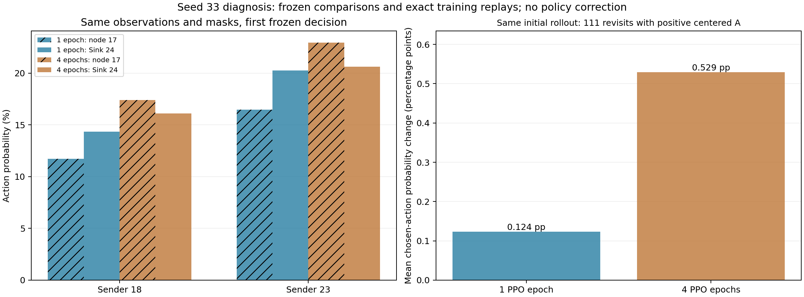

# 原TG-MAPPO：种子33的Sink选择、环路与PPO反馈检查

日期：2026-11-04。接续[PPO更新预算检查](TG_MAPPO_PPO_UPDATE_BUDGET.md)，本轮检查原浮标环境、A基线、种子33，保留所有原训练与评估结果。

## 1. 明确结论

**已确认学到的动作排序存在问题；未发现新的PPO计算错误，也未完成策略效果验收。**

- 完全相同的10个Sink可选状态，1遍Actor选择Sink为10/10，4遍为2/10；观测、合法掩码及Sink标识正确。
- 4遍Actor在节点18/23偏向17，继而形成大量重复转发。原冻结评估仍为2/48、402次成功回访，未替换动作或改评估解码。
- PPO的标准化优势确实会给部分回访样本正值；相同首回合数据复用4遍，会更强地提高其中部分动作的概率。该统计不是动作真实贡献的标签，不能把所有回访都认作错误动作。
- Critic在已采样轨迹上高估实际后续回报，GAE目标也有差距；4遍的这项误差更小，但冻结策略仍更差。因此无法把问题简单归为更新次数不足、Critic完全没学，或某一个唯一原因。

**本轮未修改项目的环境、观测、动作、奖励、PPO目标、网络结构或默认预算。暂保留ppo_epoch=1、mini=2为参考。**

## 2. 实际检查和可复现性

原配置均为20×80、task_v2、显式linear、Actor/Critic初始LR为0.0005/0.0003，只有ppo_epoch=1/4不同。
使用原Python3.6.8、Torch1.8.1 CPU，从同一训练种子完整重放；源码来自原套件157文件归档，新增诊断工具单独记SHA。

| 核验 | 1遍重放 | 4遍重放 |
|---|---:|---:|
| 活跃决策记录 | 17106 | 16982 |
| 环境交互 | 1600 | 1600 |
| 最终Actor/Critic权重 | 与原结果逐位一致 | 与原结果逐位一致 |
| 全部逐更新损失/学习率/Adam步数 | 与原结果完全一致 | 与原结果完全一致 |
| 物理JSONL与奖励CSV | 与原结果逐字节一致 | 与原结果逐字节一致 |

共补录34088条活跃决策，含FIFO服务包、访问路径、观测、动作、ACK、奖励、GAE目标、原尺度价值、原始/标准化优势和更新前后概率。
另做4遍模型160时隙的冻结重放，在1044条活跃决策上同步查询1遍Actor；两个Actor都不更新，原物理JSONL完全复现。1遍Actor的预测没有实际执行，因此不是另一条完整反事实轨迹。

新增函数3、模块3、真实PPO联调1，共**7项通过、0最终失败/错误/跳过**。原123项本轮未全部重跑；原实现未改动，另用上述完整训练/冻结重放验证插桩不改变结果。

## 3. Sink在哪里被漏选

以下为同一冻结初始时隙、同一节点输入，概率未重新归一化：

| 节点 | 1遍P(17) | 1遍P(Sink24) | 4遍P(17) | 4遍P(Sink24) |
|---|---:|---:|---:|---:|
| 18 | 11.72% | 14.35% | 17.42% | 16.11% |
| 23 | 16.48% | 20.28% | 22.95% | 20.62% |

1遍在全部10个可选状态都选Sink；4遍有8次选择17。greedy执行概率最大的动作，约1.31/2.34个百分点的差就足以改变路径。
4遍已观测的闭环为5↔6、9↔14、17↔21。物理Sink可达比例仍为100%；闭合的已观测策略转发图不等于物理拓扑没有出口。

进一步按线性动作头拆解：`log(P17/P24) = (w17-w24)·h + b17-b24`。
4遍头部偏置差仅0.001287，两个节点总logit差为0.07798/0.10732，其余0.07669/0.10603来自学习到的状态特征打分。
这能定位到模型打分，不能仅据此认定某一个原始输入字段是唯一原因。

当前实际输入：

| 输入 | 内容 |
|---|---|
| 本节点obs，26维 | 25维邻居历史成功反馈及本节点ID |
| 图节点特征，25×4 | x、y、队列包数/初始包数、是否Sink；最后一列为实体类型 |
| 图/动作约束 | 节点距离矩阵、agent_id、26维合法动作掩码 |
| 时序配置 | Actor按node聚合、Critic图按global聚合；本轮RNN关闭 |

诊断记录额外保存的包访问路径**没有输入Actor**；剩余时隙也没有显式输入Actor/Critic。
图中存在Sink标识不保证有限深度的节点聚合会让每个远端节点都直接利用该信息。本次节点18/23与Sink邻接，Sink合法且标识正确，排除了这两个案例中掩码挡住Sink的解释。

## 4. 为什么负奖励仍可能提高回访概率

实际PPO使用：

```text
A_raw = GAE_return_target − V_old_in_original_reward_units
A = (A_raw − active_sample_mean) / (active_sample_std + 1e−5)
```

即时r、GAE目标、价值、标准化优势是不同量。标准化正值表示高于本批优势均值，不表示即时奖励为正，也不表示该动作的真实边际贡献为正。
基础奖励在联合时隙内广播给各节点；各节点Critic输入/预测可以不同，因此不能说所有节点的优势完全相同。

首回合的950条活跃动作、奖励、价值与优势在两种预算下全部一致，随后才分别做1/4遍PPO。
222条成功回访中，111条得到正的标准化优势；该111条的原始优势均值为−0.1684，标准化优势均值为+0.5633。

| 相同111条样本 | 1遍 | 4遍 |
|---|---:|---:|
| 所选动作概率的平均变化 | +0.124个百分点 | +0.529个百分点 |
| 正优势且所选概率增加超过1e−6的条数 | 66 | 59 |

平均变化更大不表示每一条都增加。参数共享、其他样本、裁剪和熵正则共同影响最终变化，不能将这111条当作独立训练种子或直接推断统计显著性。

全部20回合的记录：

| 统计 | 1遍 | 4遍 |
|---|---:|---:|
| 成功回访条数 | 3441 | 3391 |
| 其中标准化优势为正 | 1845 | 1707 |
| 回访同时其他节点投递的条数 | 290 | 237 |
| 上述同时投递样本中标准化优势为正 | 252 | 217 |
| 实际投递样本中标准化优势为正 | 129/147 | 115/129 |

投递样本的平均标准化优势高于回访，回访整体平均优势仍为负。不能说奖励完全分不清投递和回访，或PPO在整体上总鼓励环路。
同槽投递与回访的正优势关联反映团队信用的混杂风险，不能证明回访造成了投递。动态网络中回退也可能合理；本次实际失败是冻结策略反复闭环且低投递。



## 5. Critic与实际后续回报

根据原奖励CSV计算到真实80时隙任务结束的`G_MC(t)=sum gamma^(k-t)*r(k)`，gamma=0.99、末端bootstrap=0；未改动训练目标。
下面分别在两个模型各自的采样轨迹上、按活跃决策统计，不是同一固定数据上的泛化排行榜：

| 轨迹内统计，原奖励单位 | 1遍 | 4遍 |
|---|---:|---:|
| V − G_MC均值 | +0.5303 | +0.2841 |
| V相对G_MC的RMSE | 0.5641 | 0.4496 |
| GAE目标 − G_MC均值 | +0.3661 | +0.1950 |

值估计相对已实现的回报偏高；4遍在自身数据上的误差较小，仍未解决冻结路由。
G_MC是带随机性的单条采样结果，不是精确条件期望V；同一回合的节点/时隙相互相关，不能把34088条当独立样本计算置信区间。
GAE中gamma×lambda=0.9405，末端TD残差直接传到相隔79步处的权重约0.00786。准确Critic仍能通过bootstrap传播未来成本，不能说末端惩罚的总影响只剩0.8%。

## 6. 诊断工具曾失败的原因与处理

首次两次20回合插桩重放均未通过最终Actor逐位一致检查，不能当作最终验收证据：

- Actor最大差均为1.19209e−7；Critic权重、物理JSONL一致。保留failed_capture_source.py、原输出、failure_report.json及独立探针。
- 原因是记录钩子在PPO计算期间提前读取分布的惰性`probs`缓存，改变计算图的浮点梯度累加顺序。独立Torch1.8最小探针：无钩子重复运行一致；提前读取后首梯度差3.72529e−9、最终参数最大差2.79397e−7。
- 先说明原因，再将新增RolloutCapture限制为无梯度阶段；训练阶段不触碰概率缓存。新增缓存状态测试及4遍真实PPO有/无钩子参数/损失一致测试，随后两次完整重放均严格通过。

失败原始目录：results/tg_credit_diagnostics/20261104_seed33；最终通过目录：results/tg_credit_diagnostics/20261104_seed33_v2。
本轮实际额外执行6400训练重放时隙（首轮失败3200、修正后3200）及160冻结时隙；这些不是新的独立训练种子或正式性能实验。

## 7. 命令、交付与接续

每块均为一条完整PowerShell命令，在仓库根目录运行。已有通过结果无需重训；重新执行时使用新的输出目录。

```powershell
& "D:\python3.6.8\python.exe" -m unittest tests.test_credit_diagnostics tests.test_legacy_credit_capture -v
```

```powershell
& "D:\python3.6.8\python.exe" scripts/diagnose_tg_credit.py --suite results/tg_ppo_budget_epoch1/20261103_232339_569526 --seed 33 --output results/tg_credit_diagnostics/recheck_epoch1
```

```powershell
& "D:\python3.6.8\python.exe" scripts/diagnose_tg_credit.py --suite results/tg_ppo_budget_epoch4/20261103_232337_352056 --seed 33 --output results/tg_credit_diagnostics/recheck_epoch4 --cross-control-suite results/tg_ppo_budget_epoch1/20261103_232339_569526
```

这是从种子重建训练，不是优化器中途恢复。诊断工具使用原源码归档，不切换研究环境。
实现：scripts/diagnose_tg_credit.py、src/buoy_network/credit_diagnostics.py；严格核验/MC对照：scripts/verify_tg_credit.py；图：scripts/plot_tg_credit.py。
[机器凭据](evidence/TG_CREDIT_DIAGNOSIS_20261104.json)含7项报告、两个完整重放摘要、相同首回合对照、同输入Sink案例、MC校准、失败原因/探针及哈希；大日志、逐样本数据与权重留本地results。

下一次优先评审并单独验证**Critic的剩余时隙信息是否有助于价值校准**，将其作为待验证假设；保持Actor、奖励、PPO遍数及交互预算一致，先短训验接口，再定多种子对照。
如果改变信息范围，须统一相关消融组并版本化，不能计作WM/PM收益。也可先补冻结sample/greedy诊断，但不得替换正式greedy指标。
尚未证明唯一因果根源、任何新特征的性能收益、长期收敛或WM/PM收益；未启动1000回合/盲测，没有强制Sink或屏蔽回访动作。

同日后续[Critic剩余窗口信息验证](TG_MAPPO_CRITIC_TIME.md)已完成：139项通过，加入默认关闭的时间分支及同容量恒定输入对照；20回合种子33三模式均16/48、150回访，时间MC误差未优于恒定输入。本轮无时间信息路由收益证据，保留disabled，下一项验证独立交互预算。
