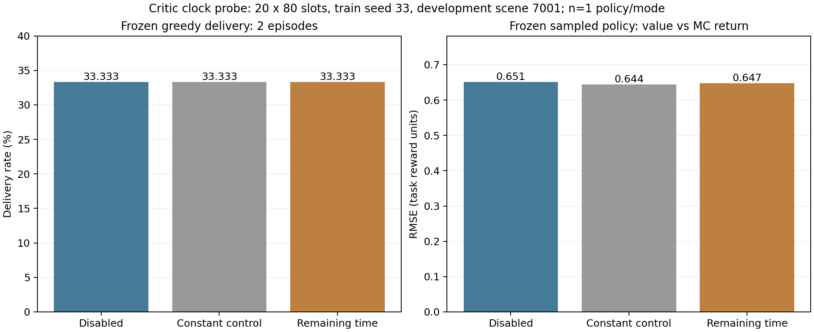

# 原TG-MAPPO：Critic剩余窗口信息的单因素验证

日期：2026-11-04。接续[种子33信用反馈诊断](TG_MAPPO_CREDIT_DIAGNOSIS.md)，沿用原浮标环境、原TG-MAPPO及task_v2。本轮验证时间信息假设，不将其记作WM/PM收益。

## 1. 结论与默认设置

**接口和运行验收通过；本轮没有得到时间信息改善路由或优于同容量对照的证据，默认保持disabled。**

- 新增9项、原130项相关回归均通过，共139项，最终无失败/错误/跳过。
- 三模式×三训练种子×训练/评估，共18个短任务通过，评估投递均为10/0/0（各分母48）。
- 种子33额外20回合诊断，三模式greedy均为16/48、150次回访。
- 剩余时间模式MC RMSE为0.64747，关闭为0.65137，同参数恒定输入为0.64450；小幅数值变化未优于恒定输入。
- 关闭模式三个短训Actor/Critic及训练/评估物理日志与旧线性基线完全一致；20回合种子33也完全一致。旧真实模型加载/冻结采样通过。

这些结果不能彻底否定时间信息在更充分训练下的作用；20回合仅检查已选种子33，不构成三种子中等预算或收敛验收。

## 2. 接入位置和对照

定义当前决策时刻t的剩余窗口比例`tau_t=(H−t)/H`。本轮H=80，t=0时为1，t=79时为1/80，末端bootstrap时t=80为0。
它是已知实验任务窗口的时钟，不是包TTL，不使用未来转移，也未将窗口未完成改为真实丢包。

| 模式 | Critic分支输入x | 参数 | 含义 |
|---|---|---:|---|
| disabled | 分支关闭 | 原18615 | 默认与旧基线兼容 |
| constant | 恒为1 | 18743 | 同容量/优化动力学对照 |
| remaining | tau_t | 18743 | 待检验的时间信息 |

Actor均21956个可训练参数。Actor网络、观测、动作、掩码和优化设置相同，仍正常PPO学习；Critic变化可经优势间接改变Actor权重，不是冻结Actor。
WM/PM在这些性能诊断中关闭，三模式的基础奖励、PPO1×2、设备、种子和学习率计划一致。

在Critic既有隐藏特征h与价值头之间增加可选调制：

```text
h_time = h * (1 + x * scale) + x * shift
V = existing_value_head(h_time)
```

scale/shift各64维，共128参数，全部初始化为0，不消耗随机数。恒定/时间两组参数量及初始化相同，原Actor和Critic公共参数也一致；初始特征/价值保持原值。
PopArt统计及目标/裁剪时序沿用修复后的实现，新增分支参数进入同一个Critic优化器。20回合后分支参数L1为constant=0.74946、remaining=0.73670，分支实际参与了学习。

## 3. 文件职责与接口

| 文件 | 本次职责 |
|---|---|
| src/onpolicy/algorithms/utils/critic_time.py | 模式/边界校验、T+1时钟、可训练调制模块 |
| graph_actor_critic.py | 仅GR_Critic增加可选critic_time；Actor保持原输入 |
| graph_MAPPOPolicy.py | get_actions/get_values/evaluate_actions向Critic透传时钟 |
| graph_buffer.py | 缓存[T+1,线程,节点,1]；采样打乱时与原样本对齐 |
| agent.py | collect用tau_t，末端compute用tau_H；不重算为下一时刻特征 |
| graph_mappo.py | 从PPO样本尾部解析可选时钟；与WM缓存并存 |
| main.py | --tg_critic_time_mode disabled/constant/remaining，默认disabled |
| policy_artifacts.py | 保存模式、加载严格匹配；旧缺字段模型视为disabled |
| ablation_suite.py | v3可选critic_time_mode，训练/冻结评估一致并检查 |

基础PPO样本16项，单独时间或WM为17项，两者同时为18项；Actor只接收原观测及原有可选WM特征。
时钟支持本项目当前feed-forward、完整任务窗口路径；启用时明确拒绝RNN组合。中途优化器恢复、GPU及完整失败分类仍不属于本次已验收范围。
PPO实现标记仍为tg_ppo_v3_lr_switch；网络变体通过critic_time_mode和源码快照独立溯源，加载时不能静默互换constant/remaining。

## 4. 函数→模块→联调与真实短训练

新增4项函数：时钟边界/多节点、零初始化与RNG/梯度、constant和remaining敏感性、无效模式/形状/范围。
新增3项模块：原初始化/同容量、时钟与打乱样本对应及重置、保存加载/模式拒绝/旧模型缺字段。
新增2项联调：同首轮采样及Actor更新一致且时钟分支学习、时间+冻结WM/PM的4遍真实PPO。
原130项本轮全部重跑，共139项最终通过；另有24个实际训练/评估任务和3次冻结采样诊断。

三种子短训练各2×80，PPO1×2，每网络实际4步Adam。每个种子的三模式前两回合物理JSONL完全一致，首轮初始化/Actor更新控制有效；第二次PPO后参数可因Critic反馈而不同。

| 模式 | seed11投递/48 | seed22 | seed33 | 三策略均值±样本SD |
|---|---:|---:|---:|---:|
| disabled | 10 | 0 | 0 | 6.94% ± 12.03% |
| constant | 10 | 0 | 0 | 6.94% ± 12.03% |
| remaining | 10 | 0 | 0 | 6.94% ± 12.03% |

三套167文件源码快照相同，并与对应工作代码字节核对；配置只差critic_time_mode。三套完成任务接续均新增训练0，原摘要不变。

## 5. 种子33的20回合与冻结价值校准

从各自已验收快照额外启动同一初始种子33，三模式均20×80、PPO1×2，每网络实际40步Adam。
显式linear：Actor初始0.0005、Critic0.0003，按同一20回合计划衰减；不与2回合预算混作单因素性能比较。
场景7001原greedy评估各2×80；之后再各2×80仅作冻结sample诊断，训练更新0、Actor/Critic权重不变，不替换正式greedy指标。

| 模式 | greedy投递/48 | greedy回访 | sample投递/48 | V−G_MC均值 | MC RMSE |
|---|---:|---:|---:|---:|---:|
| disabled | 16 | 150 | 6 | +0.64758 | 0.65137 |
| constant | 16 | 150 | 6 | +0.64066 | 0.64450 |
| remaining | 16 | 150 | 6 | +0.64375 | 0.64747 |

校准用模型自己的PopArt统计将V转回原奖励尺度，按实际完整窗口奖励独立计算gamma=0.99的G_MC。
此次三模式的采样动作/奖励序列也恰好相同；一般情况下同种子不保证后续物理随机帧一致，策略改变会改变随机数消耗。
两回合MC样本噪声大、节点/时隙相关，不是精确条件期望V或独立样本显著性检验；这里每模式只有一个独立训练策略。
常量对照误差略低于时间模式，没有足够依据认定“缺少剩余时隙”是当前路由失败的关键原因，也未将时间模式设为新默认。



总实际预算：短训1440/greedy1440、20回合诊断训练4800/greedy480、冻结sample480联合时隙；另一次采样工具初始失败发生于首时隙。测试内部的小型联调不计作正式训练预算。

## 6. 首轮错误与处理记录

1. 模块测试把0移动浮标输出误写为moves_5，找不到模型；按实际配置改路径后3项通过，项目保存逻辑未改。
2. 一条补充回归命令引用了不存在的test_legacy_policy_diagnostics，导入失败；改为实际test_legacy_diagnostic_capture后9项通过，保留首次命令报告。
3. 新冻结校准工具按数组三维索引读取Runner的奖励嵌套列表，首时隙TypeError；先说明原因，再用np.asarray转换。失败目录calibration/disabled保留，三次最终结果另存calibration_verified并全部通过。

每次均先解释原因再修正。初始失败报告/目录及修复说明纳入凭据；最终139项无失败/错误/跳过，24个实际训练/评估任务退出码均0。

## 7. 命令与产物

每块一条完整PowerShell命令，在仓库根目录执行；已有结果不需要重复训练。

```powershell
& "D:\python3.6.8\python.exe" -m unittest tests.test_legacy_critic_time.TimeFunctions tests.test_legacy_critic_time.TimeModules tests.test_legacy_critic_time.TimeIntegration -v
```

查看三种子短配置预算：

```powershell
& "D:\python3.6.8\python.exe" scripts/run_tg_ablation.py --mode plan --config configs/tg_critic_time_remaining_smoke.json
```

需要新建剩余时隙短实验时：

```powershell
& "D:\python3.6.8\python.exe" scripts/run_tg_ablation.py --mode run --config configs/tg_critic_time_remaining_smoke.json --output-root results/tg_critic_time_remaining_smoke
```

disabled/constant各用同名配置文件；接续已完成套件用--resume，避免新开重复训练。
额外20回合探针为scripts/run_tg_critic_time_probe.py；冻结采样为scripts/diagnose_tg_critic_clock.py；独立验收/图为verify_tg_critic_time.py与plot_tg_critic_time.py。

实际目录：

- results/tg_critic_time_disabled_smoke/20261104_124501_129139。
- results/tg_critic_time_constant_smoke/20261104_124457_670116。
- results/tg_critic_time_remaining_smoke/20261104_124457_644175。
- results/tg_critic_time_probe/20261104_125005_339468：命令清单、三模式20回合模型/日志、最终calibration_verified及图/CSV/SVG。
- results/tg_critic_time_tests/20261104：9项分层报告、130项回归路径及两处初始测试命令/路径错误。

[机器验收凭据](evidence/TG_CRITIC_TIME_20261104.json)包含139项报告、容量/真实Adam计数、三模式汇总、旧基线不变、MC独立校验、源码SHA和接续结果。大模型、原始日志与源归档留本地results，Git保存代码/配置/测试/文档和小型凭据/图。

## 8. 下一步

保留disabled、PPO1×2、task_v2，优先验证**增加独立环境交互回合**。建议固定学习率下比较20/100回合，先复核旧fixed20对应产物，再沿用相同Actor/Critic LR、种子和其他条件，检查100回合前20回合轨迹与旧参考一致。
不能把新100回合fixed与本轮20回合linear当成只改变交互数量的对照，因为linear随总回合数变化。后续预算比较采用共同fixed计划，避免同时改变学习率曲线。
本轮未启动100回合、正式1000回合、预留盲测、WM/PM重训或新信息范围消融。时钟保留作可选实验接口，不宣传为已有效的修复或第三个创新点。

同日后续[fixed20/100交互预算对照](TG_MAPPO_INTERACTION_BUDGET.md)已完成：时钟保持disabled，三个精确20回合前缀通过；投递均值25.00%→50.69%，但仍有等待/环路，未认定收敛。该采样预算结果不改变本文件的时钟无明确收益结论。
