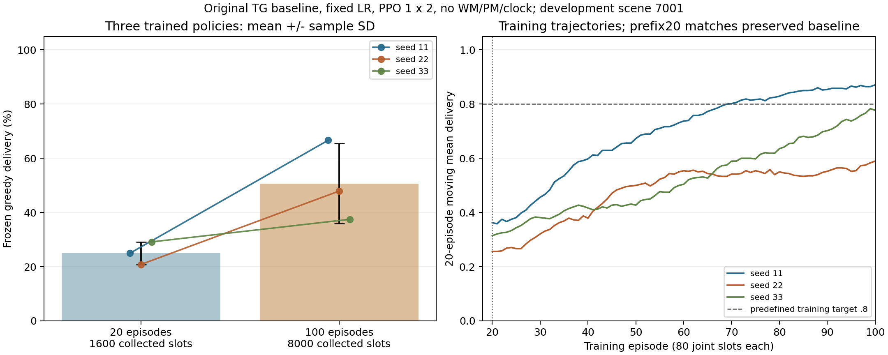

# 原TG-MAPPO：固定学习率20/100回合交互预算对照

日期：2026-11-04。状态：**三个100回合模型、冻结评估及独立验收全部完成。开发场景投递提高，收敛/泛化与创新收益仍未验收。**

接续[Critic时间信息验证](TG_MAPPO_CRITIC_TIME.md)，保持时钟disabled、Actor/Critic结构、原环境和task_v2。这里增加新的环境采样回合，每回合PPO仍1×2；不复用同一buffer增加ppo_epoch。

## 1. 对照条件

| 项目 | 两种预算共同条件 |
|---|---|
| 环境 | 原25节点、5移动浮标、随机信道、80联合时隙/回合 |
| 初始训练种子 | 11、22、33 |
| 奖励 | task_v2，投递/时间/窗口权重均1 |
| 模型 | 原TG-MAPPO，WM/PM关闭，Critic时钟disabled |
| 学习率 | fixed；Actor0.0005、Critic0.0003，全程不衰减 |
| PPO | 每rollout 1遍、2小批次 |
| 冻结评估 | 开发场景7001，各2×80，greedy、更新0 |

20回合=1600环境交互，100回合=8000；三种子分别4800/24000。新100回合每网络应实际200步Adam，20回合前缀应40步。
新数据量与实际优化次数同时增加5倍，这是保持每回合PPO配置时的自然结果，不能把它说成等计算预算。
训练回合存在历史观测反馈延续，不是统计独立样本；统计单位仍为独立训练种子n=3。

## 2. 保留旧fixed20基线

直接使用results/tg_lr_budget_fixed，不重训、不改写旧权重/日志。
配置、奖励分项/真实投递时间、模型SHA和冻结评估已只读核验：

| 种子 | 旧fixed20投递/48 |
|---|---:|
| 11 | 12 |
| 22 | 10 |
| 33 | 14 |

旧均值25.00%±4.17%样本SD。旧记录有Critic头40次Adam，但当时没有Actor累计计数字段；保持缺失信息，不编造历史实测值。
旧模型训练源码位置及原命令保存在该目录commands.json，新套件baseline20.json另保存原模型/物理日志哈希。

## 3. 工具和严格前缀检查

本轮未修改项目训练实现，只新增外部入口适配器和预算配置：

- scripts/interaction_budget_worker.py：沿用原run_algorithm默认参数及buoy_network.main；在第20次PPO更新后只读保存Actor/Critic状态，立即与旧fixed20逐位比较，不一致就停止该任务。
- scripts/run_tg_interaction_budget.py：核验旧参考、冻结源码、生成固定100回合套件，沿用原任务锁、超时处理、独立尝试和接续。
- configs/tg_interaction_fixed100.json：A基线、三训练种子、fixed100、PPO1×2、时钟disabled。

前缀保存不执行前向/梯度更新，不消耗Torch RNG；它是参数检查快照，不提供优化器中途恢复。
函数3→模块2→真实联调2共7项通过，包含拒绝错误参考/覆盖、RNG与参数不变、plan模式不启动训练、原公开入口与适配器的最终权重/物理轨迹一致。
前一轮139项未全重跑，因为训练实现未改；最终再核对真实100回合任务与20回合前缀。

## 4. 已完成产物与验收

套件：results/tg_interaction_fixed100/20261104_132048_759710。
manifest.json记录6个训练/冻结评估任务；job_logs保留每次实际命令输出；各训练run的prefix目录保留prefix_at_20.pt/.json。
三个模型各100回合，6个训练/冻结评估任务全部成功；每网络实际200步Adam，全程Actor/Critic LR为0.0005/0.0003，全部损失、梯度和策略漂移统计有限。
三个真实20回合前缀的Actor/Critic、旧记录全部损失字段、物理指标及1600条奖励分项逐一严格匹配旧fixed20，新增快照没有改写控制条件。
旧20回合与新100回合共6个冻结动作重放均与原评估物理JSONL完全一致，更新0、权重不变；diagnostics/fixed20_seed11/22/33与fixed100_seed11/22/33保存完整概率/包路径。
完成套件再次接续新增训练0，原summary不变。新工具7项最终无失败/错误/跳过；本轮未发现训练或验收失败，没有修改原项目训练代码。

[最终机器凭据](evidence/TG_INTERACTION_BUDGET_20261104.json)保存测试、174文件源快照、前缀/损失/奖励一致性、全部逐回合物理曲线、冻结动作诊断和统计。验收器scripts/verify_tg_interaction_budget.py；图/300行逐回合CSV/SVG及图源SHA位于套件figures，生成器scripts/plot_tg_interaction_budget.py。

## 5. 命令与接续

每块一条完整PowerShell命令，在仓库根目录执行。已有训练正在运行时不要再次启动同一套件。

```powershell
& "D:\python3.6.8\python.exe" -m unittest tests.test_interaction_budget.BudgetFunctions tests.test_interaction_budget.BudgetModules tests.test_interaction_budget.BudgetIntegration -v
```

只看预算和旧参考：

```powershell
& "D:\python3.6.8\python.exe" scripts/run_tg_interaction_budget.py --config configs/tg_interaction_fixed100.json --mode plan
```

本套件已完成，以下接续只校验/汇总，不重复训练（任务锁防止重复运行）：

```powershell
& "D:\python3.6.8\python.exe" scripts/run_tg_interaction_budget.py --resume results/tg_interaction_fixed100/20261104_132048_759710 --mode run
```

单个训练未完成时仍需从该次任务开头重新训练；已完成任务不会重跑。不要把新100fixed与上一轮20linear混为只增加交互量的对照。

## 6. 三种子实际结果

统计单位为三个独立训练策略，每个策略场景7001下2×80时隙、生成48包。seed是配对初始化，旧模型和新模型的前20回合训练严格一致；之后新模型继续采样/更新。

| 种子 | fixed20投递/48 | fixed100投递/48 | 投递率变化 | 旧/新成功回访 |
|---|---:|---:|---:|---:|
| 11 | 12 | 32 | +41.67个百分点 | 113 / 112 |
| 22 | 10 | 23 | +27.08个百分点 | 122 / 58 |
| 33 | 14 | 18 | +8.33个百分点 | 126 / 234 |

平均投递 **25.00%±4.17% → 50.69%±14.78%样本SD**，平均增加25.69个百分点；三种子均提高，差异幅度不一致。SD不是置信区间，不据此宣布统计显著性或最优预算。

| 种子 | 旧/新主动WAIT比例 | 新Sink选择/合法可选 | 新归一化动作熵 |
|---|---:|---:|---:|
| 11 | 30.55% / 0.91% | 88/88 | 0.8670 |
| 22 | 78.36% / 67.88% | 60/60 | 0.9498 |
| 33 | 28.67% / 20.72% | 37/37 | 0.9430 |

平均主动WAIT由45.86%降至29.83%，但种子22仍大量等待；所有种子Sink合法时均选Sink。旧20三模型原本也都选择可用Sink，因此当前不足主要仍在上游转发/等待。
成功回访总数361→404，种子33回访126→234，仍有2↔8、6↔10已观测闭环；种子11有包含0/5/6/12的已观测闭合转发分量，种子22有16↔20回访但该分量并非观测上完全无出口。
闭合策略选择图不等于物理图断开。数据中的窗口未完成仍是删失，不统计为真实丢包。

成功包的策略均值跳数1.784→2.849、时延6.072→12.199。两种预算送达的包集合不同，更多较远/较晚的包被送达；这些条件均值不能单独证明总体时延/跳数效率变优或变差。

| 种子 | 100回合最后20个训练回合平均投递 | 首次20回合移动均值≥0.8的累计交互 |
|---|---:|---:|
| 11 | 87.08% | 5520 |
| 22 | 58.96% | 100回合内未达到 |
| 33 | 77.71% | 100回合内未达到 |

这是预先设置的训练窗口目标，达到它也不等于独立评估收敛；未达到记录null，不写成0步。训练与评估场景/采样方式不同，不能把最后20训练均值当成冻结评估投递率。



## 7. 明确结论与下一步

**运行与公平对照验收通过；增加环境交互在本开发场景提高了投递，环路和等待没有整体解决，最终研究效果验收仍不通过。**
不能把原20回合的低结果直接当作模型能力上限。当前fixed100可作为下一轮同预算消融的中等预算候选，不认定它已充分收敛或全局最优。
本轮新执行24000训练/480正式冻结评估时隙，另960只读动作重放；旧4800训练/480评估直接复用，没有额外重训。原139项未全重跑，7项新工具测试及实际任务/前缀/冻结校验覆盖本轮变动。

下一次先准备统一fixed100、PPO1×2、时钟disabled的A–F配置及资源预算，复用本轮A的三个基线；WM/PM使用既有冻结权重，保持同环境、奖励和信息范围。先核对复用来源/哈希和短兼容，再按确定预算执行其他组。
目的转向同预算下WM/PM是否改善投递、上游环路和WAIT，避免只增加基线复杂度；100回合仍是开发阶段学习效率比较，最终性能结论另需更充分训练和预留场景。
本轮未启动B–F的100回合、正式1000回合、盲测或WM/PM重训；新采样预算收益不能计作两个创新点收益。
