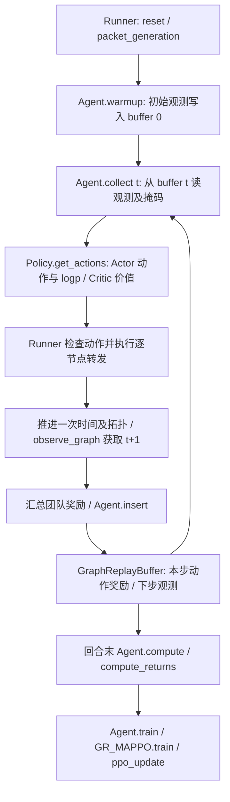

# 原 TG-MAPPO 观测、动作和 PPO 接口说明

本页保留第 2 步的基线接口核查。第 3 步新增的可选采集接口、场景种子与实际数据见
[原环境数据采集记录](TG_MAPPO_DATA_COLLECTION.md)；未指定新选项时维持本页基线行为。

核对日期：2026-11-02。对应 [实验进度](TG_MAPPO_EXPERIMENT_PROGRESS.md)第 2 步。
对象：`run_algorithm.py --algorithm tg-mappo`、`legacy_fixed_v1`、原浮标环境。
本次完成源码核对、真实张量探测、35 项回归及 2×80 时隙短训练；未修改基线算法和环境规则。

## 1. 真实调用流程

入口 [run_algorithm.py](../run_algorithm.py) 进入 [main.py](../src/buoy_network/main.py) 的 `main()`。
后者解析配置、创建原环境、构造一个共享的 `DeepQNetwork` 对象、创建各节点 Agent，再运行 Runner。
`DeepQNetwork` 是历史类名；当前 PPO 路径实际调用其 `policy`（`GR_MAPPOPolicy`）、`trainer`（`GR_MAPPO`）和 `GraphReplayBuffer`，不要因类名误认为此处运行的是 DQN 更新。



源码定位：

| 文件与函数 | 实际职责 |
|---|---|
| [environment.py](../src/buoy_network/environment.py)：observation、graph_observation、observe_graph | 普通观测、图特征、同一决策时刻快照 |
| environment.py：available_actions、active_masks | 合法动作集合、实际可决策节点 |
| [runner.py](../src/buoy_network/runner.py)：Runner._run | 统一时隙、固定待服务包、实际执行、奖励及训练调度 |
| environment.py：buoy_go、step_one_agent | 尝试传输、队列/成功率变化，封装节点奖励与观测 |
| [agent.py](../src/buoy_network/agent.py)：warmup、collect、insert、compute、train | 采样与缓冲区、回报及训练衔接 |
| [graph_MAPPOPolicy.py](../src/onpolicy/algorithms/graph_MAPPOPolicy.py)：get_actions、evaluate_actions | 调用 Actor/Critic；训练时重算采样动作概率 |
| [graph_actor_critic.py](../src/onpolicy/algorithms/graph_actor_critic.py)：GR_Actor、GR_Critic | 图编码、MLP、可选 RNN、动作分布和价值头 |
| [graph_buffer.py](../src/onpolicy/utils/graph_buffer.py)：insert、compute_returns、feed_forward_generator | 时序写入、GAE/回报、训练批次 |
| [graph_mappo.py](../src/onpolicy/algorithms/graph_mappo.py)：train、ppo_update | 优势归一化、PPO clip、熵、价值回归和优化器更新 |

重要：Runner 中 `self.env.step(actions_env)` 是注释。真实执行在 Runner 的逐节点循环中，通过 `buoy_go()`、`step_one_agent()` 和包对象操作完成。
`environment.step()` 保留的旧模板引用了这条路径未提供的接口，不能把它当成可直接用于数据采集的标准 gym step。

## 2. 观测的含义与信息范围

当前普通观测：`observation(agent) = concatenate(success_rate_neighbor, [agent.id])`。
25 节点时长度为 26，前 25 维为按节点槽位记录的链路成功率，最后一维是当前节点编号。
函数的旧注释提到速度/目标位置，和实际返回值不一致；本说明以执行代码为准。

每个图节点的 4 维特征为：

```text
[绝对 x, 绝对 y, 节点包计数 / max(初始生成包数, 1), 是否为 Sink]
```

图数据为全部节点的特征和距离矩阵，按每个 Agent 重复组织。当前没有研究参考环境中的 visible_mask，也没有对不可见节点逐项清零。
Actor 虽然按节点聚合图信息，仍不能据此把整条输入接口称为严格局部可见。
`adj` 在这里是欧氏距离矩阵；GNN 再按 `max_edge_dist=comm_range` 构边，不能将它直接解释成布尔邻接矩阵。

Actor 使用 `GNNBase → 拼接普通观测 → MLPBase → 可选 RNN → ACTLayer`。
Critic 使用独立网络及其图聚合配置。当前 `share_obs=obs`，不是额外拼接的全体普通观测；Critic 同时仍接收图输入。
当前运行默认 `use_recurrent_policy=false`；存在 RNN 状态接口不代表本次启用了策略 RNN。

## 3. 真实 shape、dtype 和设备

记 E=环境数，N=节点数。本次 E=1、N=25；表中均是一个时间点，尚未添加 Buffer 的时间维度。
已用现有 `tests/test_legacy_targeted_fixes.py` 的 `make_environment(length=4)`、`make_learner()` 构造原环境，执行 packet_generation、warmup、collect(0) 进行实际检查。
该探测使用静态拓扑、种子 0、T=4；同配置 T=80/移动节点 5 的训练另有下文独立证据，不混作同一次运行。

| 字段 | 本次 shape | dtype/设备 | 意义 |
|---|---|---|---|
| buffer.obs[t] | [1,25,26] | float32 / CPU | 普通观测 |
| buffer.share_obs[t] | [1,25,26] | float32 / CPU | 当前等于 obs |
| buffer.node_obs[t] | [1,25,25,4] | float32 / CPU | 每个 Agent 一份图节点特征 |
| buffer.adj[t] | [1,25,25,25] | float32 / CPU | 每个 Agent 一份距离矩阵 |
| buffer.agent_id[t]、share_agent_id[t] | [1,25,1] | int32 / CPU | 本节点索引；网络内转 long |
| buffer.available_actions[t] | [1,25,26] | float32 / CPU | 1 合法、0 非法 |
| buffer.active_masks[t] | [1,25,1] | float32 / CPU | 有非 WAIT 合法动作的节点 |
| buffer.masks[t] | [1,25,1] | float32 / CPU | 回合/循环状态边界 |
| collect 返回 values | [1,25,1] | float32 / CPU | Critic 输出；PopArt 开启时按其归一化约定解释 |
| collect 返回 actions | [1,25,1] | int64 / CPU | 采样的动作编号 |
| collect 返回 action_log_probs | [1,25,1] | float32 / CPU | 采样时旧 log probability |
| rnn_states / rnn_states_critic | [1,25,1,64] | float32 / CPU | 状态占位/可选循环状态 |
| collect 返回 actions_env | [1,25,26] | float64 / CPU | one-hot 表示，当前 Runner 执行使用 actions 编号 |
| buffer.actions[t] | [1,25,1] | float32 / CPU | 写入时转成 float32；编号必须仍为整数值 |
| buffer.rewards[t] | [1,25,1] | float32 / CPU | 同一份团队奖励复制给各节点 |

网络内部用 `np.concatenate` 去掉 E 的组织维度，默认得到每批 25 个 Agent 的输入。
本次探测 Actor 参数 21,956、Critic 参数 18,619，合计 40,575；历史包装类还存在其他未用于本 PPO 主干的网络，这不是包装类全部参数统计。
模型参数与内部计算实际设备为 CPU。原始环境 list/NumPy 返回值不保证与 Buffer 同 dtype，进入 Buffer 后按上表保存。

## 4. 动作、掩码、时间和包事件

动作 `0..N-1` 表示全局下一跳编号，`N` 表示 WAIT；N=25 时动作集合共 26 项。
自己、通信范围外节点被屏蔽，Sink/空队列节点仅允许 WAIT；WAIT 始终合法。
Runner 使用采样编号检查合法性，随后执行该编号，不再按邻居数取模或采样后强制直发。
`actions_mask_list` 是旧的逐节点执行记录；真正传入 Buffer 的合法动作掩码是 `available_tp1`，二者不能混用。

```text
warmup：obs[0]、node_obs[0]、adj[0]、available_actions[0]、active_masks[0]

时隙 t：
  collect 读取 obs[t]、available_actions[t]、masks[t] 等
  生成 action_t、old_logp_t、value_t
  执行当前时隙开始已固定的 FIFO 队首包
  新接收包排队，本时隙不再次转发
  等待计时、一次时间推进、必要的信道与位置/拓扑更新
  observe_graph 得到 obs_tp1，计算 available_tp1
  汇总 reward_t
  insert：action/logp/value/reward 写 t，观测/状态/掩码写 t+1
```

Buffer 的观测、价值和各状态掩码有 T+1 个时间点；动作、logp、奖励有 T 步。
`available_actions` 控制动作合法性，`active_masks` 控制有效决策样本统计，`masks` 控制回合边界/价值 bootstrap，不能互相替代。

当前 `terminal = (step == episode_length)`，本回合最后一步对所有节点设置 done，因而 `masks[T]=0`。
GAE 在末步关闭 bootstrap：计算过 next_value 也不代表末步使用了该价值。
这是当前固定有限回合的实现，不支持同一未结束任务跨独立 rollout 续采；`bad_masks` 没有携带完整截断语义。

`data_packet.life=80` 目前未在此主线中递减/触发 TTL 丢弃。原环境的“未投递”也不能直接解释成实际链路丢弃或 TTL 失败。
下一步先保存“未结束/待判定”状态；若引入真实 TTL 或任务截止失败语义，需明示规则并对所有组重跑基线。

## 5. 当前奖励和指标口径

本主线已有密集奖励，不是只有投递时才给奖：

- 非 WAIT 尝试有 step penalty（Runner 传 -35）和历史路径 `added_value` 奖励。
- 发送成功时还有向 Sink 距离改善项、接收节点相关链路丢包率统计的倒数项；失败时含 -0.5 项。
- WAIT/空队列等分支本次通常返回 0。最终 `reward_tmp=np.sum(reward_list)`，复制成每节点同一团队奖励后进入 PPO。
- `added_value` 位于回合循环外，会随已完成路径更新并跨回合保留；不能把带此历史信息的奖励误标成纯物理任务奖励。

后续导出需分别记录原始物理事件、旧密集项/历史路径项和新增 PM 项。原有奖励先命名为 `r_legacy` 或明确其组成，不能直接当作“稀疏任务 r_task”。
PM 的效果应通过同配置消融验证；已有密集奖励时是否还能改善学习，目前没有实验证据。

指标按 Runner 当前实现计算：

| 输出 | 实际口径 | 正式实验注意事项 |
|---|---|---|
| delivery_rate | `len(self.len) / env.packet_id` | self.len 在已投递包的历史结算完成后记录；是旧结算口径 |
| average_hops | `(sum(self.len) + T * 未计入投递数) / 生成包数` | len(route) 包括源节点；还含未投递惩罚，不是成功包真实跳数 |
| average_delay / average_q_time | `sum(self.q_time)/len(self.q_time)`，空时为 0 | q_time 来自包每次成功转移记录的 stay_time 合计；不能直接声称独立实测秒数 |
| temp_reward | 每个时隙团队 reward_tmp 的回合累计 | 不要把复制给 N 个节点后的 Buffer 求和再当作同一回合奖励 |

正式数据应新增按原始投递事件/生成终止时间计算的投递率、成功跳数 `len(route)-1`、时隙时延，以及未结束/截止失败/实际丢弃计数，保留旧列供历史对照。

## 6. WM 和 PM 的接入位置（设计，尚未实现）

### WM：collect 前计算，Actor 前融合，PPO 重算复用

1. 在决策时刻的同一份观测与历史上，冻结 WM 对合法候选动作预测，得到 `[E,N,N+1,F]` 特征。
2. 通过 `Agent.collect → Policy.get_actions → GR_Actor.forward` 传入，融合到原 TG 图/MLP 主干；无效候选屏蔽，WAIT 单独定义。
3. Buffer 缓存采样特征及 WM/归一化版本、当前掩码、旧 logp；扩充 minibatch、`Policy.evaluate_actions`、`GR_Actor.evaluate_actions` 的相同接口。
4. PPO 更新前验证概率比约为 1，更新期间 WM 权重不变；Actor 仍独立采样最终动作。

当前 Actor/Critic 信息范围与参数设置作为基线保留；如将输入改成严格局部可见，应作为全组统一变更单独记录。
WM 第 3 步先使用真实执行动作的转移作标签，其他未执行候选动作没有真实反事实标签。
拓扑预测应基于联合时隙末状态；业务标签则需记录逐包执行事件，避免把后来其它节点的动作影响错贴到当前发送上。

### PM：真实执行之后、insert/GAE 之前组合奖励

1. 任务开始时计算当前包历史的 Phi_t；时隙结束后，用截至 t+1 的真实事件历史计算 Phi_tp1。
2. 包级评分按约定聚合为团队势函数，`r_progress=alpha*(gamma*Phi_tp1-Phi_t)`；采用与 PPO 一致的 gamma。
3. 在 Runner 当前团队奖励汇总处，组成 `r_train=r_legacy+r_progress`，团队 PM 项只加一次，再按现有团队奖励接口写入 Buffer。
4. 单独保存 r_legacy、r_progress、r_train；Critic 和 GAE 使用 r_train，效果评估使用独立物理指标。
5. 真终止的势函数清零、纯 rollout 截断保留；PM 版本/归一化/alpha 在完整任务内固定。

第 3 步须先补齐包轨迹生命周期和结束原因。当前没有独立 PM 评分/特征字段；原 Runner 也没有完整归档已删除成功包的训练数据，不能直接开始 PM 训练。

## 7. 本次执行证据

代码分支 `experiment/tg-wm-pm`，HEAD `8f4ccaac4893bd0948193409d5f81dd00c1b048c`。
开始时算法源码相对该提交无修改；用户已有 README 删除、VDN 日志修改、虚拟环境和分析产物保持原状。

回归命令：

```powershell
& "D:\python3.6.8\python.exe" scripts/test_legacy_fixes.py --skip-smoke --output-root results/tg_step2_checks
```

结果：函数 16、模块 16、联调 3，合计 **35 通过，0 失败、0 错误、0 跳过**。
包含真实 Actor/Critic 参数更新、当前掩码的行为概率重放、全 WAIT 有限性等；并不代表未实现的 TTL/WM/PM 已验收。
报告：[test_report.json](../results/tg_step2_checks/20261102_223552_655180/test_report.json)。

独立短训练命令：

```powershell
& "D:\python3.6.8\python.exe" run_algorithm.py --algorithm tg-mappo --num_episodes 2 --episode_length 80 --num_env_steps 160 --ppo_epoch 1 --num_mini_batch 2 --num_moving_buoys 5 --output_root results/tg_step2_smoke
```

实际运行：25 节点，种子 0，移动节点配置 5，随机信道 true，CPU；2 回合、160 联合时隙，退出码 0。

| 回合 | delivery_rate | average_hops（旧） | average_delay（旧） |
|---|---:|---:|---:|
| 0 | 0.375 | 54.083333 | 29.285714 |
| 1 | 0.250 | 61.916667 | 31.750000 |

本次 CSV 与第 1 步短训练的数值相同，证明本配置复验一致；不证明收敛、多种子泛化或 GPU 性能。

- [本次环境及完整参数](../results/tg_step2_smoke/runs/20261102_223655_296563/moves_5/logs/TG_MAPPO_environment.json)
- [本次训练 CSV](../results/tg_step2_smoke/runs/20261102_223655_296563/moves_5/logs/TG_MAPPO_metrics.csv)

首次沙箱内测试在导入 SciPy `.libs` 时遭遇目录访问拒绝，未进入测试；在获准的沙箱外执行后通过。
CPU 环境中的 AMP/CUDA warning 表示自动关闭 CUDA AMP，不是测试失败；本次没有安装依赖或改变环境。

## 8. 完成结论与下一步

第 2 步已完成：真实调用流、字段/shape、掩码和时间对齐、奖励/指标口径、WM/PM 插入点均已记录，回归与同配置短训练通过。
无需为完成接口梳理而改动已经通过检查的基线算法。

下一步为第 3 步：**先设计并实现原环境的逐时隙快照与逐包事件导出，明确未结束、任务截止与 TTL 的标签语义，再采集少量完整回合并人工核验一条转移。**
优先处理：原有 dense/历史奖励分项、成功包删除前归档、未结束包状态、时间索引、跨回合历史与随机种子记录。
修改任务规则或种子机制时须升级环境说明并统一重跑对照基线，不能把这些修正记为创新收益。

## 9. 第 5 步接口更新（2026-11-03）

第 2 步以上内容保留作历史记录。现在原 TG `collect` 可在 Actor 前运行冻结 WM，候选特征为 `[1,25,26,3]`，buffer 为 `[T,1,25,26,3]`。
三个字段是 ACK 概率、发送/接收节点到下一联合时隙的队列占比变化；PPO minibatch 复用采样缓存。
Critic 输入和环境奖励维持原流程；PM 仍未实现。新增原 TG checkpoint 保存与独立冻结评估。
具体模块、约束、命令和 64 项验收证据见 [第 5 步接入说明](TG_MAPPO_WM_INTEGRATION.md)；当前接续步骤以[总进度](TG_MAPPO_EXPERIMENT_PROGRESS.md)为准。

## 10. 第 6 步接口更新（2026-11-03）

新增独立删失投递时间 PM，使用当前/过去包路径和可见图的 14 维特征，冻结后按初始包数聚合团队势函数。
原环境执行完 t→t+1 后，Runner 在广播奖励和调用 insert/compute 之前计算 `r_train=r_env+alpha*(buffer.gamma*Phi_tp1-Phi_t)`。
TG_PM_rewards.csv 保存分项；GAE/Critic 使用 r_train；原指标仍按环境结果。实际投递和完整任务终止将相应势函数置零。
不改变原始未结束标签，未实现真实失败分类或跨 rollout 延续；通用差分函数的截断边界已测。当前总计 76 项通过，见 [PM 接入说明](TG_MAPPO_PM_INTEGRATION.md)。
