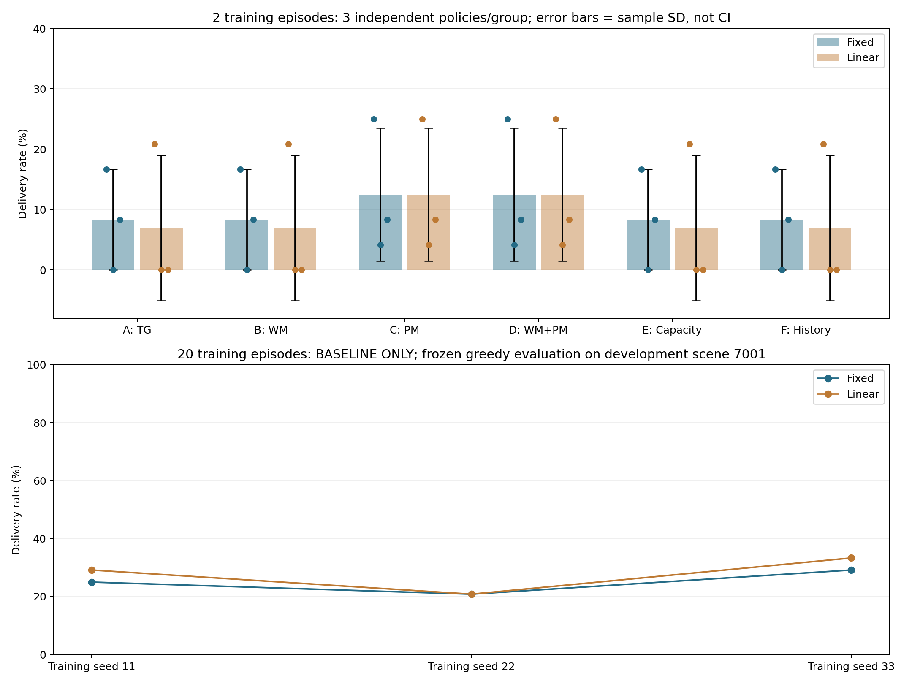

# TG-MAPPO 学习率开关修复与计划对照

日期：2026-11-03。接续 PopArt 修复；环境、task_v2、WM/PM 权重、PPO 损失与 greedy 口径均不变。

## 1. 原因与修复

原参数 `use_linear_lr_decay` 默认 false，但 Runner 每回合无条件调用 policy.lr_decay。
真实两回合探针中，false 也把 Actor/Critic 学习率从0.0005降到0.00025；冻结评估和不训练的规则采集也会执行该调用。

已改为：

- **关闭（默认）**：固定学习率，不调用衰减函数。
- **开启**：沿用原始公式 `initial - initial × (e/E)`，e为从0开始的回合编号。两回合为0.0005、0.00025；20回合最后为0.000025，不是0。
- **冻结评估/不训练的规则行为**：不调用调度，不改变优化器学习率，即使开关为true。
- Actor/Critic 初始学习率独立处理；每个PPO更新记录实际 actor_lr/critic_lr、损失及价值头Adam步数。
- checkpoint/训练报告保存 learning_rate_schedule；评估记录源模型计划与实际未变的优化器学习率。旧模型缺字段时保留null，不把旧flag=false误解释成旧模型实际用了固定计划。

实现：src/buoy_network/learning_rate.py、runner.py、agent.py、policy_artifacts.py；入口校验学习率须有限且非负。
训练实现标记为 **tg_ppo_v3_lr_switch**。旧checkpoint仍可冻结读取，仍不支持优化器断点续训。

这是公共训练配置bug修复，不是WM/PM创新收益；修正开关语义不保证某个计划一定提高投递率。

## 2. 配置与复现

原命令行是布尔开关：开启只写 `--use_linear_lr_decay`，关闭时省略；不要在其后添加true/false字符串。

实验工具新增严格 schema original_tg_ablation_v3，必须显式选 learning_rate_schedule=fixed或linear，六组统一使用该计划：

```powershell
& "D:\python3.6.8\python.exe" scripts/run_tg_ablation.py --mode run --config configs/tg_ablation_lr_fixed_pilot.json --output-root results/tg_ablation_lr_fixed_pilot
```

```powershell
& "D:\python3.6.8\python.exe" scripts/run_tg_ablation.py --mode run --config configs/tg_ablation_lr_linear_pilot.json --output-root results/tg_ablation_lr_linear_pilot
```

v1/v2旧套件创建新实验时，工具会显式加上线性开关，保留其历史**实际**计划。旧已归档任务仍从自己的不可变源码执行；接续不会改写其原命令/结果。
因此直接运行原CLI默认是固定，而旧schema套件按历史实际计划保持线性；建议后续实验统一使用v3显式配置。

```powershell
& "D:\python3.6.8\python.exe" scripts/test_tg_lr_schedule.py
```

```powershell
& "D:\python3.6.8\python.exe" scripts/probe_tg_lr_schedule.py
```

```powershell
& "D:\python3.6.8\python.exe" scripts/probe_tg_lr_schedule.py --linear
```

## 3. 分层测试与探针

新增函数4、模块2、原WM+PM联调2，共8项通过；原107项本轮全部重跑通过，合计 **115通过、0失败/错误/跳过**。
覆盖开关解析、独立Actor/Critic学习率、原线性公式/末端、边界错误、旧schema实际行为、真实训练日志/权重元数据、默认PopArt的WM+PM、冻结评估禁止调度/训练及旧模型计划未知标签。

有效探针：

| 运行 | 开关 | 两次更新实际Actor/Critic LR | 与修改前权重 |
|---|---|---|---|
| 修改前 | false | 0.0005 → 0.00025 | 原现场 |
| 修改后固定 | false | 0.0005 → 0.0005 | 预期改变 |
| 修改后线性 | true | 0.0005 → 0.00025 | Actor/Critic摘要完全相同 |

修改前也从上一轮不可变源码重放过，得到相同学习率和参数摘要，未伪造旧实现。
初次探针漏设n_rollout_threads=1，默认32环境导致800/25维度不匹配；已先说明原因并补齐配置，再重跑。该次是探针设置失败，未计作项目功能失败或有效实验；后续115项均通过。

实际报告/源码：

- 分层测试：results/tg_lr_tests/20261103_211043_507230/report.json。
- 原现场探针：results/tg_lr_before_probe/20261103_210617_338032。
- 归档旧源码重放：results/tg_lr_archived_before_probe/20261103_212454_557328。
- 新固定/线性探针：results/tg_lr_fixed_probe/20261103_211305_061773、results/tg_lr_linear_probe/20261103_211304_947267。

## 4. 同预算的六组三种子对照

两种计划各A–F六组、训练种子11/22/33、训练2×80、PPO每回合1 epoch×2 minibatch；冻结场景7001评估2×80。
共72个实际训练/评估任务；两套源文件快照相同，只有所选计划不同。两套同时运行，本轮不做运行速度比较。

- fixed：results/tg_ablation_lr_fixed_pilot/20261103_211528_024882。
- linear：results/tg_ablation_lr_linear_pilot/20261103_211525_205795。
- 旧线性对照：results/tg_ablation_popart_v2_pilot/20261103_200507_863382。

两回合冻结评估的结果（各训练种子分母48）：

| 组 | 固定计划seed11/22/33投递 | 固定均值±SD | 线性计划seed11/22/33投递 | 线性均值±SD |
|---|---|---|---|---|
| A 原TG | 8 / 0 / 4 | 8.33% ± 8.33% | 10 / 0 / 0 | 6.94% ± 12.03% |
| B TG+WM | 8 / 0 / 4 | 8.33% ± 8.33% | 10 / 0 / 0 | 6.94% ± 12.03% |
| C TG+PM | 12 / 2 / 4 | 12.50% ± 11.02% | 12 / 2 / 4 | 12.50% ± 11.02% |
| D TG+WM+PM | 12 / 2 / 4 | 12.50% ± 11.02% | 12 / 2 / 4 | 12.50% ± 11.02% |
| E Actor扩容 | 8 / 0 / 4 | 8.33% ± 8.33% | 10 / 0 / 0 | 6.94% ± 12.03% |
| F 历史特征 | 8 / 0 / 4 | 8.33% ± 8.33% | 10 / 0 / 0 | 6.94% ± 12.03% |

统计单位是独立训练策略n=3；SD不是置信区间。固定计划不是所有种子都好，WM仍无额外投递证据；相同投递数不代表完整动作/环路相同。
显式线性计划的18个训练模型Actor/Critic摘要与上轮全部相同，36份训练/评估物理JSONL逐字节一致，修复没有改写旧线性基线。
已核实：两种计划在E=2的前两次采样轨迹18/18完全相同；18/18最终参数不同。差别从最后一次PPO更新所用学习率开始，计划确实改变优化过程；全部实际学习率也核对通过。
两套各2880训练/2880评估联合时隙，共5760训练/5760评估；只是在开发场景做配置验收，没有启动正式性能实验。

## 5. 相同20回合的基线计划检查

额外只做A基线，固定学习率，三训练种子各20×80、PPO1×2，随后同场景冻结评估2×80。
与上一轮同预算的旧实际线性基线14/48、10/48、16/48对照；保留旧原始结果，不重新改写。
只检查计划影响，不与两回合WM/PM组混作创新对比。72任务中的显式线性与旧参数一致性用于确认公共学习器未发生额外数值变化。

实际目录 results/tg_lr_budget_fixed；三个训练/冻结评估全部完成：

| 训练种子 | 固定计划投递/48 | 旧实际线性计划投递/48 |
|---|---:|---:|
| 11 | 12 | 14 |
| 22 | 10 | 10 |
| 33 | 14 | 16 |

固定计划均值 **25.00% ± 4.17% 样本SD**；线性为 **27.78% ± 6.36%**，n=3。两种计划本次开发场景都没有零投递，但投递率仍低。
固定计划没有带来已证实的性能提升；不宣称差异显著，不据此认定任何计划全局最优。为衔接旧参考，下一阶段先明确使用linear计划，再单独检查PPO更新预算。
额外4800训练/480评估联合时隙，三个价值头各40次实际Adam步；旧线性20回合不重复训练。完整固定计划命令与源码位置见该目录commands.json。



## 6. 接续边界

已修复开关失效和冻结评估调度；仍需公平预算下检验学习效果。两回合只有4次优化器步，不能据此判断收敛或创新收益。
正式1000回合、预留盲测、冻结WM/PM重训、完整失败分类及可靠性门控均未启动/完成。窗口未完成仍是删失，不是新增真实丢包标签。
下一阶段应先选定显式计划，再一次只调整一个训练因素（如PPO更新预算），检查投递、Sink选择、主动WAIT和环路。

统一机器凭据：[TG_LR_SWITCH_FIX_20261103.json](evidence/TG_LR_SWITCH_FIX_20261103.json)。115项回归、72任务、18组旧参数一致性、36份旧物理日志一致性、三种子固定20回合、分项奖励/实际LR/冻结模型/接续新增任务0均通过。两套151文件源码快照相同，与当前工作代码字节核对一致。
大日志、权重、源码快照保留本地results；Git交付实现、配置、测试、文档、图和小型凭据。

2026-11-03后续单因素[PPO更新预算检查](TG_MAPPO_PPO_UPDATE_BUDGET.md)已完成：显式linear、20回合，仅A基线对照1/4遍。均值同为27.78%，4遍样本SD和环路更重，暂保留1遍参考。该结果不改写上表，不扩展成WM/PM收益结论。
