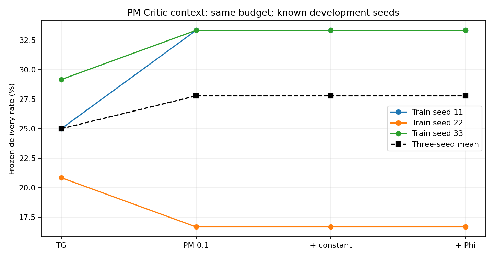

# PM Critic势值输入：梯度检查与候选验收

日期：2026-11-05至2026-11-06。接口实现及工程验收通过；额外收益和稳定性门槛失败。默认disabled，项目评分53/100保持。

## 梯度检查

接续[种子22更新追踪](TG_MAPPO_SEED22_UPDATE_TRACE.md)，在第4次更新前保存真实参数、Adam状态和minibatch。目录为 `results/tg_pm_gradient/20261105_233151_732256`。前2回合观测文件与历史逐字节一致；完整副本的裁剪梯度、更新后参数误差均为0，分量梯度重构误差4.10e-8。

固定节点13输入更新前P17−P19=-0.038788个百分点：

| 副本更新 | P17−P19变化（百分点） | 首选 |
|---|---:|---:|
| 完整梯度+原Adam历史 | +0.210417 | 17 |
| 仅节点13样本+历史 | +0.124239 | 17 |
| 仅其他节点样本+历史 | +0.150173 | 17 |
| 去掉熵项+历史 | +0.210088 | 17 |
| 当前梯度为零，仅历史 | +0.044832 | 17 |
| 完整梯度，重置Adam | +0.706708 | 17 |

这些副本没有执行替代动作。梯度裁剪和Adam分母会随消融改变，效果不可相加；不能将翻转唯一归因于其他节点、熵项或Adam。重置Adam在该批次上反而更偏17。真实重放160时隙/4次Actor更新，另有12个副本单步模拟，均不提供独立效果证据。

## 已实现的改进候选

PM势值依赖包路径与前缀隐状态，原Critic只看环境图，缺少当前塑形势值。新增可选当前Phi输入，让Critic有机会学习该回报差异。它提供一个标量，不代表完整PM隐状态、反事实信用或已证明的退化根因。

| 参数 `--pm_critic_context` | Critic新增输入 | 额外参数 |
|---|---|---:|
| disabled（默认） | 无，原路径 | 0 |
| constant | 恒为1，等容量控制 | 1 |
| potential | 当前决策时刻Phi_t | 1 |

仅用于PM-enabled、feedforward、learned_shaped；支持与WM Actor和Critic时钟组合。Actor输入、基础/塑形奖励、GAE公式和PPO预算均未修改。

输出头在构造Adam前增加零权重，旧权重、PopArt统计和RNG保留；训练中保持优化器参数引用。新增输入为学习特征，没有解析减去alpha*Phi或以PM替代V。disabled旧checkpoint兼容，不同context模式禁止混载。

动作前缓存Phi_t，环境推进后记录Phi_t+1，末端0；PPO使用对应决策索引的缓存，不重新推进PM。缺失、非有限、同一步被修改的值均拒绝。`pm_value_worker.py`和独立审计核对整个Phi缓存与GAE。

实现入口为原TG，模块见 `src/onpolicy/algorithms/utils/critic_progress.py`、原Critic/Policy/Buffer/Agent和checkpoint接口。

## 测试、失败及修复

- 新增7项函数/模块/真实联合PPO测试全部通过：RNG/PopArt优化器、参数合同、CLI白名单、缓存不可变、随机批次对齐、PM训练/保存/模式检查、WM+时钟+PM。
- 原131项回归通过；白名单修正后15项旧数据/入口回归重复通过，合计138项唯一测试。
- 首次实跑 `results/tg_pm_context/20261105_234332_068611` 因公开入口白名单漏项在训练前失败，交互0；先解释原因，再补白名单和入口测试。
- 校验器曾将历史缺省空 `pm_reliability_report` 误报为配置变化。已规范缺省值，复用完成训练，未重训。原错误及接续控制器指纹保留在manifest。
- 最终34个任务全部completed：6个默认精确兼容、4个启用模式短训练/冻结评估、6个完整训练、18个冻结评估。GAE最大独立重算误差2.47e-7，当前Phi缓存和末端0核对通过。
- 实现代码已暂存，最终验收文档已保存本地；Git提交自动审批连续两次超时，补充暂存也超时，尚未提交或推送。本轮状态不可写成已上传。

## 效果验收：没有额外收益

结果目录：`results/tg_pm_context/20261105_234440_358866`。alpha=0.1；训练11/22/33，各20×80、PPO1×2、固定LR、移动浮标5；冻结评估8001/8002/8003，各2×80。原TG和旧PM模型只读复用。

各数字为每场景投递/48，三个场景的投递相同，均值按训练种子计算：

| 模型 | seed11 | seed22 | seed33 | 平均投递 | 基础折扣回报 |
|---|---:|---:|---:|---:|---:|
| 原TG | 12 | 10 | 14 | 25.00% | -0.652453 |
| 旧PM alpha0.1 | 16 | 8 | 16 | 27.78% | -0.608630 |
| PM+constant | 16 | 8 | 16 | 27.78% | -0.608630 |
| PM+potential | 16 | 8 | 16 | 27.78% | -0.608630 |

两个新增模式各9份冻结物理指标文件逐字节等于旧PM。potential新权重确实学习到0.00842/0.00915/0.01114，训练seed33的物理结果也有变化，接口已进入学习；当前预算没有额外路由收益。

预定门槛要求potential平均投递/基础回报超过原TG、旧PM和constant，所有种子不低于TG且至少两种子胜出。超过控制的两个均值门槛、每种子不退化门槛均失败；seed22仍8/48，低于TG10/48。不推广默认，不宣称稳定提升。

新增训练10880、冻结评估3200，共14080联合时隙；另有上述梯度前缀160及微型测试。所有任务已结束，没有后台训练。已反复使用的开发数据不构成新盲测或长期收益证据。



[机器验收、测试和失败记录](evidence/TG_PM_CRITIC_CONTEXT_20261106.json)。只复核汇总、不训练：

```powershell
& "D:\python3.6.8\python.exe" scripts\analyze_tg_pm_context.py results\tg_pm_context\20261105_234440_358866
```

下一项先明确按服务包/动作对齐的局部PM辅助信用目标及其偏差，离线验证后再统一三种子实测；不继续微调本标量或按种子选alpha。本轮未实现局部辅助目标，长期预算、新种子泛化、因果信用和总成本优势仍未完成。
