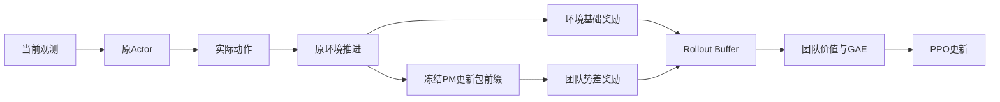
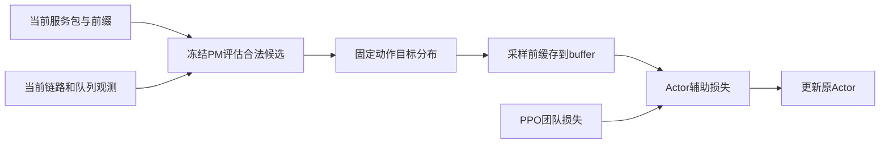

# 当前PM设计、稳定性问题与本轮修正

日期：2026-11-06。主线为原TG-MAPPO、原浮标环境与Python3.6环境；不改变环境动作、物理奖励或Actor架构。当前实跑：`results/tg_pm_action_credit/20261106_185235_592784`。效果验证进行中，不能写成已解决。

## 1. 现有PM是什么

PM是独立的、冻结的包前缀预测器。每个包每个时隙输入14维特征，按时间经过GRU保存该包自己的历史；不是Actor内部的一层网络。

| 部分 | 当前实际实现 |
|---|---|
| 输入 | 到Sink距离、自身队列、邻居平均队列、最佳邻居距离、最佳/平均链路统计、度数、已过/剩余窗口、跳数、回访比例、等待时长、邻居变化、Sink队列 |
| 网络 | 14→32 Tanh→64 GRU→80个hazard logits，24496参数 |
| 原始输出 | 未来每一个偏移时隙的条件送达hazard，sigmoid后可得到送达时间分布 |
| 使用输出 | 剩余窗口内送达概率、预期投递/等待/窗口未完成回报，以及团队Phi |
| 训练 | 原环境随机/地理规则/TG轨迹的包级监督预训练；576训练包、144验证包，训练场景0/1/2/3，验证101 |
| 标签 | 真实送达时间；到窗口结束尚未送达记右删失，不能伪造为最终失败 |
| 选择结果 | 验证NLL 2.0933→1.3758，Brier 0.2140→0.07316，第29轮选模 |
| RL阶段 | checkpoint冻结，归一化冻结，每回合清空包历史，不用PPO反向更新PM |

对应文件：`progress_model.py`、`progress_runtime.py`、`pm_return.py`。当前模型仍来自`results/tg_pm_final_pretrain/20261103_142745_276042/pm_best.pt`，SHA256为`f62f05b520cbaf665823ce38981c6c88f5e4f816dc01f85d3149aca7d3f81240`。

这种监督预训练可以通俗理解为先教PM预测“这个包接下来大约能否、何时送达”。它没有动作条件Q头、真实最终失败分类或有效不确定性保证；预训练误差降低不等于路由策略必然变好。

## 2. 它原来怎样作用于PPO

当前task_return模式把送达时间分布换算成该包的剩余折扣任务回报U_p，再汇总：
`Phi_t=sum(U_p for unfinished packets)/initial_packet_count`。
窗口末端Phi=0，`r_train=r_env+alpha*(gamma*Phi_next-Phi_now)`。

位置是“环境执行动作后→计算训练奖励→buffer→团队GAE→PPO”。Actor推理仍直接使用原观测；Critic估计该训练回报的价值。

已有三个potential模式：remaining、completion_credit、task_return；后者修正了与有限任务回报的语义对应。已有learned_shaped与base_residual两种价值坐标；base_residual解析消去势差，等于基线的安全控制，不提供额外PM收益。增加Critic势值输入的候选已验证无额外收益，默认仍关闭。

## 3. 已证实的问题和未证实的原因

- 团队塑形把所有包混成一个标量，不能直接告诉节点“你选17比19更差”。种子22坏首跳已有负的包级PM分量，团队优势仍可能为正。
- 完整任务的势差折扣和为-alpha*Phi_0。它可以改变有限样本学习信号，但不会凭空创造更优任务目标，也不保证PPO更快或更稳定；GAE时间/价值恒等式已反复实测通过。
- 冻结PM拟合的是原采集行为分布，在当前策略的长环路状态上可能存在分布偏移。初始MSE校准门控、调小alpha、加入Critic标量都没有解决全部种子退化。
- 种子22第4次更新的副本中，自身样本、其他节点和Adam历史分别都能翻转17/19，去熵影响小。因此不能把某一项当作唯一根因，直接重置Adam或反转GAE。

研究依据：[potential shaping原论文](https://people.eecs.berkeley.edu/~pabbeel/cs287-fa09/readings/NgHaradaRussell-shaping-ICML1999.pdf)、[COMA信用分配原论文](https://arxiv.org/abs/1705.08926)。本项目新评分不是COMA的真实联合Q，也不具有该方法的无偏性结论。

## 4. 本轮新增：PM候选动作辅助训练

对当前节点待服务包的每个合法动作，使用“已观测ACK概率”和冻结PM，计算近似的一步候选分数：

`q_hat_i(a) = E[该包本步任务奖励 + gamma*U_p(假设执行a后的前缀)]`。

成功/失败两种结果分别计算；送到Sink后未来值为0，并显式计入即时送达奖励；末端未完成成本按原task_v2合同计算。未来位置、其他包队列和链路保持当前观测，只调整本包自己的假设转移。没有使用下一时隙真值、实际未来ACK或额外环境交互。

在冻结PM副本式前向中批量评估候选，保持PM隐状态、原环境、模型权重和所有RNG不变。所得分数不是精确因果反事实，只是近似模型预测。

固定温度0.2得到合法动作分布 `p_teacher=softmax(q_hat/0.2)`，训练目标为：
`L_actor = L_PPO + 0.1*CE(p_teacher, pi_actor)`。
原团队奖励、GAE和Critic目标保留，训练中不覆盖采样动作。辅助系数固定、所有种子相同，属于有偏的模型辅助目标，不能宣称仍严格保持原最优策略不变。

部署/冻结评估时使用训练后的原Actor，无需候选评分来覆盖动作。新方法增加训练时模型查询，不增加可训练参数；额外推理成本必须记录，不能当成免费收益。

新增接口：
- `--pm_action_credit disabled|zero_model|learned`，默认disabled。
- `--pm_action_credit_coef 0.1`，0时精确恢复原更新。
- `--pm_action_temperature 0.2`。

zero_model是“仅即时包奖励的动作指导”控制：候选分数的未来PM值置0，仍保留相同的全局PM奖励和辅助训练结构。它不是把项目的PM全部关闭。learned与它的差异才能反映候选未来回报预测是否提供额外作用。

## 5. 验证与通过标准

已完成：8项新函数/模块/PPO测试 + 原131项 + 上轮Critic接口7项，共146项；冻结检查160时隙、1360条活跃决策，PPO0、权重/物理指标不变。同输入下，18/19均高于17，候选排序门槛通过。

实跑先验证6个旧默认短训练、一个辅助系数0的精确恢复，再做两个模式的短训练/保存/冻结评估。随后在11/22/33各训练20回合，固定80时隙、PPO1×2、相同学习率、移动浮标5、相同环境；每个模型冻结评估8001/8002/8003各2回合。

预定开发门槛：learned平均投递超过旧PM和zero_model、至少比TG高5个百分点；每个种子不低于TG和旧PM，至少两个种子超过旧PM。

只有开发通过，才使用预先固定的新训练种子1041/1042/1043/1044/1045与新场景9101/9102/9103，匹配TG、即时奖励指导控制及learned三个组，每组每种子同为20回合。要求5个learned均严格超过TG、均不低于控制，平均超过控制且至少比TG高5个百分点。

统计单位为训练种子；多个评估场景只在种子内平均，不算新增独立样本。长期预算、其他规模拓扑、真实失败分类和不确定性仍是单独未完成项。最终结论以manifest与独立验收结果为准，当前不提前宣布稳定提升。
