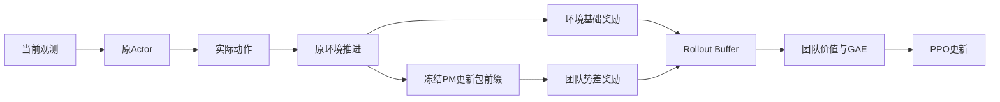
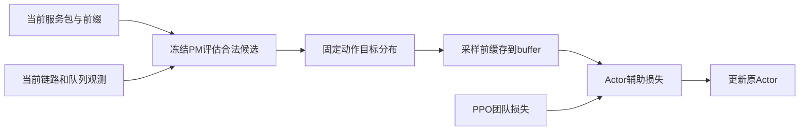

# 当前PM设计、稳定性问题与本轮修正

日期：2026-11-06。主线为原TG-MAPPO、原浮标环境与Python3.6环境。v1与v2均已完成，严格稳定性失败；已定位次优WAIT在期望差距辅助项中仍可获得正信用的机制。v3改用近优动作集合似然，三种子开发平均92.82%（TG25.00%），157项测试及35任务通过，结果在`results/tg_pm_action_credit/20261106_223635_825199`。本轮已结束；新种子留出未运行，不能写成稳定提升最终解决，默认仍关闭辅助模块。

| 版本 | 主PPO价值/优势 | Actor辅助项 | 验收状态 |
|---|---|---|---|
| 旧PM参照（task_return、alpha=0.1） | 团队塑形回报、learned_shaped | 无 | 开发均值27.78%，部分种子退化 |
| v1 | 团队塑形回报、learned_shaped | 软目标交叉熵 | 新种子均值62.36%，1042退化，严格稳定性失败 |
| v2 | 基础任务回报、base_residual | 预测动作差距 | 新种子均值30.00%，两种子退化，严格失败 |
| v3 | 基础任务回报、base_residual | 近优动作集合似然 | 三种子开发92.82%通过；新种子封存，稳定性未最终验收 |

## 1. 现有PM是什么

PM是独立的、冻结的包前缀预测器。每个包每个时隙输入14维特征，按时间经过GRU保存该包自己的历史；不是Actor内部的一层网络。

| 部分 | 当前实际实现 |
|---|---|
| 输入 | 到Sink距离、自身队列、邻居平均队列、最佳邻居距离、最佳/平均链路统计、度数、已过/剩余窗口、跳数、回访比例、等待时长、邻居变化、Sink队列 |
| 网络 | 14→32 Tanh→64 GRU→80个hazard logits，24496参数 |
| 原始输出 | 未来每一个偏移时隙的条件送达hazard，sigmoid后可得到送达时间分布 |
| 使用输出 | 剩余窗口内送达概率、预期投递/等待/窗口未完成回报，以及团队Phi |
| 训练 | 原环境随机/地理规则/TG轨迹的包级监督预训练；576训练包、144验证包，训练场景0/1/2/3，验证101 |
| 标签 | 真实送达时间；到窗口结束尚未送达记右删失，不能伪造为最终失败 |
| 选择结果 | 验证NLL 2.0933→1.3758，Brier 0.2140→0.07316，第29轮选模 |
| RL阶段 | checkpoint冻结，归一化冻结，每回合清空包历史，不用PPO反向更新PM |

PM实现的职责分工：

| 文件 | 职责 |
|---|---|
| `src/buoy_network/progress_model.py` | 包前缀特征、GRU hazard网络、监督训练与验证 |
| `src/buoy_network/progress_runtime.py` | 冻结加载、每个包的隐状态、真实转移后的势值与边界审计 |
| `src/buoy_network/pm_return.py` | 将送达时间分布换算成有限窗口的任务回报U |
| `src/buoy_network/pm_action_credit.py` | 在当前观测上评估合法动作假设，生成固定训练目标 |
| `src/onpolicy/algorithms/utils/pm_action_loss.py` | 各版本辅助损失、模式校验和目标梯度 |
| `src/onpolicy/utils/graph_buffer.py` | 按原时隙/节点缓存目标、掩码与小批次对应关系 |
| `src/buoy_network/agent.py`、`src/onpolicy/algorithms/graph_mappo.py` | 采样/价值坐标、PPO与Actor辅助损失的实际接入 |
| `run_algorithm.py --algorithm tg-mappo` | 原环境和原TG训练/冻结评估的主入口 |

PM换算的包级U不是当前PPO Critic的团队V：前者是固定行为数据训练出的预测，后者随当前策略学习真实环境任务回报。当前候选沿用原Actor输入和参数规模。

对应文件：`progress_model.py`、`progress_runtime.py`、`pm_return.py`。当前模型仍来自`results/tg_pm_final_pretrain/20261103_142745_276042/pm_best.pt`，SHA256为`f62f05b520cbaf665823ce38981c6c88f5e4f816dc01f85d3149aca7d3f81240`。

原PM训练/验证的15份数据共2400环境时隙，是已有的离线数据成本，须与本轮PPO在线交互分开报告；目前不能宣称总数据效率优于纯在线TG。

这种监督预训练可以通俗理解为先教PM预测“这个包接下来大约能否、何时送达”。它没有动作条件Q头、真实最终失败分类或有效不确定性保证；预训练误差降低不等于路由策略必然变好。

## 2. 它原来怎样作用于PPO

当前task_return模式把送达时间分布换算成该包的剩余折扣任务回报U_p，再汇总：
`Phi_t=sum(U_p for unfinished packets)/initial_packet_count`。
窗口末端Phi=0，`r_train=r_env+alpha*(gamma*Phi_next-Phi_now)`。

位置是“环境执行动作后→计算训练奖励→buffer→团队GAE→PPO”。Actor推理仍直接使用原观测；Critic估计该训练回报的价值。



已有三个potential模式：remaining、completion_credit、task_return；后者修正了与有限任务回报的语义对应。已有learned_shaped与base_residual两种价值坐标；base_residual解析消去势差，等于基线的安全控制，不提供额外PM收益。增加Critic势值输入的候选已验证无额外收益，默认仍关闭。

## 3. 已证实的问题和未证实的原因

- 团队塑形把所有包混成一个标量，不能直接告诉节点“你选17比19更差”。种子22坏首跳已有负的包级PM分量，团队优势仍可能为正。
- 完整任务的势差折扣和为-alpha*Phi_0。它可以改变有限样本学习信号，但不会凭空创造更优任务目标，也不保证PPO更快或更稳定；GAE时间/价值恒等式已反复实测通过。
- 冻结PM拟合的是原采集行为分布，在当前策略的长环路状态上可能存在分布偏移。初始MSE校准门控、调小alpha、加入Critic标量都没有解决全部种子退化。
- 种子22第4次更新的副本中，自身样本、其他节点和Adam历史分别都能翻转17/19，去熵影响小。因此不能把某一项当作唯一根因，直接重置Adam或反转GAE。

研究依据：[potential shaping原论文](https://people.eecs.berkeley.edu/~pabbeel/cs287-fa09/readings/NgHaradaRussell-shaping-ICML1999.pdf)、[COMA信用分配原论文](https://arxiv.org/abs/1705.08926)。本项目新评分不是COMA的真实联合Q，也不具有该方法的无偏性结论。

## 4. 第一轮候选（v1）：PM候选动作辅助训练

对当前节点待服务包的每个合法动作，使用“已观测ACK概率”和冻结PM，计算近似的一步候选分数：

`q_hat_i(a) = E[该包本步任务奖励 + gamma*U_p(假设执行a后的前缀)]`。

成功/失败两种结果分别计算；送到Sink后未来值为0，并显式计入即时送达奖励；末端未完成成本按原task_v2合同计算。未来位置、其他包队列和链路保持当前观测，只调整本包自己的假设转移。没有使用下一时隙真值、实际未来ACK或额外环境交互。

在冻结PM副本式前向中批量评估候选，保持PM隐状态、原环境、模型权重和所有RNG不变。所得分数不是精确因果反事实，只是近似模型预测。

固定温度0.2得到合法动作分布 `p_teacher=softmax(q_hat/0.2)`，训练目标为：
`L_actor = L_PPO + 0.1*CE(p_teacher, pi_actor)`。
原团队奖励、GAE和Critic目标保留，训练中不覆盖采样动作。辅助系数固定、所有种子相同，属于有偏的模型辅助目标，不能宣称仍严格保持原最优策略不变。



部署/冻结评估时使用训练后的原Actor，无需候选评分来覆盖动作。新方法增加训练时模型查询，不增加可训练参数；额外推理成本必须记录，不能当成免费收益。

新增接口：
- `--pm_action_credit disabled|zero_model|learned`，默认disabled。
- `--pm_action_credit_coef 0.1`，0时精确恢复原更新。
- `--pm_action_temperature 0.2`。

zero_model是“仅即时包奖励的动作指导”控制：候选分数的未来PM值置0，仍保留相同的全局PM奖励和辅助训练结构。它不是把项目的PM全部关闭。learned与它的差异才能反映候选未来回报预测是否提供额外作用。

## 5. 验证与通过标准

v1启动前已完成9项新函数/模块/PPO测试 + 原131项 + 上轮Critic接口7项，共147项；冻结检查160时隙、1360条活跃决策，PPO0、权重/物理指标不变。同输入下，18/19均高于17，候选排序门槛通过。

实跑先验证6个旧默认短训练、一个辅助系数0的精确恢复，再做两个模式的短训练/保存/冻结评估。随后在11/22/33各训练20回合，固定80时隙、PPO1×2、相同学习率、移动浮标5、相同环境；每个模型冻结评估8001/8002/8003各2回合。

预定开发门槛：learned平均投递超过旧PM和zero_model、至少比TG高5个百分点；每个种子不低于TG和旧PM，至少两个种子超过旧PM。

只有开发通过，才使用预先固定的新训练种子1041/1042/1043/1044/1045与新场景9101/9102/9103，匹配TG、即时奖励指导控制及learned三个组，每组每种子同为20回合。要求5个learned均严格超过TG、均不低于控制，平均超过控制且至少比TG高5个百分点。

统计单位为训练种子；多个评估场景只在种子内平均，不算新增独立样本。长期预算、其他规模拓扑、真实失败分类和不确定性仍是单独未完成项。最终结论以manifest与独立验收结果为准，当前不提前宣布稳定提升。

## 6. 第一轮实际验收：均值改善，逐种子稳定性失败

v1目录：`results/tg_pm_action_credit/20261106_185235_592784`。95任务全部成功，独立验收工程通过、开发通过、新种子稳定性不通过；报告`acceptance.json`，仓库证据[JSON](evidence/TG_PM_ACTION_TEACHER_V1_20261106.json)、[图](evidence/TG_PM_ACTION_TEACHER_V1_20261106.png)。

| 范围/方法 | 平均投递率 | 平均基础折扣任务回报 |
|---|---:|---:|
| 开发 TG（3种子） | 25.00% | -0.652453 |
| 开发旧PM | 27.78% | -0.608630 |
| 开发仅即时指导 | 41.67% | -0.364343 |
| 开发PM软目标 | 49.77% | -0.222466 |
| 新种子 TG（5种子） | 25.00% | -0.685855 |
| 新种子仅即时指导 | 19.17% | -0.747758 |
| 新种子PM软目标 | 62.36% | 0.026090 |

| 新训练种子 | TG | 仅即时指导 | PM软目标 |
|---|---:|---:|---:|
| 1041 | 12.50% | 12.50% | 41.67% |
| 1042 | 87.50% | 20.83% | 83.33% |
| 1043 | 0.00% | 29.17% | 49.31% |
| 1044 | 12.50% | 12.50% | 95.83% |
| 1045 | 12.50% | 20.83% | 41.67% |

种子1042在每个评估场景均少2/48包，严格门槛失败；不能用总体均值掩盖。场景9101首回合TG/PM回访转发为0/63，基础回报均值0.356525/0.352048。另一项只读回放确认种子22包13已从旧PM的13→17→12↔17改为13→19→24，两回合均送达；这是一个已修复案例，不代表全部环路消失。

本轮新训练35040时隙、评估10400时隙，另有两个160时隙只读检查（排序门槛与路由回放），均不执行PPO。既有PM离线2400时隙单列。20回合训练壁钟均值：新种子TG185.6秒、即时指导218.9秒、PM软目标243.6秒；后者约增加31.3%，受本机负载影响。

验收脚本首次执行因Python3.6没有datetime.fromisoformat而失败；改用strptime后独立审计通过，未重训或改动历史结果。

## 7. 修正版v2：基础奖励坐标与预测动作差距（已完成，效果失败）

首先明确原因的证据边界：交叉熵存在可证明的反向作用，但不能单凭它断定1042全部退化的唯一成因；PM近似预测误差、状态分布偏移和共享Actor更新仍可能影响。

1. 主PPO使用`base_residual`。Critic原始输出和PopArt目标保持基础奖励坐标；有效塑形价值为`V_base-alpha*Phi`，势差在TD/GAE中解析消去。保留塑形日志用于审计，实际优势与基础奖励精确对应，不再让全局Phi误差进入主GAE。系数0的真实短训权重、损失与TG精确一致。
2. 辅助项由交叉熵改为最小化预测动作差距：
   `L_aux=sum_a pi(a)*(q_max-q_hat(a))/temperature`。
   仍缓存`softmax(q_hat/temperature)`，用log概率差恢复差距；目标冻结。总损失`L_actor=L_PPO+0.1*L_aux`。
3. 梯度等价于按`q_hat(a)-E_pi[q_hat]`提升预测更好的动作。已经很确信优选动作时，仍鼓励该动作；交叉熵则可能因Actor概率高于软目标而降低它。手算梯度与自动微分一致。评分全相同时辅助梯度为0，不强迫Actor变均匀。
4. 对照使用`zero_regret`，将候选的未来PM回报置0；候选用`learned_regret`，其他参数相同。普通PM全局势差在两组的主GAE均被消去，因此候选相对对照的差异来自冻结PM的未来动作评分。

v2的一条训练样本除原观测、动作、旧log概率/价值、环境奖励和下一观测外，还带有采样前冻结的`pm_action_targets_t`。主GAE使用`r_env`；Actor的PPO损失再加动作差距辅助项，Critic不回归辅助项。候选评分虽然先于本次动作计算，但不作为Actor输入、不覆盖采样动作；只在更新参数时产生辅助梯度。冻结评估不分配训练标签缓存，也不计算候选动作分数；仍运行PM用于势差/基础回报审计，因此不能宣称整体评估零开销。诊断工具另作只读候选重算，不改变原Actor的动作。

新接口支持`disabled|zero_model|learned|zero_regret|learned_regret`；旧cross_entropy模式保留用于复现。基础奖励价值坐标不构成额外收益，只有辅助预测通过对照才可计作PM贡献。当前`pm_reward_alpha`控制审计用势差，并在主GAE中抵消；真正控制新辅助梯度的是`pm_action_credit_coef`和`pm_action_temperature`，不能再用调alpha替代这个实验。本轮没有重训PM或增加离线数据，始终使用同一个冻结checkpoint。仍是有偏近似目标，不提供任意场景或每个种子必胜保证。

已完成153项唯一测试：原131项、Critic接口7项、动作辅助15项。最近凭证：`results/tg_pm_reliability_tests/20261106_195340_513762/report.json`及`results/tg_pm_action_credit_tests/20261106_211348_818103/report.json`；15项覆盖手算梯度、0系数精确恢复、目标与时序掩码、PM/RNG冻结、真实PPO/保存重载和WM+时钟+Critic上下文联调。

补充修复：极低温度使合法软目标概率下溢为0时，原差距损失会漏罚对应动作；最小复现先失败，现明确报错并提示增大温度。同时保留极小正概率的真实log差值，去掉1e-30截断偏差。[新测试及失败复现凭证](evidence/TG_PM_ACTION_REGRET_GUARD_TESTS_20261106.json)。运行中的v2冻结源码不改；独立验收另检查所有合法缓存概率均>=1e-30，证明固定温度0.2未触发此问题，补丁在这些缓存上数值等价。

v2开发仍用已知11/22/33与8001/8002/8003；开发门槛不放宽。只有开发通过才解封预先固定的新训练种子2041–2045与场景9201–9203，避免把已见1041–1045当新留出集。各组统一20回合、80时隙、PPO1×2、固定学习率、系数0.1、温度0.2，不按种子选参数或挑版本。基础任务回报附加门槛已在开始时记录；最终以该目录manifest与独立acceptance为准。

v2三种子开发为42/48、28/48、16/48，平均59.72%，基础任务折扣回报均值-0.087568（TG -0.652453、旧PM -0.608630、即时对照-0.650936）；开发门槛通过，已开始预定新种子。已知失败种子1042另由`scripts/run_tg_pm_known_case.py`顺序执行回归，已完成，见第8节。回归要求三个旧场景逐个不低于TG、基础回报均值不低于TG；它是已知案例，不算新留出种子。计划为v2目录中的`known_case_regression_plan.json`，状态为`known_case1042/manifest.json`。

v2已结束，结果见第8节；以下是只读复核命令（当前接续入口为第9节v3）：
```powershell
& "D:\\python3.6.8\\python.exe" scripts/analyze_tg_pm_action_credit.py results/tg_pm_action_credit/20261106_204430_204518
```
长期预算、跨拓扑泛化、真实失败分类、可靠性与数据效率仍需后续独立实验；本轮不调整历史项目评分。

## 8. v2最终验收与定点诊断：已知案例修好，稳定性仍失败

v2的95任务、已知1042回归4任务和2042只读诊断3任务均已结束。独立工程审计通过，基础任务回报均值门槛通过，严格稳定性与额外投递收益失败，不推广。证据：[验收JSON](evidence/TG_PM_ACTION_REGRET_V2_20261106.json)、[图](evidence/TG_PM_ACTION_REGRET_V2_20261106.png)。

| 新训练种子 | TG | 即时指导zero_regret | PM learned_regret |
|---|---:|---:|---:|
| 2041 | 34.72% | 45.83% | 45.83% |
| 2042 | 50.00% | 54.17% | 37.50% |
| 2043 | 12.50% | 20.83% | 33.33% |
| 2044 | 29.17% | 16.67% | 20.83% |
| 2045 | 12.50% | 12.50% | 12.50% |
| 平均 | 27.78% | 30.00% | 30.00% |

基础任务折扣回报均值TG/即时/PM为-0.580249/-0.543984/-0.530316。投递方面2042、2044下降，2045持平；PM与即时平均相同，相对TG只高2.22个百分点，未达到预定5个百分点。不能把开发59.72%当作新种子收益。

旧失败种子1042：v1为40/48，v2为42/48，与TG42/48相同；基础回报0.379944超过TG0.356525，已知案例回归通过。这个局部修复不能覆盖新种子的失败。

只读回放目录`v2/action_diagnosis_2042`：三组均精确复现原物理日志，Actor/Critic/PM权重不变、PPO0。PM两回合仅送达18包，TG24包、即时26包；回访转发123/145/279次，不能用“PM环路更多”解释少送达。PM出现1454次服务队头WAIT，其中1423次PM候选最高分其实是转发；节点1/2/3/4/7/10/14/15/20的队头各连续等待160个决策（两回合）。

已确认的目标机制：expected_regret梯度按`q(a)-E_pi[q]`计算。某动作低于最佳、却高于平均时，它的原始logit也会被辅助项抬高。实际初始失败状态9个WAIT节点中有8个满足该条件；全回放1454个WAIT状态中400个存在这种辅助logit方向。不是说所有PPO/Adam退化都由这一项独立造成，也不是认定PM的所有排序正确。[实际状态的梯度反例](evidence/TG_PM_ACTION_WAIT_GRADIENT_20261106.json)。

v2及补充回归/诊断共训练36640、评估11360联合时隙；额外诊断单步采集没有推进环境或执行PPO。157项测试另按微型测试计，不混入正式实验预算。诊断工具曾因Actor返回三项、评估不分配训练标签缓存而在接口检查中暴露问题；已修正为三项解包与只读候选重算，单步检查和完整三组精确回放均通过。

## 9. v3候选：近优动作集合似然（三种子开发已完成）

本轮完成目录：`results/tg_pm_action_credit/20261106_223635_825199`。新方法保留base_residual与同一个冻结PM；只替换可关闭的Actor辅助项。157项唯一测试和35任务已通过，开发结果见第10节；留出未运行，不能称为稳定提升最终解决。

在采样前缓存的PM分布上确定冻结集合：
`G={合法a: log(p_teacher_max)-log(p_teacher_a)<=0.1}`。
固定温度0.2时，等价于`q_max-q(a)<=0.02`的近优动作。辅助损失：
`L_set=-log(sum(pi(a) for a in G))`，总Actor损失仍为`L_PPO+0.1*L_set`。

这样不再要求Actor模仿整个软分布，也不再提升所有高于平均分的动作。对集合外动作，原始logit梯度为正；集合内为非正。在独立logit下降中，集合外WAIT相对每个近优动作的赔率下降；已经以近优动作为最高概率的策略不会被迫变回软目标。概率归一化、共享网络、PPO/熵与Adam仍会影响实际更新，因此不能把局部梯度性质写成策略必然不退化。PM自身近优集合也可能错误，效果必须实跑。

新增模式`zero_set|learned_set`，固定log分数带宽0.1，系数0.1、温度0.2。即时对照只保留包级即时任务奖励评分；PM候选才加入冻结模型未来回报，其他设置一致。环境动作/WAIT、Actor/Critic可训练参数和PPO更新次数保留原配置。

157项包括原131项、Critic接口7项、动作辅助19项。新项覆盖：高于平均但次优WAIT的梯度方向、近优并列动作与已正确高信心动作、极低好动作概率的有限梯度、0系数精确恢复TG、真实PPO/保存重载及WM分支。[测试凭证](evidence/TG_PM_ACTION_SET_TESTS_20261106.json)。

本轮按此前用户选择的三种子短预实验预算执行，已完成11/22/33各20回合及三场景冻结评估；3041–3045与9301–9303已预先登记并继续封存，开发通过也不自动启用。后续开启留出集时可使用既有训练checkpoint，不重复前35个任务：

```powershell
& "D:\\python3.6.8\\python.exe" scripts/run_tg_pm_action_credit.py --continue-holdout results/tg_pm_action_credit/20261106_223635_825199
```

本轮训练已结束，禁止重复启动创建实验。复核已完成任务的只读审计：

```powershell
& "D:\\python3.6.8\\python.exe" scripts/analyze_tg_pm_action_credit.py results/tg_pm_action_credit/20261106_223635_825199
```

未完成：v3新种子留出与已知病例回归、长期预算、跨拓扑规模、地理规则教师对照、真实失败分类与可靠性、总数据效率及完整WM+PM消融。历史项目评分53保持。

## 10. v3短开发最终结论与接续

本轮已结束，没有本轮后台训练。独立审计：工程通过、开发门槛通过、基础任务回报门槛通过；留出集未运行。报告字段为`holdout_gate_passed=null`、`stability_status=holdout_not_run`，不能解释成新种子已通过，也不是一次新种子效果失败。

[验收JSON](evidence/TG_PM_ACTION_SET_V3_20261106.json)、[开发结果图](evidence/TG_PM_ACTION_SET_V3_20261106.png)。实际模型、完整日志、源码快照及完整`acceptance.json`保存在`results/tg_pm_action_credit/20261106_223635_825199`。

每个模型训练20×80=1600联合时隙，Actor/Critic各40次Adam更新；学习率、环境、原Actor/Critic可训练规模保持一致。冻结贪心评估8001/8002/8003各2回合：

| 训练种子 | TG | 旧PM alpha0.1 | 即时指导zero_set | 新PM learned_set |
|---|---:|---:|---:|---:|
| 11 | 25.00% | 33.33% | 20.83% | 86.81%（45/39/41包） |
| 22 | 20.83% | 16.67% | 12.50% | 100.00%（48/48/48包） |
| 33 | 29.17% | 33.33% | 34.03% | 91.67%（44/44/44包） |
| 平均 | 25.00% | 27.78% | 22.45% | 92.82% |

括号内为三个场景各48个初始包中的投递数。统计单位仍是3个训练种子，不能把9个场景结果当9个独立训练种子。三种子样本SD：TG4.17、旧PM9.62、即时10.85、新PM6.67个百分点。基础任务折扣回报均值依次为-0.652453/-0.608630/-0.702068/0.438483。

35个实跑任务和157项唯一函数/模块/集成测试通过；合法动作/目标归一化、目标缓存冻结、PM权重冻结、价值/GAE重算、模型保存重载、原默认与0系数精确恢复均通过。本轮新增训练11040、冻结评估3200时隙；既有TG/旧PM的完整开发基线复用，既有PM离线训练/验证2400时隙另外列计。20回合训练壁钟均值即时228.8秒、PM272.9秒，受本机负载与轨迹影响，不宣称无额外成本。

已解决的具体设计问题：避免把次优但高于平均的WAIT继续作为正辅助信用，避免将正确高信心动作拉向完整软分布；实现与实际三种子结果已验证。尚未解决的研究验收：该方法在全新训练种子上是否仍逐个超过TG和即时对照。反复使用的11/22/33属于开发集，本轮强开发结果不能替代独立验证。

下一步仅继续预先封存的3041–3045和9301–9303。使用第9节`--continue-holdout`复用既有35任务与checkpoint；不要重新运行创建实验的命令。另需为v3重做1042及2042/2044等已知失败病例回归、长期100回合/多拓扑与完整WM+PM消融。现有`run_tg_pm_known_case.py`仅支持v2模式，给v3使用前需先扩展候选模式并核验。默认仍关闭PM动作辅助，历史整体评分53不变。
