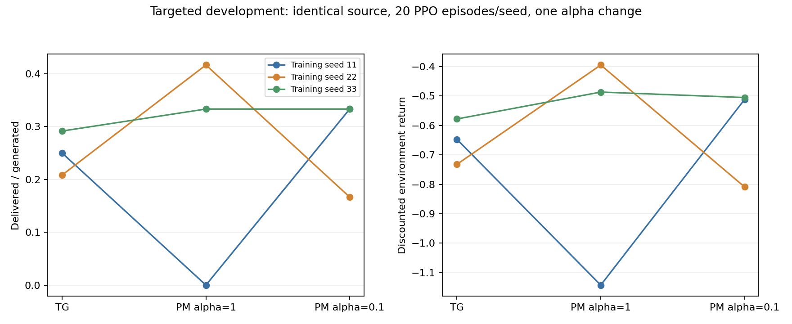

# PM强度定点修正：零投递恢复，但稳定收益仍未通过

后续[种子22动作/优势定点检查](TG_MAPPO_SEED22_ACTION_ADVANTAGE.md)和[逐次PPO更新追踪](TG_MAPPO_SEED22_UPDATE_TRACE.md)已完成：少投递的两个包均为packet13，低强度第4次Actor更新后形成17优先排序并持续，上游13→17进入12↔17闭环；Sink可选时全部选择。原训练精确复现，未改训练算法/原模型；节点级因果贡献分解和稳定提升仍未完成。

日期：2026-11-05。原TG-MAPPO、原浮标环境，Python3.6.8 / Torch1.8.1 CPU。

## 明确结论

将任务回报PM的alpha从1降至原方案建议的冷启动值0.1，在相同源码、初始化和20回合预算下，修复了已知seed11的贪心零投递：三个开发场景均从0/48恢复至16/48，高于原TG的12/48。

三种子平均投递25.00%→27.78%，基础折扣回报-0.652453→-0.608630；但seed22为8/48，低于原TG的10/48，**“每个种子不退化”的稳定收益门槛失败**。这是一项已测到局部恢复和开发均值改善的配置修正，不是稳定超越基线、显著性或完整PM创新验收。

## 为什么改这一项

[原方案](../WORLD_MODEL_PROGRESS_REWARD_PLAN.md)7.4规定先用小alpha接入，参数表给出的起点是0.1。前轮实际使用1.0，新PM seed11出现环路与Sink排序错误；同缓存的GAE公式已核对，不能直接归为实现反号。

本轮只改变alpha。强度下降直接减少势差对早期TD/GAE的影响，之后PPO优化路径会改变。三个首回合缓存的r_env、原始Critic值、Phi、mask逐元素相同；实际GAE满足alpha线性关系，误差最大2.08e-7。由此可确认本对照隔离了强度，而非换环境/网络/预算。

这支持“强度影响seed11早期训练路径”的局部判断，不能认定它是全部退化的唯一原因；seed22的反向变化说明仍有稳定性问题。

## 实际结果

种子11/22/33，各训练20×80时隙、PPO1×2、每网络40步Adam；固定学习率，Critic时钟关闭、5移动节点、随机信道。评估场景8001/8002/8003各2×80，每场景48包；本表各模型在三个场景的送达数恰好相同，其他物理指标不同。

| 训练种子 | 原TG，每场景/48 | PM alpha=1，每场景/48 | PM alpha=0.1，每场景/48 |
|---|---:|---:|---:|
| 11 | 12 | 0 | 16 |
| 22 | 10 | 20 | 8 |
| 33 | 14 | 16 | 16 |
| 投递均值 | 25.00% | 25.00% | 27.78% |
| 投递样本SD，非置信区间 | 4.17个百分点 | 22.05个百分点 | 9.62个百分点 |
| 基础折扣回报 | -0.652453 | -0.674590 | -0.608630 |



原TG与alpha=1是上一轮已验收的只读结果，未重复训练。低强度运行在`results/tg_pm_strength/20261105_154758_858806`；新12任务全部完成，独立审计同时核验24个参考任务的原始指纹。归档源码逐文件完全一致，仅alpha和输出/checkpoint路径变化；没有混入本轮校准门控功能。

独立重算60个低强度rollout，GAE最大误差2.36e-7；冻结评估PPO0、权重不变、PM冻结、终端势0、奖励物理事件核对均通过。额外用**当前项目公共入口**加载该模型，场景8001的物理日志与归档源码逐字节相同，证明产物可在当前代码运行。

机器凭据：[强度修正结果](evidence/TG_PM_STRENGTH_FIX_20261105.json)。原始PNG/SVG在运行目录`figures`，当前入口检查在`current_entry_compatibility.json`。

## 初始MSE门控没有修好路由可靠性

另一个[校准门控候选](TG_MAPPO_PM_RELIABILITY.md)完成39任务：新种子44/55/66、评估8101/8102/8103，校准4101/4102；四任务初始MSE均改善，三个门控全选择alpha=1。始终PM与门控PM参数/物理轨迹逐个完全相同。

| 新训练种子 | 原TG平均投递 | 始终PM | MSE门控PM |
|---|---:|---:|---:|
| 44 | 12.50% | 0% | 0% |
| 55 | 20.83% | 20.83% | 20.83% |
| 66 | 44.44% | 29.17% | 29.17% |
| 均值 | 25.93% | 16.67% | 16.67% |

该候选**效果失败，不推广**。旧失败seed11独立校准也被接受，证明初始价值MSE不能直接当成贪心路由可靠性。

已知失败策略11的只读采样回放为18/48，而贪心为0/48；18次Sink ACK成功中5次标准化GAE为负，但Sink动作平均优势仍高于其他合法动作。各节点优势差异约1e-7，说明是近似共同的团队信号。它揭示了采样训练/贪心执行差异与局部信用方差，不能据此说GAE公式错、或全部Sink动作都被反向训练。

## 当前可用方式与限制

原TG仍是稳定性参照；PM默认保持关闭。继续研究PM时，可使用明确标注的`task_return + alpha=0.1`开发配置，不加载未验证有效的MSE门控报告。不要直接用低强度参数加载旧alpha=1策略，checkpoint保护会拒绝。

以下是新建低强度训练的命令，已有结果不需要重复运行：

```powershell
& "D:\python3.6.8\python.exe" run_algorithm.py --algorithm tg-mappo --use_pm_reward true --pm_reward_checkpoint results/tg_pm_final_pretrain/20261103_142745_276042/pm_best.pt --pm_potential_mode task_return --pm_value_mode learned_shaped --pm_reward_alpha 0.1 --tg_reward_version task_v2 --tg_critic_time_mode disabled --seed 11 --scenario_seed 11 --num_episodes 20 --episode_length 80 --num_env_steps 1600 --ppo_epoch 1 --num_mini_batch 2 --num_moving_buoys 5 --random_channel true --output_root results/tg_pm_alpha01
```

重跑检查工具：`scripts/check_tg_pm_strength.py`；独立验收：`scripts/analyze_tg_pm_strength.py <实际运行目录>`。控制器有意使用上一轮归档源码做单变量对照，当前源码的加载兼容已单独验证。

仍未通过/未实现：seed22稳定性修复、新种子低强度泛化、100/1000回合确认、真实有效的可靠性模型、节点级因果归因、计入校准成本的交互效率优势。当前开发场景已多次使用，不能再算盲测。

下一次先在相同缓存/动作样本中检查seed22的转发与优势、PM势差与环路的关系及采样/贪心差异，再设计单一可验证候选。校准通过不等于路由有效；不能按评估结果为每个种子挑alpha。

本轮131项测试通过，12兼容任务、39门控任务、12强度任务均完成工程审计；两个效果门槛均未通过。另做320时隙旧种子校准、160时隙只读采样和160时隙当前入口检查。所有进程已结束，没有后台续训；历史项目评分53保持。
