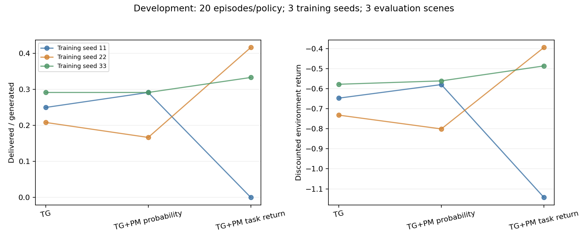

# PM任务回报势函数：目标校准与开发预实验

日期：2026-11-05。沿用原TG-MAPPO、原浮标环境、Python3.6.8 / Torch1.8.1 CPU。

## 本轮问题与候选

上一轮`base_residual`是价值坐标安全对照，更新等同PM关闭，不能产生额外收益。本轮独立检验另一项假设：旧PM的送达概率没有包含环境的等待成本、未完成成本和折扣，作为价值先验存在尺度/目标错配。

新候选`--pm_potential_mode task_return`保留同一个冻结PM、原始Actor/Critic结构、奖励权重、alpha=1、gamma=.99、lambda=.95、PPO预算。只把PM的离散送达时间分布换算成**当前任务的期望折扣回报**。PM仍在奖励阶段，通过GAE影响PPO；不是给Actor预处理，也不替换环境奖励。

## 输入、输出与时间定义

PM输入仍是每个未送达包的14维历史特征；GRU输出未来80个时间偏移的hazard logits。第一个偏移代表下一次环境转移送达。设当前剩余L个时隙，`h_k=P(K=k | K>=k)`，`S_(k-1)=P(K>=k)`，`q_k=S_(k-1)*h_k`。

每个未完成包的预测回报为：

```text
v_PM = sum(k=1..L) gamma^(k-1) * [w_delivery*q_k - w_delay/H*S_(k-1)]
       - gamma^(L-1)*w_unfinished*S_L
Phi_t = sum(v_PM for unfinished packets) / initial_packets
r_train = r_env + alpha*(gamma*Phi_next - Phi_t)
Phi_H = 0
```

等待成本包含送达所在时隙，分母使用完整任务H而非剩余L。已送达包不再产生未来收益或成本，故从未来价值求和中移除。窗口末尾未完成仍是删失，不伪造真实丢包标签；任务预先声明的窗口成本可以计算。

新势函数允许为负数。没有裁剪负奖励、删除终端项或增加人工动作奖励。PM只在当前观测和过去历史上前向，不访问当前任务的未来标签。奖励契约、PM参数/归一化、alpha、gamma在训练期间固定并审计。旧`remaining`默认与PM默认关闭均保留；新旧势函数checkpoint互相拒绝。

## 与价值估计的关系

本轮使用`--pm_value_mode learned_shaped`，Critic学习`G_base - alpha*Phi_t`。有效基础价值可以解释为`V_network + alpha*Phi_t`；如果Phi与实际任务回报接近，初期价值估计有机会得到更好的先验，减少残差拟合负担。这是待测假设，不是效果保证。

新势函数若搭配`base_residual`仍会被解析消去，因此本轮收益候选不用该安全对照。旧GAE公式并未被证明错误。

历史研究讨论了势函数塑形与价值初始化的联系，但表格TD算法的等价结论不能直接当成神经PPO的性能保证：[Wiewiora原论文](https://arxiv.org/abs/1106.5267)。上面的价值坐标关系直接由本项目的奖励公式推导。

## 只读目标校准

数据为原数据集`results/tg_wm_multiscene/20261102_235951_684782`。只读取train/validation，无新增拟合，不读取test或路由评估场景。每个包内部平均所有已观测前缀，再对包等权平均；这里是**单包回报误差**，不是团队回报或路由投递率。

| 分割 | 包数 | 旧概率作为价值的MSE | 新任务回报MSE | 旧平均偏差 | 新平均偏差 |
|---|---:|---:|---:|---:|---:|
| train | 576 | 0.854595 | 0.247840 | +0.665060 | +0.035994 |
| validation | 144 | 0.829879 | 0.233394 | +0.636710 | -0.006035 |

validation中TG行为48包：MSE 1.191758→0.412618；随机行为48包：1.290414→0.257511；地理行为48包：0.007467→0.030053，后者反而上升，保留。该PM的行为分布包含规则策略，不能声称已对PPO新策略完成校准。验证场景只有101，仍存在数据规模和分布偏移限制。

结果：`results/tg_pm_target_audit/20261105_135329_154148/report.json`。实现`src/buoy_network/pm_return.py`，诊断`scripts/analyze_tg_pm_target.py`。

## 验证顺序与预定标准

1. 独立枚举所有送达时间/未完成事件，验证折扣、等待与窗口成本；覆盖终端L=0、极端hazard和异常输入。
2. 模块校验团队聚合、冻结奖励契约、负势函数和边界恒等式。
3. 原PPO短联调、PopArt更新、存取权重与旧模式拒绝；再跑原TG与上一轮PM回归。
4. 三种子fixed2预检：原A/旧PM的参数、物理日志和奖励CSV逐字节复现历史；候选真实训练及冻结评估。预检只验兼容，不作为效果验收。
5. 通过后执行预先固定的20回合开发实验：种子11/22/33，原A、旧PM、新PM；各模型在8001/8002/8003场景冻结评估，每场景2×80。三个新场景是本轮开发场景，后续不能再当盲测。

配置在`configs/tg_pm_task_return_pilot.json`，PPO1×2，固定学习率，Critic时钟关闭，5个移动节点，随机信道开启。每模型1600次真实交互、每网络40步Adam，Actor/Critic容量相同。重跑原A后与历史fixed20权重/物理/奖励进行严格校验；不把100回合结果混进20回合比较。

开发门槛在运行前声明：新PM平均投递率同时超过原A和旧PM，至少2/3训练种子超过原A，平均基础折扣回报也超过原A。否则不推广；即使通过，也只进入更长预算/独立场景验证，不能称正式研究收益成立。所有结果按三个训练种子聚合，不把多个场景冒充独立训练重复。

## 运行与接续

以下命令均在仓库根目录运行。先测试，预检成功后才启动预实验；每次都会新建目录，禁止重复运行已完成任务。

```powershell
& "D:\python3.6.8\python.exe" scripts/test_tg_pm_task_return.py
& "D:\python3.6.8\python.exe" scripts/check_tg_pm_task_return.py preflight
```

然后用实际成功的预检目录替换参数：

```powershell
& "D:\python3.6.8\python.exe" scripts/check_tg_pm_task_return.py pilot --preflight-root "results/tg_pm_task_return/preflight_实际时间戳"
```

入口会核对预检源码快照与当前源码/配置一致性、PM文件哈希；每个任务保存完整命令、退出码、实际预算、原始指标与权重。出现训练/验收失败会停止并把manifest标成failed，不重复训练。旧fixed100结果继续保留，不绕过其源代码冻结保护。

## 当前验收记录

新增6项、原TG 105项、价值坐标7项、完成信用5项，共123项唯一测试通过，最终失败/错误/跳过0。分层日志：`results/tg_pm_task_return_tests/20261105_135833_511279`。其余研究/编排工具测试本轮未全部重跑；CPU CUDA警告与旧日志文件ResourceWarning保留。

首次模块测试失败原因是测试没有生成数据包，捕获预测列表为空；已先解释原因、保留`results/tg_pm_task_return_tests/fixture_failure`、补齐测试初始化并重跑。

fixed2预检`results/tg_pm_task_return/preflight_20261105_140102_431103`的12任务及独立审计通过：原A/旧PM三种子共6模型参数、物理与奖励CSV精确复现；候选3训练/3冻结评估成功。候选场景7001投递0/0/4（各48包），不是性能通过。

同一首回合缓存中，原始环境奖励、网络值和mask逐元素相同，候选使实际GAE发生0.505/0.842/0.757最大差异，确认没有按上一轮安全模式消掉PM。旧/新有效基础价值的采样MC误差分别为0.256→0.132、0.960→0.085、1.148→0.133；seed11的无PM数值误差0.098反而更低。该缓存诊断不等于真实条件价值校准或独立样本统计。

20回合预实验已完成：`results/tg_pm_task_return/pilot_20261105_140555_016580`。该轮源码快照固定；此后只读审计工具增加了历史权重独立复核与缓存诊断，未修改训练实现。

## 完整开发结果：工程通过，效果未通过

9个训练任务、27个冻结评估任务全部退出0；独立审计36任务通过。三个原A模型与历史fixed20参数、物理日志及奖励CSV精确一致。每个评估场景生成48包；本轮每模型三个场景的送达数恰好相同，但尝试、环路、延迟和文件哈希不同，确实使用了不同场景随机数。

| 训练种子 | 原TG，每场景送达/48 | 旧PM，每场景送达/48 | 新任务回报PM，每场景送达/48 |
|---|---:|---:|---:|
| 11 | 12 | 14 | 0 |
| 22 | 10 | 8 | 20 |
| 33 | 14 | 14 | 16 |
| 三种子均值 | 25.00% | 25.00% | 25.00% |
| 样本SD，非置信区间 | 4.17个百分点 | 7.22个百分点 | 22.05个百分点 |
| 平均基础折扣回报，越高越好 | -0.652453 | -0.647250 | -0.674590 |

新PM相对原TG的每场景差值为-12、+10、+2包，两个种子提升被另一个种子的退化抵消。平均回报也下降，预先声明的开发门槛**失败**；不能说PM已经获得额外提升、稳定性已修好或长期效果已验证。没有跑新100/1000回合，也没有修改默认设置来推广候选。



原始审计`pilot_20261105_140555_016580/acceptance.json`；PNG/SVG/CSV在同目录`figures`。可迁移的机器证据见[本轮结果凭据](evidence/TG_PM_TASK_RETURN_PILOT_20261105.json)。候选实现及工程凭据已提交`e9720e05`。

## 实际行为诊断与原因边界

另做4次场景8001只读回放：新PM seed11，以及原TG/旧PM/新PM seed22。均精确复现正式冻结物理日志，策略权重不变、PPO0更新；诊断的额外640时隙不混入主表。

- 新PM seed11：主动WAIT 2.19%，Sink可选268次但选择0次；558次ACK成功中463次回访，闭环包括3↔9、16↔17、18↔19。物理可达100%。动作归一化熵0.9927、平均最大两动作概率差0.015，表明概率排序很弱，贪心执行却形成闭环。这里的失败行为是环路和Sink排序，不能沿用旧C100 seed22/33“过度等待”的解释。
- seed22：原TG主动WAIT 76.92%，旧PM 90.91%，新PM 0%；三者Sink可选时均全部选Sink。新PM送达10→20包，但回访127→204次，仍有路由质量问题。新模式并非把全部种子的等待都解决成稳定正确路由。
- seed11训练末5回合采样MC价值误差：旧PM0.09177、新PM0.07530；GAE标准差旧0.09436、新0.18840。初始化更准、平均价值误差较低，仍未转化成该策略的贪心投递收益。这些轨迹不同，不能把GAE波动直接认定为唯一因果根源，也不能把全部变化称为无用噪声。

独立审计对6个PM训练模型的120个rollout逐个重算实际GAE，最大误差2.82e-7，并核对奖励分项、终端势归零、真实Adam步数、模型版本与冻结评估。未发现本轮数值发散、预算差异或已证实的GAE公式错误。

## 下一项：可靠性与时间信用，不能按评估分数挑种子

本轮已修正候选的回报表示，但**PM额外收益问题仍未解决**。当前使用保留原TG基线，候选用于研究复现，历史评分53保持。

下一轮先验证PM先验的可靠性和逐步信用质量，优先离线/同缓存检查，再决定单一候选：

1. 分别评估整体回报预测误差、相邻时隙势差、实际TD/GAE、Sink动作排序与环路，防止只凭Brier/MSE降低就宣布效果改善。时间一致性也不能靠简单最小化方差，把有用动作反馈一起压掉。
2. 若采用可靠性门控，规则须从训练/独立校准轨迹确定并在PPO前冻结；可比较有/无PM先验的价值误差。需要单列校准交互成本、给对照相同预算，并在新训练种子与新开发场景验证。不能因为本表seed11失败就硬编码关闭seed11，也不能用评估结果选择alpha。
3. 对照至少包括PM关闭、始终启用、预定可靠性门控；若出现正收益，还需常量hazard/简单任务先验对照，分清学习到的PM贡献与通用价值初始化收益。更换贪心/采样评估方式时须对所有组一致，作为新协议。

本轮实际新增：预检1440训练/480评估时隙，主实验14400训练/4320评估时隙，行为回放640时隙；分层测试中的微型运行另计，不充当独立训练种子。当前所有任务均已结束，没有后台续训或待提醒任务。
