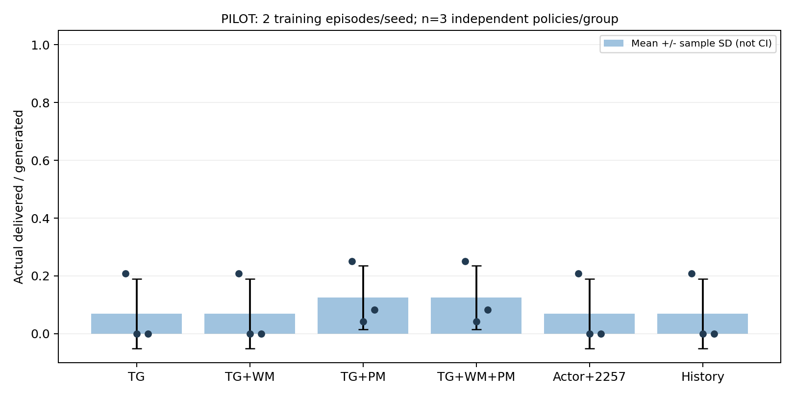

# 原 TG-MAPPO：Critic 的 PopArt 修复与验收

日期：2026-11-03。接续 task_v2 奖励修复；本轮奖励、环境、动作掩码和 greedy 评估定义不变。

后续已完成[学习率开关修复与计划对照](TG_MAPPO_LR_SWITCH_FIX.md)，本文末尾待审查的lr_decay问题现已关闭；本文保留当轮源码/结果，后续采用新记录中的显式计划。

## 1. 已确认的 bug

原 PopArt.update 每次通过 `nn.Parameter(...)` 替换 weight/bias/stddev：优化器仍持有旧 weight/bias，当前价值头有梯度却没有被优化器更新；stddev 还被误设为可训练参数。
此外，旧均值引用被原地更新；重缩放使用带偏统计，而 normalize/denormalize 使用去偏统计，无法保持原尺度预测。
不能只把替换改成原地复制：原调用发生在 Critic 前向后，直接修改会破坏反向计算，并且新旧价值预测的归一化坐标仍不一致。

在原 Python 3.6 / Torch 1.8 的独立探针中，旧版：

| 检查 | 修改前 | 修改后 |
|---|---|---|
| 价值头仍属于优化器 | false | true |
| 参数对象身份保持 | false | true |
| 有非零梯度 | true | true |
| 优化器实际改变当前价值头 | false | true |
| 仅更新统计后，原尺度输出最大变化 | 93.9057007 | 0.0000011772 |
| stddev.requires_grad | true | false |

旧版来自上轮不可变源码快照，不是临时编造的错误实现。Torch 2.11 的独立探针也复现相同现象。
这是明确的训练实现 bug；它不是零投递的唯一已证实原因，修好该组件不等于路由策略已经收敛。

## 2. 修复方法与边界

1. 用去偏均值和标准差的旧/新快照重缩放，原地更新数值，保留所有参数对象及 requires_grad。
2. 先按采集时统计计算 GAE 和优势；随后每个 rollout 用有效训练目标更新一次统计，发生在 Critic 前向/反向之前。
3. rollout 内所有 PPO epoch/minibatch 固定统计。旧缓存价值换算到新统计坐标，再做价值裁剪；不改 buffer 原始价值或 returns。
4. 更新结束/异常时清理统计上下文。无有效目标时不更新统计。共享非图 MAPPO 也使用相同流程，并补齐全 inactive 的安全分母/优势处理。
5. 原 TG 每次训练保存损失、梯度范数、比率、价值头与优化器关联、价值头 Adam 实际累计步数。发现参数脱离优化器就明确报错。

实现位置：

- src/onpolicy/algorithms/utils/popart.py：保持原尺度输出、统计上下文、旧价值坐标转换。
- src/onpolicy/algorithms/graph_mappo.py、mappo.py：统计更新时序与价值裁剪。
- src/buoy_network/agent.py：实际优化器步数与 PPO 训练记录。
- src/buoy_network/policy_artifacts.py：保存 training_implementation=tg_ppo_popart_v2；评估明确标记源模型版本。

这是所有实验组的公共学习器修复，不能记作 WM/PM 创新收益。旧训练结果保留；旧 checkpoint 继续允许冻结评估，缺版本时标为 legacy_popart_v1。
继续保留 legacy_v1 默认奖励，当前推荐实验通过配置显式选择 task_v2。两版奖励都使用修复后的公共学习器；不再要求新训练权重与有 bug 的旧训练逐字节相同。

## 3. 分层测试与复现

新增 7 项：函数 4、模块 2、联调 1，全部通过。包括多输出/多次统计变化、参数身份、真实 Adam 更新、原尺度预测保持、非法目标、截断上下文清理、固定统计、缓存不改写、共享 MAPPO 以及默认 PopArt 下 WM+PM 的 PPO/冻结重载。
原 100 项本轮全部重跑通过；共 **107 项，通过 107、失败 0、错误 0、跳过 0**。
额外 17 项 unittest 的原始工具输出已保存于 results/tg_popart_regressions/extra_tests.json，和其余 90 项报告共同构成文件回执。

```powershell
& "D:\python3.6.8\python.exe" scripts/test_tg_popart.py
```

```powershell
& "D:\python3.6.8\python.exe" scripts/probe_tg_popart.py
```

实际通过报告：results/tg_popart_tests/20261103_200114_613815/report.json。
原 Torch 的修改前/后探针分别为 results/tg_popart_original_legacy_probe/20261103_200535_669664、results/tg_popart_fixed_legacy_probe_versioned/20261103_200534_544337。

## 4. 相同两回合预算，六组统一复跑

使用上轮同一配置：task_v2、三种子 11/22/33、训练 2×80、每回合 PPO 1 epoch×2 minibatch；各模型在开发场景7001独立冻结 greedy 评估 2×80。
共 18 训练 + 18 评估任务，训练/评估各 2880 联合时隙。实际目录 results/tg_ablation_popart_v2_pilot/20261103_200507_863382。

| 组 | seed11 投递/48 | seed22 投递/48 | seed33 投递/48 | 均值 ± 样本 SD |
|---|---:|---:|---:|---:|
| A 原 TG | 10 | 0 | 0 | 6.94% ± 12.03% |
| B TG+WM | 10 | 0 | 0 | 6.94% ± 12.03% |
| C TG+PM | 12 | 2 | 4 | 12.50% ± 11.02% |
| D TG+WM+PM | 12 | 2 | 4 | 12.50% ± 11.02% |
| E Actor 扩容 | 10 | 0 | 0 | 6.94% ± 12.03% |
| F 历史统计特征 | 10 | 0 | 0 | 6.94% ± 12.03% |

统计单位是独立训练策略 n=3，不是包/回合，SD 不是置信区间。WM 仍未显示额外投递收益，不能认为各组完整动作相同。


与修复前同 task_v2 的两回合结果相比，A11 从 2/48 增至10/48；C22 从6/48降至2/48。不能宣称修复对所有种子、所有组均提升。

原旧 A22 checkpoint 在新代码下再次冻结评估，与旧物理 JSONL 逐字节一致、Actor/Critic 不变、优化器更新0；实际目录 results/tg_popart_old_policy_compat/runs/20261103_200534_210560/moves_5。
修复后两回合 A22 的只读复查仍是0/48、217次回访，与该轮原评估完全一致；目录 results/tg_popart_v2_diagnostics/A22。

六组训练运行于不可变源码快照。工作树随后仅清理 graph_mappo.py 的尾随空格；验收会同时记录双方 SHA 并验证 Python AST 完全相同，未改动已运行的快照。

```powershell
& "D:\python3.6.8\python.exe" scripts/run_tg_ablation.py --mode run --config configs/tg_ablation_task_v2_pilot.json --output-root results/tg_ablation_popart_v2_pilot
```

## 5. 三种子、20 回合的基线预算诊断

为检查两回合是否过短，额外从同一不可变源码运行 A 组种子11/22/33，每个20×80训练、PPO1×2，最后仍用场景7001冻结 greedy 评估2×80。
这是基线学习预算诊断，不能拿它与两回合 WM/PM 组做创新对比。预算增加还沿用原 Runner 按总回合数调用的线性学习率衰减，因此不是仅改变回合数的严格因果消融。

实际目录：results/tg_popart_budget_probe。三个训练与三个冻结评估全部完成，结果：

| 训练种子 | 修复后2回合训练，投递/48 | 修复后20回合训练，投递/48 | 20回合投递率 |
|---|---:|---:|---:|
| 11 | 10 | 14 | 29.17% |
| 22 | 0 | 10 | 20.83% |
| 33 | 0 | 16 | 33.33% |

20回合平均投递率 **27.78% ± 6.36% 样本 SD**，n=3。当前开发场景中三种子均有投递；并未达到高投递或收敛验收。
额外训练4800、评估480联合时隙。每个模型价值头 Adam 实际累计40步（2回合对照为4步），全部训练损失/梯度等有限、奖励与实际投递逐步核对通过。
完整训练/评估命令和固定源码位置保存于该目录 commands.json；没有用两回合 PM 组与20回合基线比较创新效果。

## 6. 明确结论与接续

**已修复**：PopArt 价值头脱离优化器、统计尺度不一致、更新时序/价值裁剪错位。**未通过策略效果验收**：两回合仍有零投递、主动等待与环路，尚无收敛或显著性结论。
未启动1000回合正式实验、未使用预留盲测；冻结 WM/PM 没有重训、可靠性门控及完整失败分类仍缺失。
原 Runner 无条件调用 lr_decay 的开关语义仍需单独审查，本轮保持原调度并记录预算关联；不把该因素忽略掉。

下一步先读取三种子20回合结果和训练损失/价值头步数，继续定位学习预算、学习率计划和动作排序；每次只调整一个因素，在同一规则下重跑相关对照。

最终机器凭据：[TG_POPART_FIX_20261103.json](evidence/TG_POPART_FIX_20261103.json)。107项、36个统一短任务、3个20回合基线训练与3个冻结评估、旧策略兼容、0重复接续任务、分项奖励审计均通过。
源码/权重/逐步大日志保留本地 results；Git 交付实现、工具、测试、文档、图和小型凭据。
