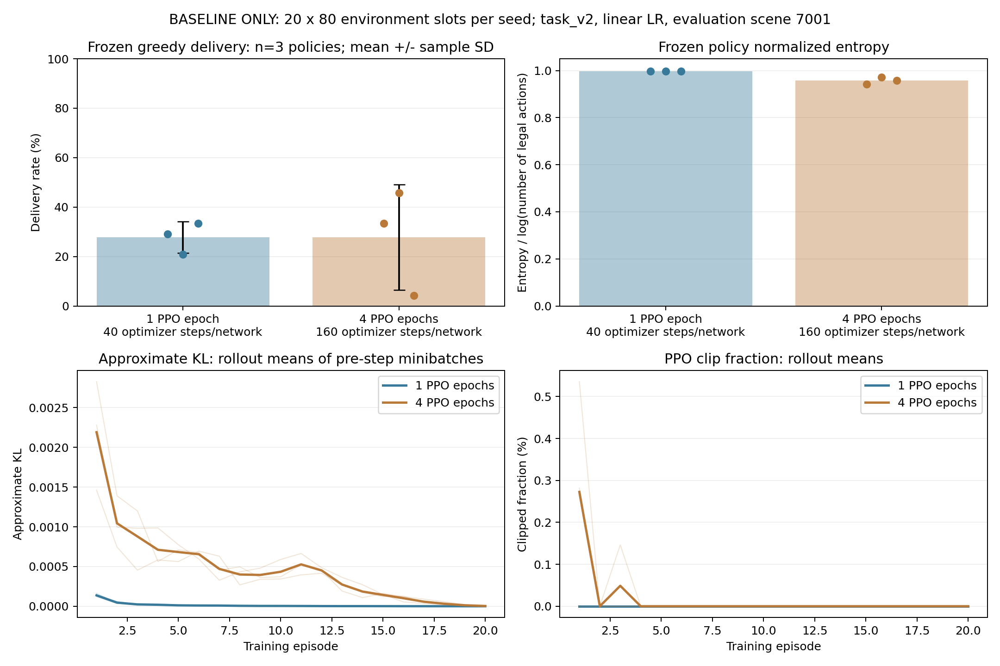

# 原 TG-MAPPO：单独检查 PPO 更新预算

日期：2026-11-03。主线仍为原浮标环境与原 TG-MAPPO，本轮只做 A 基线的预算诊断。

## 1. 控制条件

| 项目 | 两组共同设置 |
|---|---|
| 环境/动作 | 原25节点、5移动浮标、随机信道、原合法掩码 |
| 任务奖励 | task_v2，三个基础权重均1，不启用PM |
| Actor/模型 | 原Actor，不接入WM，不扩容，无辅助模型实际调用 |
| 训练 | 20回合，每回合80联合时隙，每策略1600次环境交互 |
| 初始种子 | 11、22、33，配对初始化 |
| 学习率 | 显式linear，Actor初始0.0005、Critic初始0.0003，按相同20回合计划衰减 |
| 小批次 | num_mini_batch=2，保持不变 |
| 冻结评估 | 开发场景7001，greedy，各2×80时隙，优化器更新0 |

**唯一调整：ppo_epoch=1或4。** 每回合复用同一批轨迹1遍/4遍，每个网络实际Adam总步数40/160；不是环境交互也增加4倍。
两种预算需要不同计算量，不能称为等计算预算。两套共9600训练、960评估联合时隙，另6次只读动作重放共960时隙。
多出的PPO遍数还消耗更多shuffle随机数，第一条采样轨迹相同，之后策略/轨迹自然会分开；不声称所有后续外部随机帧逐步一致。

## 2. 只读诊断与功能测试

没有修改PPO损失、裁剪规则、GAE、网络结构或奖励；新增两项小批次更新前诊断：

```text
log_ratio = log pi_current(a|s) − log pi_behavior(a|s)
approx_kl = mean[max(exp(log_ratio) − 1 − log_ratio, 0)]
clip_fraction = mean[abs(exp(log_ratio) − 1) > clip_param]
```

按有效动作样本记录，先对小批次求值，再按每次rollout的PPO小批次平均。它们描述优化过程，**不是最终整个rollout上的精确KL**，没有添加KL早停或自适应学习率。
训练报告另记录Actor与Critic的实际Adam累计步数，避免把20次rollout更新误称为只有20个优化器步。
原 value_loss/policy_loss、熵、梯度、比率照常保存；PopArt目标统计仍每rollout更新一次，不能用归一化价值损失单项认定策略收敛。

实现位置：

- src/onpolicy/algorithms/utils/ppo_diagnostics.py：不改梯度、输入或RNG的统计函数。
- src/onpolicy/algorithms/graph_mappo.py：采集上述统计，PPO目标和步骤保持原实现。
- src/buoy_network/agent.py：保存实际Actor优化器步数及训练记录。
- src/buoy_network/ablation_suite.py：新增baseline-only diagnostic目的，允许A单组；pilot/formal消融仍要求A-D。

新增函数4、模块2、联调2，共8项通过；原115项本轮全部重跑通过，总计 **123通过，0失败/错误/跳过**。
覆盖数值/掩码/多动作分量、空有效集、RNG与梯度不受扰动、诊断开启/关闭的真实PPO参数相同、1/4遍实际更新次数、固定交互数、PopArt更新次数及4遍下冻结WM/PM缓存兼容。
WM/PM仅做小型联调回归，没有进行辅助模型的性能比较。

## 3. 配置、执行与复现

```powershell
& "D:\python3.6.8\python.exe" scripts/test_tg_ppo_budget.py
```

```powershell
& "D:\python3.6.8\python.exe" scripts/run_tg_ablation.py --mode run --config configs/tg_ppo_budget_epoch1.json --output-root results/tg_ppo_budget_epoch1
```

```powershell
& "D:\python3.6.8\python.exe" scripts/run_tg_ablation.py --mode run --config configs/tg_ppo_budget_epoch4.json --output-root results/tg_ppo_budget_epoch4
```

本次两套源文件快照相同，完整配置只差ppo_epoch。CPU上两个独立进程并行运行，时间只作记录，不作严格速度比较。
沿用套件的不可变源码、独立输出、超时回收子进程、任务锁、完整哈希和完成任务接续机制；无需另建研究环境。
继承套件的WM/PM预训练路径用于既有配置溯源/完整性检查，但A基线报告中wm/pm实际调用与冻结参数数均为0。

实际产物：

- 分层测试：results/tg_ppo_budget_tests/20261103_231949_700502/report.json。
- 1遍：results/tg_ppo_budget_epoch1/20261103_232339_569526。
- 4遍：results/tg_ppo_budget_epoch4/20261103_232337_352056。
- 旧1遍线性基线：results/tg_popart_budget_probe，保留原日志/权重。
- 冻结动作重放：各套件diagnostics目录，记录完整概率、主动WAIT、Sink选择及包路径/环路。

优先使用已有目录的`--resume`接续；不要不加区分地新开同样训练。

## 4. 三种子实测与动作分布

12/12训练与冻结评估任务全部完成，6次只读动作重放与各自原冻结评估的物理JSONL逐字节一致。

| 训练种子 | 1遍投递/48 | 4遍投递/48 | 1遍主动WAIT | 4遍主动WAIT | 1遍成功回访转发 | 4遍成功回访转发 |
|---|---:|---:|---:|---:|---:|---:|
| 11 | 14 | 16 | 83.88% | 0.00% | 0 | 427 |
| 22 | 10 | 22 | 64.50% | 40.87% | 106 | 246 |
| 33 | 16 | 2 | 67.34% | 15.33% | 150 | 402 |

每个策略均生成48个包，统计单位为三个独立训练策略，n=3：

| 指标 | 1遍 | 4遍 |
|---|---:|---:|
| 投递率均值 ± 样本SD | 27.78% ± 6.36% | 27.78% ± 21.38% |
| 主动WAIT比例均值 | 71.91% | 18.73% |
| 成功转发中回访占比的策略均值 | 43.51% | 81.30% |
| 三策略成功回访转发总数 | 256 | 1075 |
| 冻结策略归一化熵均值 | 0.99693 | 0.95728 |

主动WAIT分母为有可用转发动作的活跃决策；回访指包成功转发至已访问节点，分母为成功转发数。
均值先在各策略求比例，再对三个策略平均，不能当作合并分母后的比例；SD不是置信区间。
种子11/22的投递增加被种子33的下降抵消；本次没有平均投递收益，环路与种子波动更重。

| 训练种子 | 1遍选择Sink/合法可选 | 4遍选择Sink/合法可选 |
|---|---:|---:|
| 11 | 24/24 | 28/28 |
| 22 | 33/40 | 41/41 |
| 33 | 24/24 | 2/10 |

所有包时隙的物理Sink可达比例均为100%。4遍种子33在Sink合法时仍有8次未选，且出现5↔6、9↔14、17↔21的已观测闭合转发环；种子11有3↔4、5↔10、20↔21。
这些环来自已观测的策略选择，不能据此说物理网络没有出口。仅增加PPO遍数没有解决该路由行为。

训练过程全部损失、梯度范数、比率、KL及裁剪比例均有限；所记录rollout均值的KL最大0.002829、裁剪比例最大0.536%。1遍三个种子的裁剪比例均为0。
没有从这些记录发现漏更新或数值发散证据。4遍种子33的最后5次归一化价值损失均值从0.4721降至0.1041，但实际投递降至2/48，损失降低不足以验收任务效果。



图中点为独立训练策略，误差为样本SD；下方细线为逐种子值，粗线为种子均值，均采用第2节口径。
原图/SVG、120行逐更新CSV和图源SHA保留在results/tg_ppo_budget_figures。

## 5. 验收与下一步边界

**工程验收通过，增加到4遍的效果验收未通过。暂保留ppo_epoch=1、num_mini_batch=2作已记录的参考配置；不把4遍推广到WM/PM或六组消融。** 1遍本身仍低投递、有等待和环路，不认定它是最优或已收敛。

已核验：123项测试全部通过；12任务成功；每个网络实际40/160个Adam步；相同学习率计划及奖励计数/分项；冻结评估和6次重放均更新0、权重不变；接续新增训练任务0。
1遍三个Actor/Critic参数以及三份训练、三份评估物理日志，与旧20回合基线完全一致，进一步证明只读诊断没有改变该对照的训练结果。
两套157文件源码快照映射相同，与运行后的对应工作代码字节一致；配置只差ppo_epoch；每个配对种子的初始Actor摘要及首回合训练物理指标一致。

完整[机器凭据](evidence/TG_PPO_UPDATE_BUDGET_20261103.json)保存测试报告、逐更新记录、完整动作诊断、哈希及配对统计。验证器为scripts/verify_tg_ppo_budget.py，图工具为scripts/plot_tg_ppo_budget.py；大权重、原始日志与源快照保留本地results。

这是三训练种子、单个已使用开发场景的有限预算诊断，不是收敛、显著性或论文验收。没有查看预留盲测，没有启动1000回合，也没有推广到WM/PM组。
目前不能把低投递简单归因为“PPO更新次数不够”。下一次先以种子33为具体案例，对照Sink未选和回访环路的观测、概率、训练优势/回报，确认策略学到错误路由的原因；再决定独立增加交互回合或做针对性修改，每次只改一个因素。
本轮不改奖励、强制动作、评估解码或模型结构，也不盲目增加到8/10遍。WM/PM收益、长期收敛和完整方案仍未验收。
