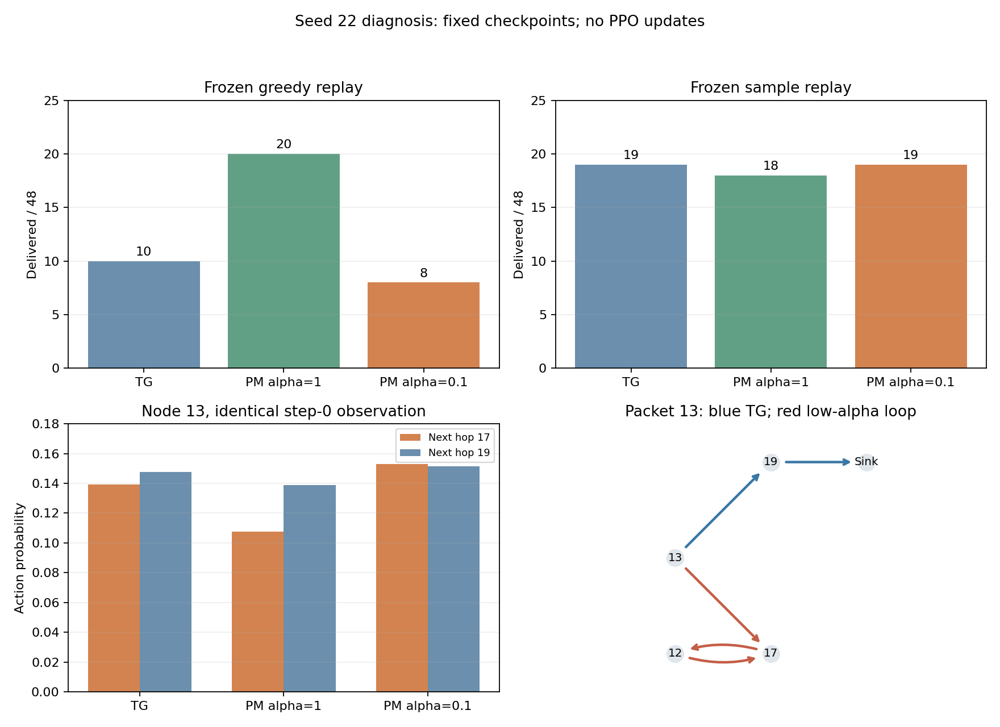

# 种子22：动作与优势信号定点检查

后续[逐次PPO更新追踪](TG_MAPPO_SEED22_UPDATE_TRACE.md)已完成：三组原训练精确重放；低强度在第2回合、第4次Actor更新后改选17，此后未恢复。本文保留先前只读诊断的范围与原始结论。

日期：2026-11-05。对象：原TG、task_return PM alpha=1、PM alpha=0.1的既有20回合模型。只读回放，PPO更新0；没有重新训练或修改环境、策略和奖励公式。

## 明确结论

低强度模型比原TG少投递的2个包，恰好是两个评估回合中的同一个源包13。基线走`13→19→24(Sink)`；低强度走`13→17`后在`12↔17`循环，包13最终未完成。

本例不是Sink可用却不选：低强度的27次Sink机会全部选Sink。问题在上游动作排序和随后的环路/FIFO阻塞。PM对坏首跳实际上给了负包级势差，但PPO使用的是团队回报和共同优势，局部扣分没有成为独立的节点信用。

没有发现GAE公式或时间索引错误。当前证据尚不能确定20回合中哪次参数更新导致最终17/19排名翻转，因此本次不宣布已修复。

## 冻结回放结果

场景8001，各模型2×80时隙、48个初始包。三个贪心回放的物理日志与已有正式评估逐字节相同；Actor/Critic/PM均冻结。

| 模型 | 贪心投递/48 | 主动WAIT | Sink选择/机会 | 回访转发 |
|---|---:|---:|---:|---:|
| 原TG | 10 | 1293/1681 = 76.92% | 49/49 | 127 |
| PM alpha=1 | 20 | 0/694 = 0% | 50/50 | 204 |
| PM alpha=0.1 | 8 | 961/1360 = 70.66% | 27/27 | 210 |

主动决策数随各策略队列/投递状态改变，比例不能单独解释性能。低强度的WAIT比例反而低于TG，不能笼统归因为“更爱等待”。

另做相同种子配置下的采样诊断，送达分别为19/18/19包。它提示贪心排序敏感性；这是单次冻结采样，不作为新效果评估或采样方式一定更好的证明。

## 少投递的包如何卡住

逐包比较发现，只有下列两项送达状态不同，其他包的送达/未完成状态相同。

| 包 | 基线路径与时延 | 低强度实际路径 | FIFO阻塞 | 自身WAIT |
|---|---|---|---:|---:|
| episode0 / packet13 | 13→19→24，21时隙 | 13→17→12→17→…→12，截止未完成 | 69时隙 | 0 |
| episode1 / packet13 | 13→19→24，8时隙 | 13→17→12→17→…→12，截止未完成 | 63时隙 | 0 |

低强度包13分别发起11/17次转发尝试，成功路径均有10跳，其余时间排在其他包之后。FIFO阻塞、主动WAIT、无邻居强制WAIT和发送尝试分别计数，四项之和等于真实存活时长，未使用旧指标中的惩罚跳数。

## 同一输入下的动作排序

将三个冻结Actor分别送入低强度模型实际遇到的完全相同观测/掩码，只读计算概率，没有执行替代动作。自身概率回放最大误差5.96e-8，权重及RNG均不变。

第一回合step0、节点13的比较：

| Actor | P(下一跳17) | P(下一跳19) | 贪心选择 |
|---|---:|---:|---:|
| TG | 13.9185% | 14.7558% | 19 |
| PM alpha=1 | 10.7602% | 13.8863% | 19 |
| PM alpha=0.1 | 15.2979% | 15.1348% | 17 |

低强度仅以约0.1631个百分点选中17；第二回合step0也复现此排序。差异远大于诊断数值误差，是已学参数的排序差异，不是浮点并列偶然取值。不能据此承诺只把首跳改为19就一定恢复投递，替换动作后的后续状态/随机信道仍会改变。

## PM局部评分与团队优势

另一次精确冻结回放提取包13的原始PM预测，重新求和与实际团队Phi误差小于1e-12。坏首跳`13→17`的信号为：

| 回合 | 包13预测回报，前→后 | 包13势差奖励 | 其他包势差 | 同时其他包投递 | 重算的团队标准化优势 |
|---|---|---:|---:|---:|---:|
| 0 | 0.810929→0.494971 | -0.001337 | -0.003554 | 1 | +2.733985 |
| 1 | 0.810929→0.626714 | -0.000794 | +0.002362 | 2 | +3.214582 |

以上势差已含alpha=0.1和初始24包归一化。局部模型的方向并未把这个首跳判为进步；但基础奖励包含其他投递，优势还包括后续团队回报、Critic和批内标准化。负包级进度不要求节点优势必为负。

这些是**训练完成后的贪心冻结轨迹重算值**，不是当初训练该动作时的历史更新记录。它们显示当前团队信用的局限，不能单凭正优势就断言历史PPO实际奖励了这次坏首跳。原TG同样使用团队信号，也不能把该结构现象直接称为PM独有bug。

## 核验原训练首回合

用原初始化、种子22、场景22只采样1×80时隙，不加载训练后权重；独立影子PM只读评分，不进入Actor或环境奖励。它与两种PM历史第0回合缓存的r_env、原始V和Phi逐元素相同，物理指标也精确一致。未执行PPO或参数更新，优势只在采集后离线重算。

因此可以使用原缓存的float32 GAE和重建的活跃掩码，恢复**第一次PPO的标准化优势输入**。独立重算误差分别为2.50e-7 / 1.91e-7。

- 两种强度在60/80个联合时隙的标准化优势符号不同；活跃决策条目为676/886，条目高度相关，不算独立样本。
- 节点13选择17、19的样本各4个。alpha=1的平均标准化优势为+0.0223 / -0.9846；alpha=0.1为+0.7591 / +0.6247。
- 首回合ratio=1局部似然项的“17相对19”方向代理，alpha=1为+0.14878，alpha=0.1为+0.02048；不含熵、共享参数Jacobian及实际minibatch顺序。

强度1在首回合该代理上反而更偏17，最终却选择19，说明不能把最终退化归因于这一个回合的简单符号差异。后续19个回合没有保存逐动作/更新后概率，只读缓存不能补出完整优化因果链。

所有冻结轨迹还核对了基础/塑形价值坐标的TD恒等式，最大误差2.22e-16；动作、奖励、优势索引逐行核对通过。

## 产物、验证与下一步

运行目录：`results/tg_seed22_signals/20261105_165019_896744`。`acceptance.json`、各组`credit_rows.jsonl`/`packet_waiting.json`、`same_inputs`、`first_rollout_rows.jsonl`和`packet_pm_replay`保存细节。机器凭据见[诊断证据](evidence/TG_SEED22_ACTION_ADVANTAGE_20261105.json)。

新增4项手算GAE/归一化、空活跃样本、他人投递不冒充自身投递、FIFO/服务等待区分测试全部通过；真实只读回放/重建8次，新增1200环境时隙，PPO0、原模型文件哈希不变。另有同输入Actor评分，环境步0。原131项训练回归本轮未重跑。

本次没有改训练代码、模型或默认配置。下一项若继续修复，先扩展已有`diagnose_tg_credit.py`支持PM：在新目录对seed22做同配置20回合的有观测训练重放，记录每次更新前后的同输入P17/P19及包级/团队信用；必须与原模型、loss、奖励CSV和物理日志精确一致，再定位排名在哪次更新翻转。该训练重放本次没有启动，不能把它算作新的独立种子效果。

之后再设计单一的信用/训练候选，统一对照全部种子。当前证据不支持按种子挑alpha、硬编码下一跳、反转GAE符号或删除标准化。历史项目评分53保持。
