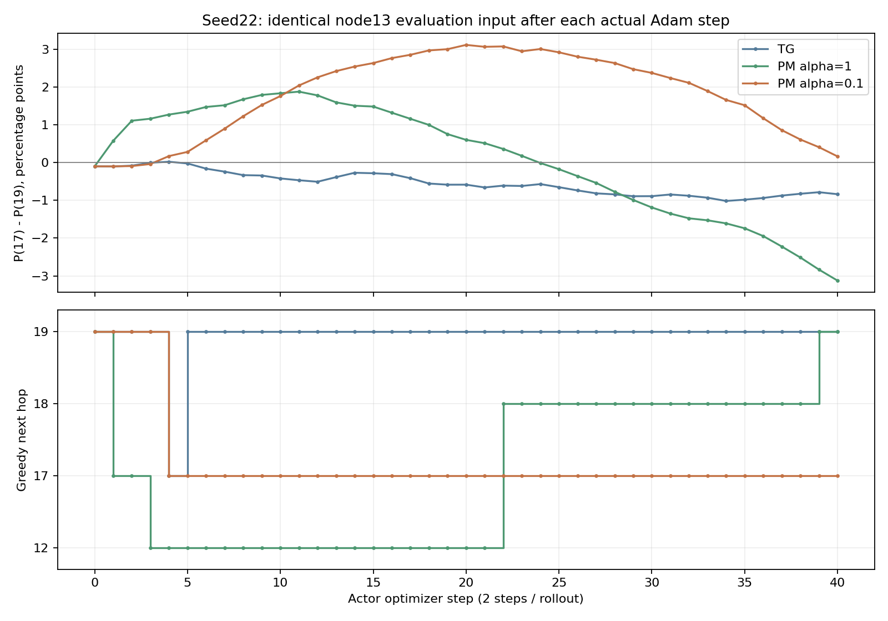

# 种子22：逐次PPO更新与17/19排序追踪

后续[梯度来源分解及Critic势值输入候选](TG_MAPPO_PM_CRITIC_CONTEXT.md)已完成：138项测试、34任务工程通过，新增输入没有额外收益，未推广默认。

日期：2026-11-05。接续[动作与优势只读诊断](TG_MAPPO_SEED22_ACTION_ADVANTAGE.md)。

已完成三组原配置20回合训练重放，定位了最终排序差异形成的时间：**低强度PM在第2回合的第4次Actor更新后，将17排到19之前，此后36次更新均未恢复。** 原TG在第5次更新恢复19；强度1在第24次更新使P19超过P17，第39次更新才将19排为全部合法动作的第一名。

训练算法、损失、GAE公式、奖励公式、默认配置及原模型均未修改。通过了观测工具的精确复现验收；PM稳定提升仍未通过。

## 观察方法与验收

重放原训练种子22、20×80时隙、PPO epoch=1/minibatches=2，分别使用原TG、task_return alpha=1和alpha=0.1。使用原任务归档源码；两种PM仍加载原冻结checkpoint。训练在新目录执行，原产物保留。

每个真实Adam更新前后，都将**固定的场景8001、step0、节点13完整输入**交给当前Actor，只读、确定性计算动作概率，恢复原训练模式与RNG。记录真实训练采样、实际送入PPO minibatch的优势和ratio、包级PM分量及同一训练输入更新后的概率。固定输入的排序探针没有执行替代动作，也没有增加环境交互。

先完成三个2回合前缀验证，再执行三个20回合完整重放。验收均通过：

- 三个完整重放的最终Actor/Critic逐张量与原checkpoint完全相同；损失、Adam步数与原训练记录完全相同。
- 环境物理JSONL、奖励CSV、两种PM的奖励CSV逐字节一致；PM的全部40个历史rollout中，原始V、GAE、Phi、mask和塑形奖励逐元素一致。
- 前缀和完整重放的前2回合观测文件逐字节一致；最终固定输入概率精确恢复上一轮冻结诊断。
- 新增3项函数/模块测试通过：训练图的惰性分布与Adam更新保持一致、概率探针保留RNG/权重/模式/采样记录、探针异常时恢复上下文。失败0、错误0、跳过0；原131项训练回归本轮未重跑。

新增交互5280个联合时隙：前缀480 + 完整重放4800；Actor优化器132步：前缀12 + 完整重放120。这是已知训练的重复观察，新增独立效果种子为0。

## 排名在哪次更新改变

以下都是同一个固定输入，不混入不同策略访问状态的差异。第1回合对应episode0，每回合有2次Actor Adam更新。

| 模型 | 最终P17 | 最终P19 | P17−P19 | 最后一次17/19相对顺序变化 | 最终贪心动作形成时间 |
|---|---:|---:|---:|---|---|
| TG | 13.9185% | 14.7558% | -0.8374个百分点 | 第5次：17→19 | 第3回合，第5次更新：17→19 |
| PM alpha=1 | 10.7602% | 13.8863% | -3.1261个百分点 | 第24次：17→19 | 第20回合，第39次更新：18→19 |
| PM alpha=0.1 | 15.2979% | 15.1348% | +0.1631个百分点 | 第4次：19→17 | 第2回合，第4次更新：19→17 |



低强度第4次更新的实际变化为：P17从11.8618%升到12.1303%，P19从11.9005%升到11.9587%。该minibatch共421个活跃节点样本；节点13选择17的3个样本，平均标准化优势+0.546167；选择19的4个样本，平均-0.036217。这与当次排序变化方向一致。

但整个更新还含其他节点、其他动作、熵项、共享网络参数和Adam历史。上述均值没有分解这些贡献，不能单独认定“这几个样本就是唯一原因”。也不能将训练场景22的所有13→17一律判成评估场景8001中的坏路由。

## PM扣分怎样进入实际学习信号

低强度20回合中，节点13在17/19均合法时选择17共115次：67次包级PM分量为负，其中42次实际标准化团队优势仍为正。选择17的平均优势+0.318607，选择19的平均优势+0.349608；两类样本来自不同时间与状态，均值不能预测最终排序。

一个可以定位到原训练的例子：第2回合step4，packet13在节点13尝试发送给17，ACK失败。包级PM分量为-0.000361350，实际标准化优势也略负（-0.004517）。该回合两次更新后，在这条样本的相同输入上，P17仍从11.6459%升到12.1304%。这是混合批次、共享参数和优化器历史共同更新的结果；单条负优势不保证该条动作概率独立下降。

结合上一轮物理回放，证据链现在为：

1. 原训练在第4次更新形成固定输入下的17优先排序，最终仍保留0.1631个百分点优势。
2. 冻结贪心评估将源包13发送到17，随后进入12↔17循环，两回合均未完成；TG走13→19→Sink，最终多投递2包。
3. 包级PM评价被汇总进团队塑形奖励，再进入团队价值/GAE和共享Actor更新；该接口未提供独立的节点、动作反事实信用。

第1项定位参数更新的时间，第2项定位实际路由损失，第3项说明信用分辨率限制。尚未通过反事实梯度实验证明某一组节点或某一项损失是排序翻转的唯一原因。当前无证据支持反转GAE符号、删除优势标准化或按种子选alpha。

## 产物与接续

结果目录：`results/tg_pm_update_replay/20261105_211844_626825`。

- `manifest.json`：六个任务的精确命令、状态、返回码和源码指纹。
- `full_*/updates.jsonl`：每次真实PPO更新前后固定输入概率、实际节点13 minibatch优势/ratio。
- `full_*/training_credit.jsonl`：逐动作训练信用、包级PM分量及目标节点更新后的概率。
- `acceptance.json`、`figures/`：独立复核、汇总和PNG/SVG。
- [Git内保存的验收证据](evidence/TG_SEED22_UPDATE_TRACE_20261105.json)：日志/模型/工具指纹、命令、测试和完整汇总。

汇总复核命令（不训练）：

```powershell
& "D:\python3.6.8\python.exe" scripts\analyze_tg_pm_updates.py results\tg_pm_update_replay\20261105_211844_626825
```

必须保留的未完成项：PM稳定提升、未知训练种子与长期预算泛化、节点级因果信用、总交互成本优势。历史评分53/100保持。

下一项先对低强度第4次更新做梯度来源分解，检查节点13自身样本、其他节点、熵项及Adam历史对固定输入差值的贡献，再确定单一信用修正候选。候选须保留原环境和团队基础奖励、验证关闭候选时精确恢复基线，并统一对照11/22/33；本轮未实现或推广新的训练算法。
