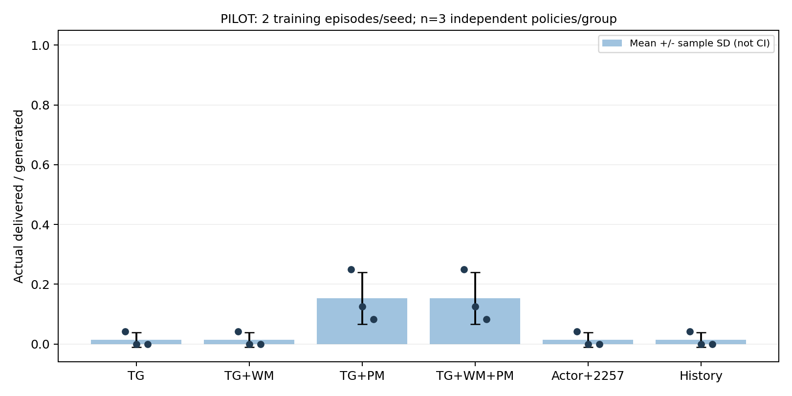

# TG-MAPPO 基础任务奖励 v2

日期：2026-11-03。沿用原 TG-MAPPO、浮标环境、观测、动作、合法掩码和 greedy 评估。

后续发现并修复了公共 Critic 的 PopArt bug，见[修复与新验收](TG_MAPPO_POPART_FIX.md)。本文保留该修复前的奖励实验结果；新版结果独立记录，不能混用。

## 1. 修改原因与范围

旧版成功到 Sink 的即时奖励可能仍为负，全 WAIT 没有时间或窗口成本。旧地理规则总回报仍可能很高，不能据此断言 WAIT 全局最优。
本次新增可选 `task_v2` 基础奖励，保留 `legacy_v1` 为默认及旧实验对照。基础奖励修正属于共同任务定义，不能算作 WM/PM 创新收益。

**奖励契约通过不等于零投递已解决。** 两回合短训练仍有 WAIT、环路和零投递；新任务奖励尚未通过策略性能验收，不能替换成已验证的默认训练配置。

## 2. 契约

每回合初始包数 P、完整任务窗口 H、动作前未完成数 U_t、本时隙真实投递数 D_t：

```text
r_delivery   = w_delivery × D_t / P
r_delay      = −w_delay × U_t / (P × H)
r_window_end = −w_unfinished × U_(t+1) / P    仅完整任务窗口结束时
r_base       = r_delivery + r_delay + r_window_end
r_progress   = alpha × (gamma × Phi_(t+1) − Phi_t)
r_train      = r_base + r_progress
```

- 默认三个 w=1；投递和延迟权重须有限且 >0，窗口权重有限且 ≥0。空任务分母使用 max(P,1)，奖励为 0。
- 按动作前 U_t 收取本时隙时间成本；本时隙成功投递的包也承担该时隙。初始 P/H 固定，不用不断减少的包数重新归一化。
- 只在实际包进入目标 Sink 后计一次 D_t；ACK 成功的普通中继不计投递收益。不使用 WM 预测、未来轨迹或事后失败标签。
- 全 WAIT：每时隙 −1/H，最后额外 −1，整个窗口未折扣总回报 −2。
- 成功包按真实投递时长计延迟，未完成包按 H 计窗口内时间。窗口成本表示任务服务未完成；**删失仍是删失，真实丢包率继续为 null**，没有新增 TTL/删除包逻辑。
- 普通 rollout 截断不等于任务终止。账本支持无窗口罚分的中途截断；当前原 Runner 仍是每个 rollout 恰好一个完整任务，没有声称实现跨 rollout 接续。
- 团队奖励算一次后广播给 25 个 Agent，不再次乘 25。Actor 和 Critic 的 PPO/GAE 均使用 r_train。

新版本不叠加旧距离/链路/历史奖励的数值。原环境仍执行旧物理过程与历史状态更新，旧观察接口保留；旧数值另记为 r_legacy，方便对照，不进入 task_v2 的训练奖励。
PM 的 gamma 来自 PPO buffer（0.99），不是历史包装器中的 0.9；任务终止 Phi=0，折扣势差恒等式继续验收。

## 3. 实现位置与日志

| 文件 | 职责 |
|---|---|
| src/buoy_network/task_reward.py | 契约、固定归一化、真实投递账本、重复事件/时序检查 |
| src/buoy_network/runner.py | 在真实转移后计算基础奖励，再加 PM，最后写 buffer |
| src/buoy_network/task_reward_audit.py | 独立用物理投递时间重建每步计数、分项与整个窗口回报 |
| src/buoy_network/policy_artifacts.py | 保存和校验奖励版本/权重；旧 checkpoint 缺字段时按 legacy_v1 解释 |
| configs/tg_ablation_task_v2_pilot.json | 六组统一的新契约与短预算；旧 pilot 配置保留 |
| scripts/test_tg_task_reward.py | 函数 → 模块 → 原 TG PPO 联调 |
| scripts/verify_tg_task_reward.py | 六组全量核验、旧基线一致性、奖励探针与无重复训练接续 |

新日志 `logs/TG_reward_components.csv` 记录真实计数、r_legacy、投递/时间/窗口成本、r_base、r_progress、r_train。
`step=t` 从 0 开始，`next_step=t+1` 与物理投递时间对应；原 PM CSV 的 step 同为 t。
`TG_PM_rewards.csv.reward_env` 表示配置所选的基础奖励：v2 下是 r_base；不是另加一份旧 r_legacy。控制台 temp_reward 累加基础奖励，不含势差。
环境 JSON、训练和冻结评估报告、checkpoint 均保存同一 reward_contract。跨版本或权重不一致的 checkpoint 加载会明确拒绝。

当前原始 WM 数据导出审计仍对应旧奖励，`task_v2 + export_wm_data` 会明确拒绝。旧采集命令继续使用 legacy_v1；没有悄悄改写历史数据的奖励定义。
冻结 WM/PM 仍沿用旧混合行为数据预训练权重：动力学和窗口目标未变，但新策略分布的泛化尚待更长训练/新数据验证。

## 4. 验证与复现

```powershell
& "D:\python3.6.8\python.exe" scripts/test_tg_task_reward.py
```

```powershell
& "D:\python3.6.8\python.exe" scripts/probe_tg_reward_contract.py --suite results/tg_ablation_pilot/20261103_151015_964923 --reward-version task_v2 --output-root results/tg_task_v2_reward_probe
```

```powershell
& "D:\python3.6.8\python.exe" scripts/run_tg_ablation.py --mode run --config configs/tg_ablation_task_v2_pilot.json --output-root results/tg_ablation_task_v2_pilot
```

中断后接续本次目录，避免无意重开一轮：

```powershell
& "D:\python3.6.8\python.exe" scripts/run_tg_ablation.py --mode run --resume results/tg_ablation_task_v2_pilot/20261103_171200_267697
```

新测试 8 项（函数 4/模块 2/联调 2）通过；原回归 92 项本轮全部重跑通过：51 原修复、8 WM 接入、6 PM 接入、10 实验工具、6 WM、5 PM、4 诊断函数、2 分布捕获。
机器测试报告覆盖其中 83 项；另外 17 项通过记录在本轮 unittest 标准输出（模型 11 + 诊断 6），不冒充独立文件回执。
第一次联调遇到日志 t 与 t+1 编号不一致，先说明原因再统一编号，随后 8 项全部通过。原失败回执保留：results/tg_task_reward_tests/20261103_170836_871253。

真实控制探针：全 WAIT 0/48，回报 −2/−2；地理规则 48/48，回报约 0.86/0.82。控制实际物理轨迹与旧探针核对；首个投递有明确正的 r_delivery。
旧 buoy_go 的原始负奖励仍单独保留，不能把它说成新基础奖励，也不能把规则探针说成训练策略的结果。

本次实际目录：

- 分层通过回执：results/tg_task_reward_tests/20261103_170948_556757/report.json。
- 新奖励控制探针：results/tg_task_v2_reward_probe/20261103_171030_884443。
- 六组短实验：results/tg_ablation_task_v2_pilot/20261103_171200_267697。
- 旧奖励不变性复跑：results/tg_task_v2_legacy_parity/runs/20261103_171214_556858/moves_5。
- 动作复查：results/tg_task_v2_diagnostics（A/11、22、33 及 C/22，独立冻结 greedy）。

## 5. 策略性能结论与下一步

已完成六组 × 三训练种子 ×（2 回合训练 + 2 回合冻结 greedy 评估），窗口 80，PPO 每回合 1 epoch、2 minibatch。
共 18 训练 + 18 评估任务，训练/评估各 2880 联合时隙；场景 7001 仍是开发场景，不是新盲测。源码快照 142 文件。

| 组 | seed 11 投递/48 | seed 22 投递/48 | seed 33 投递/48 | 投递率均值 ± 样本 SD |
|---|---:|---:|---:|---:|
| A 原 TG | 2 | 0 | 0 | 1.39% ± 2.41% |
| B TG+WM | 2 | 0 | 0 | 1.39% ± 2.41% |
| C TG+PM | 12 | 6 | 4 | 15.28% ± 8.67% |
| D TG+WM+PM | 12 | 6 | 4 | 15.28% ± 8.67% |
| E Actor 扩容对照 | 2 | 0 | 0 | 1.39% ± 2.41% |
| F 历史统计特征对照 | 2 | 0 | 0 | 1.39% ± 2.41% |



统计单位为独立训练策略 n=3，不是包或评估回合；图的误差线是 SD，不是置信区间。B/E/F 与 A 投递数相同，不表示动作和环路逐步相同（例如 seed33 回访分别为 320/329/320，A 为 309）。

- **通过**：100 项单元/模块/联调回归；4 项 CLI 拒绝检查；36 任务逐时隙物理事件和奖励分项核对；PM 势差恒等式；冻结模型/评估零更新；已完成任务接续新增训练 0。
- **通过**：旧奖励 seed11 复跑 Actor/Critic、旧指标 CSV、新物理 JSONL 均与原 A/11 逐字节/张量摘要一致；新旧规则控制的物理结果一致。
- **未通过策略效果验收**：基础组 seed22/33 仍为 0，seed11 从旧奖励的 47/48 降至 2/48。新旧奖励值不可直接比较，物理投递可比较；不能因为契约正确就声称性能改善或切换默认值。
- PM 在相同 task_v2 下开始改变决策并出现更多投递，这是本轮短预算观察；仍低投递、未收敛、未证明统计显著性或最终创新收益。WM 未显示额外投递收益。所有窗口仍有未完成包。
- A/11、22、33 冻结动作复查：主动 WAIT 28.02%/0%/54.65%，回访 126/171/309；Sink 可选 17/322/8 次，实际选 2/0/0。动作熵仍接近均匀（归一化约 0.9994～0.9996），不能把低投递都归因于 WAIT。
- C/22 只读复查：6/48，Sink 可选/选中 11/11，仍有 213 次回访。与对应评估的物理指标完全一致，没有改成采样、强制直达 Sink 或训练时替换动作。

机器验收凭据：[TG_TASK_REWARD_V2_20261103.json](evidence/TG_TASK_REWARD_V2_20261103.json)。其中保存 83 项文件回执、36 任务分项核验、3 个基础组复查及 4 项 CLI 检查；另外 17 项测试、C/22 复查见本轮标准输出/本地日志说明。
原始权重、逐步日志和快照保留本地 results；Git 交付代码、配置、文档、图及小型凭据。

下一阶段先在同一 task_v2 契约下确定中等训练预算，继续逐种子检查 Sink 选择、主动 WAIT、回访和学习曲线，再决定正式消融；不直接启动 1000 回合正式实验。
