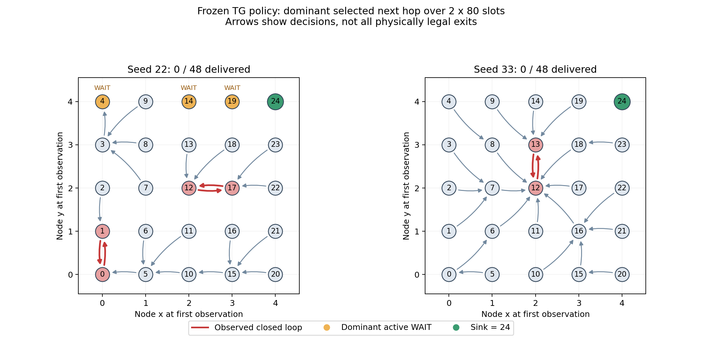

# 零投递策略：动作、环路与奖励诊断

日期：2026-11-03。对象为第 7 步短预实验的冻结权重、已使用调试场景 7001、每例 2×80 时隙。
**诊断完成：贪心决策把包困在往返环路；种子 22 还主动等待。网络物理可达。未修改环境奖励、Actor/PPO、模型权重或原评估口径。**

本轮新增只读诊断工具，不是修复实验；未启动中等/正式训练，未查看预留盲测场景。

## 1. 直接证据

| 原 TG 训练种子 | 22 | 33 |
|---|---:|---:|
| 实际投递/生成 | 0/48 | 0/48 |
| 包所在节点物理可达 Sink 的时隙比例 | 100% | 100% |
| 成功发送次数 | 375 | 249 |
| 其中回访旧节点的成功跳数 | 273（72.8%） | 129（51.8%） |
| 活跃决策中的主动 WAIT | 41.31% | 0% |
| Sink 合法可选的活跃决策次数 | 165 | 20 |
| 实际选择 Sink 次数 | 0 | 0 |
| 主要观测闭合往返 | 0↔1、12↔17 | 12↔13 |
| 平均归一化动作熵（最大为 1） | 0.999631 | 0.999367 |
| 最大与次大动作概率平均差 | 0.003418 | 0.003564 |

成功转发很多，包在移动，但方向不形成通向 Sink 的有效路径。种子 33 没有主动 WAIT，说明只处理 WAIT 仍不能解决全部零投递。
“观测闭合”指本次成功转发图里没有观测到外流边，不是物理拓扑封闭；实际邻居始终允许到达 Sink。

种子 22 代表包真实路径：`0→1→0→1→0→1→…`；另有 `13→12→17→12→17→…`。
种子 33 代表包：`6→12→13→12→13→…`。完整路径保存在 packet_routes.jsonl。
种子 22 的 4、14、19 号节点在有合法转发动作时，均累计主动选择 WAIT 160 次。



图按首时隙坐标放置节点，箭头是两个回合中主导的实际决策，不代表所有物理链路；红色为观测闭环，橙色为主动 WAIT。

## 2. 为什么贪心会锁住

策略概率非常接近均匀分布，动作最大概率只略高于其它选择；greedy 每次都选择这个微弱优势。
例如种子 22 第一时隙的 19 号节点：WAIT 概率约 **17.4987%**，Sink=24 概率约 **17.1920%**，相差约 **0.31 个百分点**，却反复选择 WAIT。
0 号节点略偏向 1，1 号略偏向 0；12/17 或 12/13 互相偏向，形成往返。
高熵是对当前合法动作数归一化后的平均值，不表示策略有强信心。

这是本场景上直接观察到的动作机制。它与 2 回合短预算下尚未形成稳健路由排序一致，但不能据此保证“多训练就一定解决”。

## 3. 权重加载和训练实际发生了什么

用每个训练任务保存的配置及**训练种子**重建初始 Actor，再重置 RNG 到评估种子 7001；没有把评估种子生成的随机权重冒充训练初始权重。

| 基线种子 | 初始权重 greedy | 训练后 greedy | 同一训练权重 sample |
|---|---:|---:|---:|
| 11 | 0/48 | 47/48 | 12/48 |
| 22 | 0/48 | 0/48 | 6/48 |
| 33 | 0/48 | 0/48 | 7/48 |

Actor 相对初始化的参数 L2 变化分别为 0.070721、0.069528、0.082327，均非零。
在训练后轨迹的相同当前输入上重算初始 Actor，活跃决策的 greedy 排名一致率分别约 3.61%、30.55%、3.87%。
因此不能把现象解释为权重完全没更新，或全部由原始初始化不变造成；种子 11 已从初始零投递转为 47/48。
训练协议只有 2 个完整回合、2 次 PPO 更新，按 epoch=1/minibatch=2 配置，每网络共 4 次小批量优化。

原训练的采样轨迹也有实际成功：种子 22 两回合投递 4/24、7/24；种子 33 为 6/24、9/24。采样中能偶尔到达，不等于 greedy 已学会有效路由。
sample 对照保持权重和原仿真规则，只改变诊断解码；同初始种子不意味着不同动作后的所有随机事件逐帧相同。
它帮助两个零投递种子逃出部分固定环路，却使种子 11 明显变差，**不能直接用更换评估解码当成通用修复，更不能混入原 greedy 消融结果。**

## 4. 为什么六组短预实验一样

A–F 对每个训练种子的 160 个时隙、25 个节点，**实际选择动作的完整序列 SHA256 完全相同**。
并非只有最终投递率恰好一样。采集到的概率确有差异，例如种子 22：

- B（WM）相对 A 的最大概率差约 1.51e-4。
- C（PM）约 2.25e-6。
- D（WM+PM）约 1.50e-4。

当前预算下差异没有改变 greedy 动作顺序。不能据此说辅助模型没接上，也不能认定创新长期无效。
WM/PM 前两步的更新/缓存/冻结验证继续保留；此次只证明部署行为在这些短训权重和场景里相同。

## 5. 奖励契约的实测风险

原实现的 WAIT 分支把 0 传入 step_one_agent；发送尝试承担 −35 步惩罚，再叠加链路、距离与历史项。
成功到 Sink 没有独立、保证为正的即时投递奖励，未投递回合结束也没有单独负项写入 PPO buffer。
旧 average_hops 对未投递包加的 80 惩罚属于事后指标，不是 Actor/Critic 的训练奖励。

另外执行了两个明确标注的**环境/奖励规则探针，未使用 Actor 选动作**：

| 规则探针 | 实际投递 | 第 0/1 回合环境总回报（未折扣） |
|---|---:|---|
| 全 WAIT | 0/48 | 0、0；两回合终止步奖励也为 0 |
| 地理转发 | 48/48 | 8,071.86、47,861.85 |

地理探针首次成功向 Sink 发送发生在 step=0、18→24，历史项为 0，即时奖励为 **−17.833333**。
说明冷启动时有“等待无成本、成功发送仍可能付代价”的局部激励风险；地理规则证明当前网络/时限能完成这些包。
但地理转发总体回报为正，后续历史项会改变收益，**没有证明全 WAIT 是全局最优，也没有证明奖励问题是唯一原因**。
PM 势函数差分不能自动重新定义基础任务目标，不能指望只加大 PM 系数就解决这一契约问题。

## 6. 复现、只读约束与验收

诊断目录：`results/tg_policy_diagnostics/20261103_155544_634157`。
奖励探针：`results/tg_reward_probe/20261103_160122_985683`。
小型[核验凭据](evidence/TG_ZERO_DELIVERY_DIAGNOSIS_20261103.json)保存摘要、动作摘要、源码/原始日志 SHA 和全部命令。

- 24 个冻结复现：六组×三种子 trained-greedy=18；基线初始权重 greedy=3；基线训练权重 sample=3。
- 18 个 trained-greedy 的原物理指标与预实验逐字节一致。
- 所有 Actor/Critic/WM/PM 参数保持不变，PPO 更新为 0；随机采样没有被误标为原 greedy 评估。
- 2 个独立规则奖励探针；真实 buffer 记忆索引照常写入，保留历史奖励规则，没有用假 buffer 抹去后续历史项。
- 新增函数 4、模块 2，共 **6 项通过**：循环方向/SCC、活跃与强制 WAIT 区分、Sink 可选次数、分布钩子/缓存及 RNG 不扰动。
- 原 130 个预实验源码/脚本/配置字节核对不变；本轮未重复运行旧 86 项回归，不把它们写成本轮新增 92 项。

每例 slots.jsonl 保存所有节点的合法掩码、实际动作、完整动作概率、相同输入下初始概率、ACK 与分项团队奖励。
packet_routes.jsonl 保存成功和未结束包的完整路径。report.json 中 policy_sha256 是**参考训练 checkpoint 的文件摘要**；initial 对照实际使用 initial_actor_sha256 所标初始参数，未加载训练权重。
已把实际旧源码、诊断脚本及测试另外归档到 diagnostic_source，后续修改奖励仍能保留旧现场。
另已从归档脚本实际重放 A/22，仍为 0/48、273 次回访且原指标逐字节一致；输出 results/tg_diagnostic_archive_check/A22。
原始大日志留本地 results；Git 保存诊断工具、文档、图和小型凭据。

仓库根目录运行，每个代码块为一条完整 PowerShell 命令：

```powershell
& "D:\python3.6.8\python.exe" scripts/diagnose_tg_policy.py --suite results/tg_ablation_pilot/20261103_151015_964923 --output-root results/tg_policy_diagnostics
```

```powershell
& "D:\python3.6.8\python.exe" scripts/probe_tg_reward_contract.py --suite results/tg_ablation_pilot/20261103_151015_964923
```

```powershell
& "D:\python3.6.8\python.exe" scripts/plot_tg_policy_diagnosis.py results/tg_policy_diagnostics/20261103_155544_634157
```

旧核心代码被修改后，诊断器会拒绝将新核心冒充旧预实验。可从归档脚本复现旧现场：

```powershell
& "D:\python3.6.8\python.exe" results/tg_policy_diagnostics/20261103_155544_634157/diagnostic_source/scripts/diagnose_tg_policy.py --suite results/tg_ablation_pilot/20261103_151015_964923 --output-root results/tg_policy_diagnostics_archived
```

## 7. 建议的下一次修改顺序（本轮未实施）

1. 先评审并版本化任务奖励契约：明确投递正反馈、未完成包每时隙成本、窗口结束成本；删失不自动等于真实丢包/TTL 失败。用全 WAIT 与有效转发探针检查回报排序。
2. 对同一版奖励统一重跑 A–F，保留原奖励作为旧版对照。先做小规模验收，再确定中等预算；观察 Sink 选择率、主动 WAIT、熵和回访率，不只看总回报。
3. 若加入环路代价或路径约束，不能一概禁止必要回访；更不能在采样后强行直发 Sink/替换动作却沿用旧 PPO logp。新约束须进入采样掩码并统一训练/评估。
4. 固定评估解码与场景；采样只作额外诊断指标。不能因种子 22/33 采样稍好，就改口径掩盖种子 11 下降。

尚未验证新奖励、更多训练或可靠性门控是否改善结果。本轮给出定位和修改建议，没有提前写入修复或性能提升结论。
